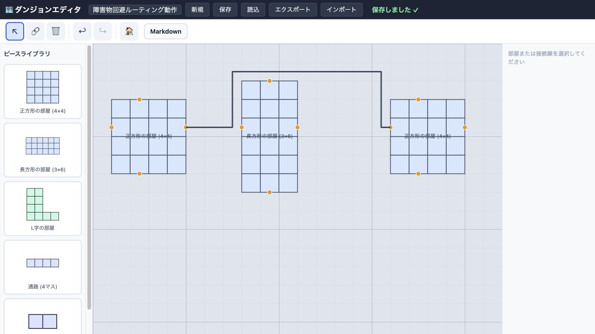
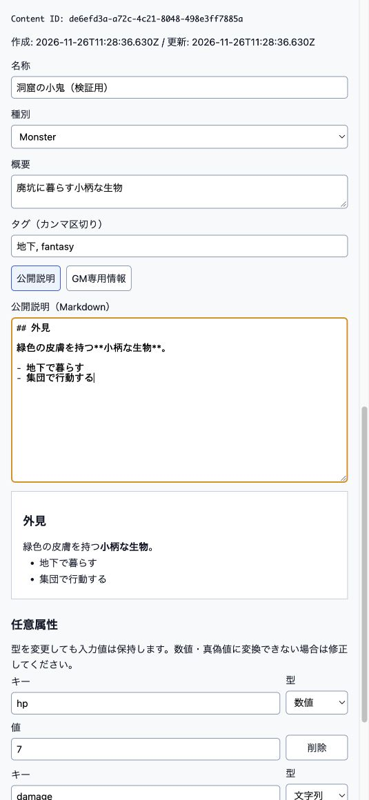
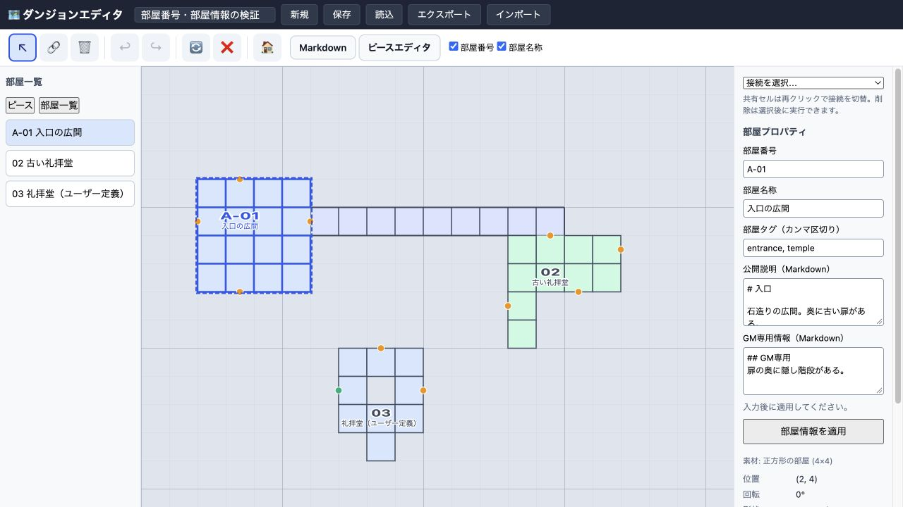
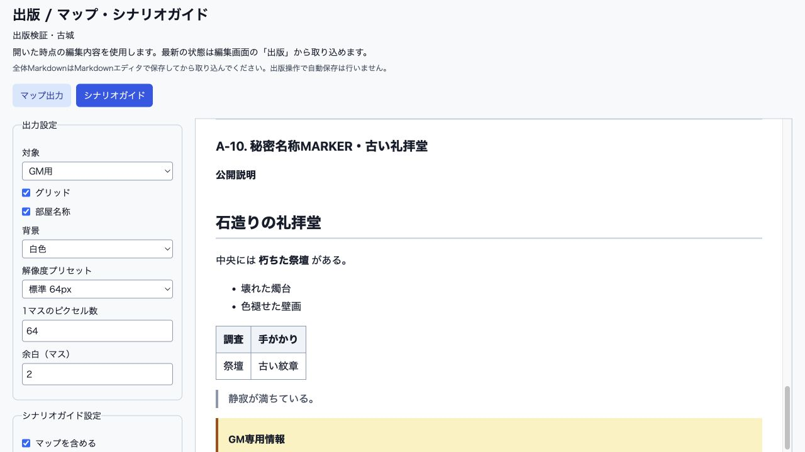
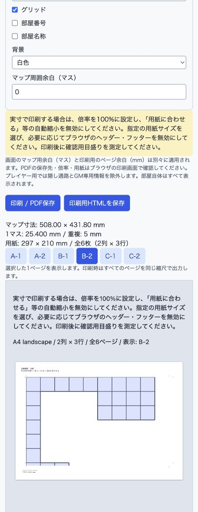
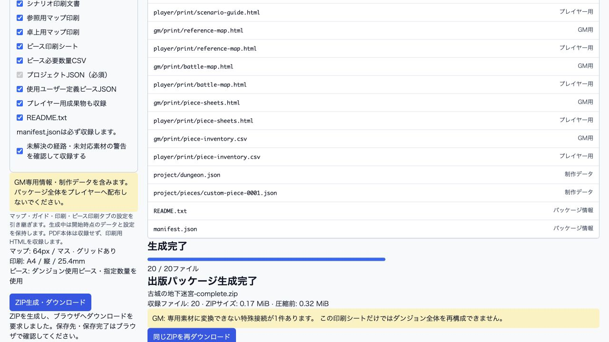

# TRPGダンジョンエディタ

TRPGのダンジョン自動生成＋編集ツール（MVP実装）


## 概要

React + TypeScript + Vite で構築した、ブラウザ上で動作するダンジョン編集ツールです。

## 機能

### キャンバス
- SVGによる方眼紙表示
- マウスホイールによる拡大・縮小
- 中ボタンドラッグまたはSpaceキー＋ドラッグでパン操作

### ピース
| 種別 | 説明 |
|------|------|
| 正方形の部屋 (4×4) | 標準的な正方形部屋 |
| 長方形の部屋 (3×6) | 横長の部屋 |
| L字の部屋 | L字形状の部屋 |
| 通路 (4マス) | 長い廊下 |
| 短い通路 (2マス) | 短い廊下 |

各ピースは以下の操作が可能：
- **配置**: サイドバーから選択 → キャンバスにクリック
- **移動**: ドラッグ
- **回転**: R キー または プロパティパネルの回転ボタン
- **削除**: Delete モードまたはプロパティパネルの削除ボタン

### コネクター
各ピースはコネクター（接続口）を持ちます。コネクターには以下の属性があります：
- **方向**: north / south / east / west
- **幅**: グリッドセル単位
- **種類**: open / door / secret / locked

### 手動接続（コネクターシステム MVP）

- ツールバーの 🔗 ボタン、または `C` キーで接続モードへ切り替える
- 異なる部屋の白い接続ポイントを2つクリックして接続を作成する
- ポイントは白が未接続、青が選択中、灰色が接続済み。1ポイントにつき1接続
- 同じポイントの再クリック、`Esc`、キャンセルボタンで始点の選択を解除する
- 新しい接続の種類は通路 / ドア / 階段 / 隠し通路から選択する
- 線を選択して右パネルの「接続を削除」、`Delete` / `Backspace`、または削除モードで線をクリックすると削除する
- 接続の作成・削除、部屋削除に伴う接続削除は Undo / Redo に対応する
- `V` キーで選択モードへ戻り、部屋を移動・回転すると線が追従する

接続は `DungeonDocument.connections` に部屋ID・固定コネクターID・種類を保存します。
接続経路は部屋の現在位置・回転後のコネクター方向から毎回計算し、SVG・経路座標・自動生成通路ピースは保存しません。
手動接続では距離・方向・幅・コネクター種類による制約を設けません。
既存の隣接コネクター候補判定は別用途のロジックとして残しています。

### 直交ルーティング

接続線は水平・垂直線を組み合わせたL字・Z字・折り返し経路で描画します。
始点はコネクターの外向き方向へ伸び、終点は外側から接続口へ入ります。
対向・直角・同方向の全16通りに対応し、部屋の移動・回転やUndo / Redo後も自動で再計算します。
対向する接続口が一直線上にあり、間に障害物がない場合は水平または垂直の1本線になります。

Routing層とRendererは分離しています。経路は保存データに追加せず、既存の接続情報から再生成します。
交差回避・Waypoint・手動経路編集・通路アセット生成は今後の拡張です。
詳細は [直交ルーティング実装メモ](docs/orthogonal-routing.md) を参照してください。


### 障害物回避ルーティング

- 配置済みの全ピースを、実際の占有セルから障害物として扱う（L字の空き部分は通行可能）
- 既存の直交経路が安全なら再利用し、衝突する場合だけ上下左右4方向のA*で迂回する
- 接続元・接続先の部屋も障害物に含め、接続口の外側の空きセル同士をつなぐ
- 接続対象以外の部屋の追加・移動・回転・削除でも経路を更新する
- 接続口が塞がれている場合や探索上限に達した場合は、接続を保持して赤い警告経路を表示する
- 赤い経路は通行可能な経路ではなく接続関係の表示。線の説明で失敗理由を確認でき、配置を変えると自動復旧する

占有グリッド・経路・探索状態は保存しません。現在の保存形式 `1.3.0` でも既存データの互換性を維持します。
探索範囲とノード数には上限があります。具体値と検証内容は [障害物回避実装メモ](docs/obstacle-routing.md) を参照してください。



### 動的通路の床・壁描画

- `corridor` 接続を、1グリッドセル幅の床・壁を持つ通路として描画する
- 方向ビットマスクから水平・垂直・曲がり角・接続端部の壁を生成し、接続方向には壁を描かない
- 部屋と同じ40px間隔・色・太さのマス目を描画し、選択中や共有区間でも維持する
- 部屋側の接続口も開口し、1セル通路・隣接部屋の直接接続に対応する
- 床セルから生成元Connectionを選択し、経路全体を強調表示できる
- `door` / `stairs` は従来の線表示、`secret` は紫の破線表示を維持する
- 経路探索失敗時は通路を描かず赤い警告線を表示し、配置変更で復旧する

通路はConnection単位で生成した後、通常通路同士の同一セルを集約します。
生成セル・ビットマスク・床や壁の形状をPieceや保存データへ追加せず、読み込み後に再生成します。
手動配置の通路Pieceは従来どおり保存・編集できます。
展開は1接続4,096セル・全体16,384セルを上限とし、超過時は線表示へ戻します。
詳細は [動的通路描画実装メモ](docs/dynamic-corridors.md) を参照してください。


### 通路の交差・合流・分岐

- 通常通路が同じセルを通ると方向ビットを統合し、T字路・十字路・共有区間を生成する
- 床と壁は統合後に一度だけ描画し、合流点の接続方向を開口する
- 隣接するだけの通路は接続せず、ドア・階段・隠し通路は独立した線表示を維持する
- 共有セルの再クリックで生成元Connectionを1本ずつ切り替え、選択した経路全体を強調する
- 右パネルの接続一覧からも選択でき、端点・種類を確認して個別に削除できる
- 削除モードでも共有セルのクリックは選択切替のみ。削除は右パネルまたはDeleteキーで実行する
- 削除・移動・回転・Undo / Redo・読み込み後は、残る論理データからネットワークを再生成する

物理的な合流によって移動できる部屋の組み合わせが増えても、論理Connectionを自動追加・変更しません。
ネットワーク・合流点・生成元ID一覧は保存しません。失敗した経路は集約から除外し、既存の警告を表示します。
詳細は [通路ネットワーク実装メモ](docs/corridor-network.md) を参照してください。


### 衝突判定
ピース配置時および移動時に、他のピースとの重なりを自動検出します。
重なりがある場合は赤色で表示され、配置できません。

### ピースエディタ

- ツールバーの「ピースエディタ」から別ウィンドウで開く（開いていれば同じウィンドウを再利用）
- 最大16×16のグリッドで床セルを追加・削除し、自由形状を作成する
- 外周セルに幅1の接続口を設定し、方向と種類（open / door / secret / locked）を指定する
- 名称・タグを付けて保存すると、メイン画面のピースライブラリへ自動反映する
- ユーザー定義ピースも標準ピースと同様に配置・回転・接続・保存できる
- 標準ピースは複製して編集する。保存済みユーザー定義ピースも、形状・接続口を変える場合は複製する
- 保存後の名称・タグは変更可能。配置済みの部屋は配置時のスナップショットを維持する
- 参照中のピースは削除不可。保存済みダンジョン・開いている編集画面・配置待ち・履歴を確認する
- ピース単体のJSON入出力と、ユーザー定義ピースを含む既存のダンジョンJSON入出力に対応する

床セルは上下左右でつながる1領域が必要です。セル変更で無効になった接続口は、件数を表示して除去します。
詳細・参照保護の条件・既知の制約は [ピースエディタ実装メモ](docs/piece-editor.md) を参照してください。


### コンテンツライブラリ

- ツールバーの「コンテンツ」から別ウィンドウを開き、Monster / Treasure / Trap / Object / NPC / Eventを管理する
- 名称・概要・公開説明・GM専用情報・タグ・任意属性を編集し、Markdownをプレビューする
- 名称・概要・タグの検索と種別フィルターを組み合わせる。一覧は50件ずつ表示する
- 保存済みコンテンツの複製・削除、未保存変更の保存／破棄／キャンセルに対応する
- 任意属性は文字列・数値・真偽値。型変更で入力値を破棄せず、変換できない値は修正を求める
- 単体・複数選択・検索結果・全体のJSON出力と、単体／ライブラリJSONのImportに対応する
- ID衝突時は同一内容を再利用し、異なる内容はスキップまたは新規IDで登録する。一括Importは全件をまとめて保存する
- 別ウィンドウの更新は通知し、未保存の編集を保護する。同じデータの保存・削除競合は上書きせずエラーにする

コンテンツはダンジョンから独立したGM用ライブラリです。部屋へ配置する際は、その時点の定義をEntityへコピーして保持します。
DBをバージョン2へ更新し、既存のダンジョン・ピース・Markdown・設定を保持します。
操作・データモデル・JSON形式・制限・検証結果は [コンテンツライブラリ実装メモ](docs/content-library.md) を参照してください。



### 部屋へのEntity配置

- 部屋を選び、右パネルの「Entity」からコンテンツライブラリの素材を追加する
- 6種別のEntityを分類し、数量・個別名称・配置固有の公開説明・GM情報・公開範囲を編集する
- 「Entity情報を適用」で編集をまとめて確定する。複製・移動・削除・定義更新はUndo / Redoに対応する
- 部屋削除時は所属Entityもまとめて削除し、Undoで部屋・Entity・接続を復元する
- ライブラリを変更・削除しても配置時点の定義を維持する。「ライブラリの最新版を反映」から確認後に更新できる
- Entityとスナップショットをダンジョンへ保存し、ライブラリがない環境でもJSONから復元できる
- GMガイドでは種別・数量・素材情報・配置情報を表示し、プレイヤーには公開指定した配置固有の公開説明だけを渡す
- シナリオ印刷とZIPにも同じ公開範囲を適用する。マップ・ピースシート・必要数量にはEntityを加算しない

Entityの初期公開範囲はGM専用です。数量や名称をプレイヤーに知らせる場合は、配置の公開説明へ明示的に記述してください。
保存形式は1.3.0です。1.0.0〜1.2.0はEntity一覧を空として読み込めます。
構成・操作・公開情報の抽出・制限・検証結果は [部屋へのEntity関連付け実装メモ](docs/room-entities.md) を参照してください。


### 部屋番号・部屋情報

- 新規配置した部屋や手動通路ピースに、数値番号の最大値＋1で番号を付与する（01、02…）
- 右パネルで番号・部屋名称・公開説明・GM専用情報・部屋タグを入力し、「部屋情報を適用」でまとめて確定する
- 番号は `A-01` / `B1-05` などの文字列も利用でき、空・重複はエラーとして既存値を維持する
- 部屋ごとの名称・説明・タグはPiece定義と独立し、名称未設定時はPiece名を表示する
- 番号と名称を実際の床セル内に描画し、ツールバーで個別に表示を切り替える
- 左側の「部屋一覧」から選択できる。部屋削除で他の部屋を再採番しない
- 情報の適用は1回のUndo / Redoで復元でき、情報だけの変更では通路を再計算しない
- 公開説明・GM専用情報はMarkdown文字列として保存し、ダンジョン全体のMarkdownとは別に管理する

旧データは既存の番号を優先し、未設定の番号と空の部屋情報を安定した順序で補完します。
JSONはGM専用情報も含む完全なプロジェクトデータです。プレイヤーへのマップ配布には「出版」を使ってください。
採番・移行・保存・検証の詳細は [部屋情報管理実装メモ](docs/room-information.md) を参照してください。



### 出版 / マップ出力

- ツールバーの「出版」から別ウィンドウを開き、現在の未保存内容も含めてマップ全体を出力する
- GM用・プレイヤー用を選び、グリッド・部屋番号・名称・白色／透明背景・解像度・余白を設定する
- プレイヤー用は隠し通路をデータ抽出時に除外し、GM専用情報をSVGへ含めない。部屋自体はすべて表示する
- 同じSVGをプレビュー・SVG出力・PNG変換に使い、編集画面の選択・パン・ズームに依存しない
- 開いた時点の状態を保持する。最新状態を取り込む場合は、編集画面で再度「出版」を押す
- 未解決の接続がある場合は警告し、「この状態で出力する」を選ぶまで出力を停止する
- PNGは一辺8,192px・合計16,777,216画素まで。解像度は1マス1〜512px、初期値64px

出版操作でダンジョンを自動保存せず、履歴・ピースライブラリ・JSON形式1.3.0を維持します。
操作方法・情報分離・制限・検証結果は [出版システム実装メモ](docs/publishing.md) を参照してください。


### シナリオガイド / HTML出版

- 出版画面の「シナリオガイド」へ切り替え、GM用・プレイヤー用の独立したHTML文書を生成する
- 目次・マップ・公開説明を個別に選び、GM用では全体Markdown・GM専用情報・部屋タグも出力できる
- プレイヤー用の初期設定は部屋番号のみ。名称は明示的に有効にし、Piece名には置き換えない
- 部屋番号の自然順でガイドを並べ、目次から各部屋へ移動する。マップにも同じ部屋番号を表示する
- Markdownは既存のmarked / DOMPurifyを使い、出版時は外部画像・危険なHTML・URLを除去する
- 全体MarkdownはMarkdownエディタで保存した内容を取り込む。出版操作では自動保存しない
- 単一HTMLにSVGマップ・文書スタイル・印刷用CSSを含める

出力したHTMLはブラウザで開いて参照・印刷するための文書です。GM専用情報はプレイヤー用データの抽出時に除外します。
詳しい操作・生成方式・制限・検証範囲は [シナリオガイド実装メモ](docs/scenario-guide.md) を参照してください。



### 印刷 / PDF保存

- 出版画面の「印刷 / PDF」で、シナリオガイド・参照用マップ・卓上プレイ用マップを選ぶ
- A5 / A4 / A3 / Letter、縦横、上下左右の余白（mm）を設定する
- 参照用マップは縦横比を保って1ページ内へ配置する
- 卓上マップは1マス15 / 20 / 25 / 25.4 / 30mmまたはカスタム寸法で出力し、必要な枚数へ分割する
- グリッド上の接合位置、指定mmの重複、カットマーク、ページラベル、縮尺確認用目盛りを利用する
- ページ一覧から1枚ずつプレビューし、ブラウザ標準の「印刷 / PDF保存」または「印刷用HTMLを保存」を使う

実寸印刷では倍率100%、自動縮小なし、指定用紙を選び、印刷後に目盛りを測定してください。
計算方式・上限・検証範囲は [印刷レイアウト実装メモ](docs/print-layout.md) を参照してください。



### ピース印刷シート

- 出版画面の「ピース印刷」で、ダンジョン使用ピース・標準／ユーザー定義ライブラリ・基本通路素材を選ぶ
- 必要数量を自動計算し、印刷数量を個別に調整する。共有・交差通路は合流後のセルから重複せず集計する
- 物理グリッド寸法を維持して自動面付けし、90度回転・複数ページ・部屋と通路の分類配置に対応する
- 実際のセル外周・穴・接続口に切り抜き線を描き、グリッド・Connector記号・名称を切り替える
- 未配置・重なり・領域超過・不正数量を検査し、完全に配置できない状態での出力を停止する
- 同じ面付け結果をプレビュー・独立した印刷用HTML・ブラウザ標準印刷へ使用する

プレイヤー用は隠し通路を集計前に除き、部屋の秘密情報を含めず汎用素材番号を使用します。
数量・寸法・上限・検証範囲は [ピース印刷シート実装メモ](docs/piece-print-sheets.md) を参照してください。


### ZIPパッケージ / 一括出版

- 出版画面の「一括出版」で、プレイヤー用・GM用・完全版を選び、収録予定のファイルを確認する
- SVG／PNG、HTMLガイド、印刷用HTML、ピースシート、必要数量CSV、プロジェクトJSONを選択してZIPへまとめる
- 各出版タブの設定とピース印刷数量を引き継ぎ、同じスナップショットから順番に生成する
- プレイヤー用へのGM・制作データの混入を拒否し、秘密情報を公開範囲別の抽出段階で除外する
- manifest・READMEを同梱し、完全版のJSONは既存のImport機能で復元できる
- 進捗表示・キャンセル・多重実行防止・容量制限・失敗時の出力停止に対応する

PDF本体は収録せず、独立した印刷用HTMLを同梱します。GM用・完全版全体はプレイヤーへ配布しないでください。
操作方法・構成・情報分離・制限・検証範囲は [ZIP一括出版の実装メモ](docs/publication-packages.md) を参照してください。

個別出力とZIP出力は共通の出版生成処理を利用します。画面の責務分離と出力互換性の検証については [出版処理リファクタリング](docs/publication-refactor.md) を参照してください。

ピース印刷は全体の印刷用HTMLと選択ページのプレビューを分けて保持します。[ページ切り替えの最適化と検証](docs/piece-preview-performance.md) に詳細を記載しています。

各画面は必要になったときに読み込みます。[画面読み込みの分割と検証](docs/window-lazy-loading.md) に構成とビルド容量の比較を記載しています。



### 保存
Dexie + IndexedDB を使用してブラウザローカルに保存します。
メニューバーの「保存」で保存し、「読込」で保存済みダンジョンを開きます。
ページ再読み込み後も「読込」から部屋・接続を復元できます。
読み込み時には現在の未保存の編集を置き換えます。

### Export / Import
JSON形式でエクスポート・インポートが可能です。
フォーマット識別子 `trpg-dungeon-generator` とスキーマバージョンを含みます。
現在のスキーマは `1.3.0` で、接続情報・部屋情報・Entityと配置時点のコンテンツ定義も含みます。従来の `1.0.0` / `1.1.0` / `1.2.0` を読み込み可能です。
接続情報のない旧データは空の接続一覧として読み込みます。
旧 `PlacedRoom.connections` に接続がある場合はドキュメント単位の接続へ移行し、
部屋単位のマップは除去します。詳細は [コネクター実装メモ](docs/connector-system.md) を参照してください。

### Markdown Editor
- ツールバーの `Markdown` ボタンから別ウィンドウで開く
- EasyMDE ベースの編集（Edit / Preview / Split）
- DungeonDocument に紐づく Markdown を Repository 経由で保存
- 1秒デバウンスの自動保存 + 手動保存
- `.md` のインポート / エクスポート
- Preview を使った PDF 出力（ブラウザ印刷）

### Undo / Redo
- `Ctrl+Z` で元に戻す（最大50履歴）
- `Ctrl+Y` または `Ctrl+Shift+Z` でやり直す

## 技術スタック

| 技術 | 用途 |
|------|------|
| React 19 | UIフレームワーク |
| TypeScript 6 | 型安全性 |
| Vite 8 | ビルドツール・開発サーバー |
| SVG | キャンバス描画 |
| Zustand 5 | 状態管理 (Undo/Redo含む) |
| Dexie 4 | IndexedDB ORM |
| uuid | ID生成 |

## ディレクトリ構成

```
src/
  model/          - TypeScript型定義・ピースライブラリ
  content/        - コンテンツの入力変換・検索・JSON入出力・更新通知
  store/          - Zustand状態管理（Undo/Redo）
  db/             - Dexie DBセットアップ
  repository/     - データアクセス層
  editor/
    connectors/   - コネクター座標計算・互換性ロジック
      routing/    - 占有グリッド・直交経路・A*・Router境界
      corridor/   - 通路セル・方向ビット・壁形状・描画用データ
    collision/    - 衝突判定
  utils/
    geometry.ts   - 回転・座標変換ユーティリティ
    exportImport.ts - JSON Export/Import
  components/
    canvas/       - SVGキャンバス（グリッド・ズーム・パン）
    pieces/       - ピース描画・配置ゴースト
    connections/  - 通路床壁・接続線・警告描画・接続ポイントUI
    sidebar/      - ピースライブラリUI
    toolbar/      - ツールバー
    ui/           - メニューバー・プロパティパネル
    editor/       - エディタメインレイアウト
```

## 開発・実行

```bash
npm install
npm run dev      # 開発サーバー起動
npm run build    # プロダクションビルド
npm run lint     # Oxlint
npm test         # 接続・経路・通路セル／描画・履歴・互換性・保存の回帰テスト
```

## データモデル

```typescript
// コネクター（接続口）
interface Connector {
  id: string;
  direction: 'north' | 'south' | 'east' | 'west';
  width: number;
  kind: 'open' | 'door' | 'secret' | 'locked';
  position: { x: number; y: number };
}

// ピーステンプレート
interface Piece {
  id: string;
  name: string;
  shape: 'rectangle' | 'l-shape' | 'corridor' | 'custom';
  cells: { x: number; y: number }[];
  connectors: Connector[];
  tags?: string[];
}

// キャンバス上の配置済みピース
interface PlacedRoom {
  id: string;
  pieceId: string;
  piece: Piece;
  position: { x: number; y: number };
  rotation: 0 | 90 | 180 | 270;
  information: RoomInformation;
}

interface RoomInformation {
  number: string;
  name: string;
  description: string;
  gmNotes: string;
  tags: string[];
}

// 配置済み部屋同士の論理的な接続（座標は保存しない）
interface Connection {
  id: string;
  fromRoomId: string;
  fromConnectorId: string;
  toRoomId: string;
  toConnectorId: string;
  type: 'corridor' | 'door' | 'stairs' | 'secret';
}

// ダンジョンドキュメント
interface DungeonDocument {
  id: string;
  name: string;
  version: string;
  rooms: PlacedRoom[];
  connections: Connection[];
  entities: EntityInstance[];
  markdown: string;
  meta: DungeonMeta;
  createdAt: string;
  updatedAt: string;
}
```

## 技術スタック採用理由

### React

コンポーネント指向でエディタUIを構築しやすく、

将来的な機能追加・分割が容易なため採用。

### TypeScript

型安全性を確保し、

ダンジョンデータやコネクターなど複雑なデータ構造を安全に扱うため採用。

### Vite

高速な開発サーバーとビルド速度を重視して採用。

### SVG

部屋や通路、コネクターをベクター形式で描画するため採用。

CanvasよりDOMとして扱いやすく、クリック判定や編集機能との相性が良い。

### Zustand

シンプルな状態管理ライブラリ。

Undo/Redoや選択状態など、エディタ向けの状態管理を容易に実装できる。

### Dexie

IndexedDBを扱いやすくするORM。

ブラウザだけで保存・読込ができ、将来的なオフライン編集にも対応できる。

### UUID

配置済み部屋やドキュメントを一意に識別するため採用。

## ロードマップ

### Phase1（MVP）

- [x] SVGキャンバス

- [x] ピース配置

- [x] Undo / Redo

- [x] Export / Import

### Phase2

- [x] 手動コネクター接続 MVP（直線・追従・保存・Undo / Redo）

- [x] 直交ルーティング基盤（コネクター方向に応じたL字・Z字・折り返し経路）

- [x] 障害物回避ルーティング（実セル占有・A*・探索上限・失敗表示）

- [x] 動的通路描画（1セル幅の床・壁・接続口開口・接続単位の操作）

- [ ] コネクター自動接続

- [ ] 自動ダンジョン生成

- [ ] ピース編集

### Phase3

- [ ] EncounterTemplate

- [ ] Monster配置

- [ ] Event配置

### Phase4

- [ ] Tauri版

- [ ] プラグイン対応
