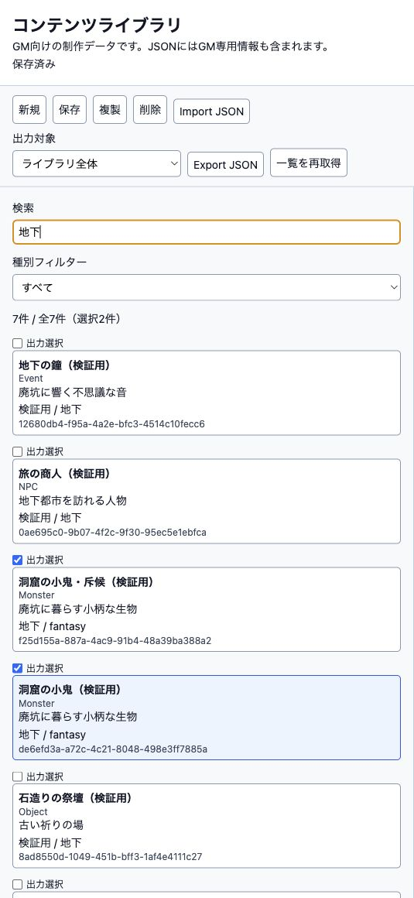
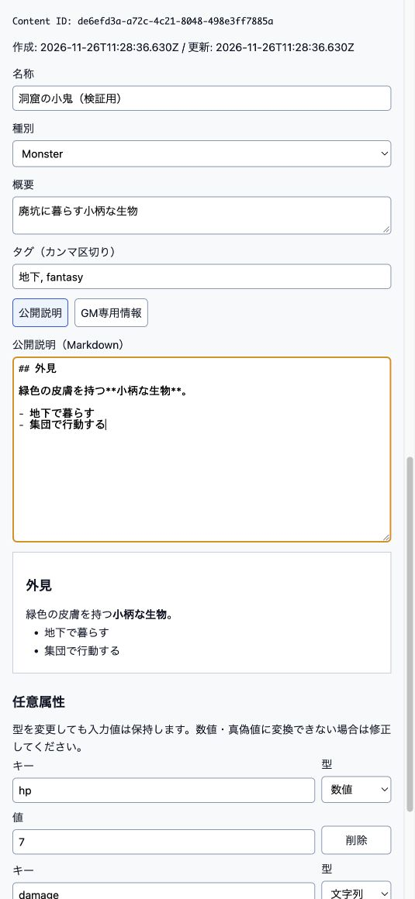

# Entity・コンテンツライブラリ管理 MVP

## 実装範囲

master `d1441e8`を基点に、再利用可能なContent Definitionの管理を追加した。Piece、PlacedRoom、RoomInformation、DungeonDocument、出版処理との責務を分離し、コンテンツをダンジョンへ埋め込まない。

Monster / Treasure / Trap / Object / NPC / Eventの6種別に、新規・編集・保存・複製・削除・検索・JSON入出力を提供する。Entity Instance、部屋やマップへの配置、Faction、Theme、Encounter Template、自動生成、戦闘計算は追加していない。

## 調査と構成

README、出版処理リファクタリング、印刷プレビュー改善、画面の遅延読み込みの資料を確認した。モデル、RoomInformationのタグ正規化、Piece/Dungeon Repository、Dexie、Zustand、JSON検証、Markdown変換とサニタイズ、ウィンドウ起動・BroadcastChannel、出版と既存テストを調査した。

既存の`openEditorWindow`、`downloadJson`、`normalizeRoomTags`、`renderMarkdownToHtml`を利用する。PieceとContentを共通の抽象モデルに統合していない。既存のリファクタリング後の構成と画面単位の遅延読み込みを維持する。

| ファイル | 責務 |
| --- | --- |
| `src/model/content.ts` | 6種別、Definition/Draft、上限、純粋な検証・正規化・複製・同一性判定 |
| `src/content/contentForm.ts` | 属性行と文字列入力から保存用データへの変換、タグの引用・復元 |
| `src/content/contentJson.ts` | 単体／ライブラリJSONの検証・入出力、安全なファイル名 |
| `src/content/contentSearch.ts` | 名称・概要・タグと種別の絞り込み |
| `src/content/contentEvents.ts` | 永続化完了後の更新通知 |
| `src/repository/contentRepository.ts` | Repository Interface、Dexie実装、保存競合検出、一括Importトランザクション |
| `src/components/content/useContentEditor.ts` | 一覧取得、編集中データ、未保存保護、非同期操作、外部更新・競合・エラー処理 |
| `ContentEditor.tsx` / `ContentFields.tsx` | 一覧・ページ分割・操作画面、Markdownと属性入力 |
| `ContentEditorWindow.tsx` | CSSと画面の遅延読み込みの入口 |

ReactのコンポーネントはRepositoryを通して取得・保存する。Dexieの操作とトランザクションをUIへ露出させていない。ダンジョンのZustand Storeや履歴は利用・変更しない。

## モデルとID

```ts
type ContentKind = 'monster' | 'treasure' | 'trap' | 'object' | 'npc' | 'event';
type ContentAttributeValue = string | number | boolean;
interface ContentDefinition {
  id: string;
  kind: ContentKind;
  name: string;
  summary: string;
  description: string;
  gmNotes: string;
  tags: string[];
  attributes: Record<string, ContentAttributeValue>;
  createdAt: string;
  updatedAt: string;
}
```

種別の定数と表示名を一か所で管理する。ルール固有の能力値は共通フィールドにしない。HP、難易度、通貨等は任意属性として入力できる。

新規・複製時は既存と同じuuid方式でIDを発行する。新規の空データはメモリ上のDraftに留め、初回の保存成功時に作成・更新日時を確定する。通常保存ではIDとcreatedAtを維持する。updatedAtはUTC ISO日時で、同一ミリ秒に保存しても前回より後になる。

同名コンテンツを許容し、一覧の選択・出力・更新にはContent IDを使う。複製は別IDの未保存Draftになり、タグと属性を独立して複製する。保存済みの元データは変更しない。

## タグと任意属性

タグは既存のRoomInformationと同じ方式で前後の空白と空要素を除去し、同一文字列の重複を除去する。格納時は大文字・小文字を区別する（`Fantasy`と`fantasy`は別タグ）。検索時は英字の大文字・小文字を区別せず、日本語にも部分一致する。

タグ入力はカンマ・読点・改行区切り。区切り記号や引用符を含むタグはCSVと同じ二重引用符で囲む。タグ内の`"`は`""`とする。Importした複雑なタグは自動で引用表示し、編集・再保存で分割されない。閉じていない引用符はエラーにする。

任意属性はキー・型・入力文字列の行として編集し、保存前に値を変換する。数値は有限値だけを許可し、真偽値は`true` / `false`を入力する。型変更は元の入力文字列を保持する。`1d6`を数値型へ変えた場合はエラーとなり、値を修正するまで保存できない。空キー・重複キー・配列・入れ子・null・非有限値と`__proto__` / `prototype` / `constructor`を拒否する。キーの前後空白を除去した後にも重複を検査する。

属性の表示はJavaScriptのプロパティ列挙順を維持する。通常の文字列キーは登録順で、整数形式のキーは数値順になる。属性の文字列をJavaScriptや式として評価しない。

## 保存・DB移行・同期

`ContentRepository`は`list`、`get`、`save`、`delete`、`saveMany`を定義する。保存と削除には、編集開始時のupdatedAtを渡す。Repository内の同じ読み書きトランザクションで現在値と比較し、更新・削除・新規ID衝突を検出する。競合時は既存データを上書きせず、Draftを残して再確認を案内する。

`DungeonDB`をバージョン1から2へ更新し、`contentDefinitions`テーブル（`id, kind, name, updatedAt`）を追加する。既存の`dungeons`、`pieceLibrary`、`settings`と保存済みMarkdownには変更・再生成・削除を行わない。種別ごとのテーブル分割はしない。

保存・削除・登録を伴うImportのコミット後に`CONTENT_LIBRARY_UPDATED`を専用BroadcastChannelへ通知する。通知を受けたウィンドウとフォーカスを戻したウィンドウは一覧を再取得する。検索は取得済み一覧に対して行い、入力ごとにDBへアクセスしない。

選択中データに外部更新があった場合、未編集なら新しい内容を表示する。未保存の変更や処理中の内容は保持し、通知を表示する。外部の物理削除でも、未保存データを無条件に消さない。画面終了時には購読を解放し、古い一覧取得が新しい結果を上書きしないよう世代を確認する。

通常のツールバー起動は既存の名前付きウィンドウを再利用する。直接URLを開く等で複数の編集画面が存在しても、Repositoryの競合検出が働く。

## JSON形式と衝突処理

単体は`{ schemaVersion: '1.0.0', type: 'content-definition', content: ContentDefinition }`、複数は`{ schemaVersion: '1.0.0', type: 'content-library', contents: ContentDefinition[] }`とする。いずれも全フィールドを収録するUTF-8のGM向け完全データで、gmNotesも復元する。

出力対象は、編集中の保存済みデータ、チェックした複数件、検索・種別フィルターの結果全件、ライブラリ全体。ページ分割は出力件数を制限しない。未保存Draftの変更は出力へ混ぜない。安全なファイル名へ正規化し、Windows予約名も避ける。

Importではファイル容量、JSON構文、バージョン、種別、全Definition、入力内のID重複を検証する。JSON.parseだけでは失われる重複キーも、エスケープされたキーを含めて拒否する。文字列内の括弧・引用符とJSON構造を区別する。

確認画面で衝突時の処理を選ぶ。全件の検証後、Repositoryの単一トランザクションで最新の既存IDを再確認して登録する。

- 同一ID・同一内容：既存を再利用する。作成・更新日時だけの違い、タグ順・属性の挿入順だけの違いも再利用する。
- 同一ID・異なる内容：スキップ、または新規IDを発行して別データとして登録する。上書きはしない。
- 非衝突：IDと作成・更新日時を保持して登録する。
- 新規IDによる登録：作成・更新日時も新しく確定する。

完了時は新規登録・再利用・スキップ・新規ID発行の件数を報告する。新規ID発行件数は新規登録件数の内数。途中で書き込みが失敗した場合は全体をロールバックし、成功通知を送らない。

## 操作方法と未保存保護

1. ダンジョン画面の「コンテンツ」を押す。
2. 「新規」でDraftを作り、名称・種別・概要・タグを入力する。
3. 公開説明／GM専用情報を切り替えてMarkdownを入力し、プレビューを確認する。
4. 必要なら属性を追加し、キー・型・値を設定して「保存」を押す。
5. 一覧で検索・種別の絞り込みを使い、編集対象を選ぶ。別件の作成・選択時は未保存確認で保存・破棄・キャンセルを選ぶ。
6. 保存済みデータは「複製」から別データを作れる。「削除」は確認後に物理削除する。
7. 出力対象を選び「Export JSON」を押す。複数件は一覧の「出力選択」をチェックする。
8. 「Import JSON」でファイルを選び、検証後の画面でID衝突時の処理を選んで実行する。

Importでファイルを選ぶ前にも未保存確認を行う。保存に失敗した場合は確認画面と編集中データを残し、操作を続行しない。タブ終了・再読み込み時は未保存または処理中のデータがあればブラウザの終了確認を利用する。保存済み一覧の再取得だけが失敗した場合は、保存成功と一覧取得失敗を区別して表示する。

## Markdownと公開範囲

入力欄はtextareaで、既存のmarked / DOMPurifyによる変換・サニタイズを再利用する。プレビューは対象Markdownが変わったときだけ再計算する。出版用と同じタグ・属性・URLの許可リストを使い、script、イベントハンドラ、javascript URL、iframe、外部画像等を除去する。名称・概要・タグ・属性はReactのテキスト／値として表示する。

ライブラリはGMの制作環境で、name・summary・tags・attributesの公開可能性を推測しない。descriptionとgmNotesを別フィールドに保持する。既存のマップ、ガイド、印刷、ピースシート、Player / GM / Complete ZIPの抽出・生成へContent Repositoryを接続していない。

## 制限

| 項目 | 上限 |
| --- | ---: |
| ID | 128文字 |
| 名称 | 200文字 |
| 概要 | 1,000文字 |
| 公開説明・GM専用情報 | 各100,000文字 |
| タグ | 正規化前50個・各64文字 |
| 任意属性 | 100個 |
| 属性キー | 100文字 |
| 文字列属性値 | 4,000文字 |
| Import / Export | UTF-8で10 MiB |
| 一括Import / Export | 1,000件 |
| 一覧の同時表示 | 50件 |

文字数はJavaScriptの文字列長で検証する。超過データを保存・Import時に切り詰めない。大きなライブラリは検索結果・複数選択で分けて出力する。属性は配列・入れ子オブジェクトに対応しない。

## 検証結果

- `npm test`：全458件成功（既存412件＋追加46件）。
- `npm run build`：成功。TypeScriptの型チェックを含む。500 kB超の容量警告なし。
- `npm run lint` / `git diff --check`：成功。
- 6種別、空Markdown、日本語、タグ正規化、日時、サイズ上限、危険なキーと非有限値、属性の追加・削除・キーと型の変更、引用付きタグ、複製の独立性を検査。
- 旧v1 DBへDungeon・Piece・Markdown・設定を入れた状態からv2を開き、既存レコードが変更されずコンテンツテーブルだけが追加されることを検査。
- Repositoryの保存・更新・再オープン・削除、同時保存の片方だけの成功、古い更新・削除の拒否、一括書き込み失敗時のロールバックと通知抑止を検査。
- 単体／複数JSON、スキーマ・種別・ファイル／件数上限、重複キー、ID衝突の全方針、ID維持、GMデータ維持を検査。
- 実際のReact編集画面とHookで、未保存保護の3選択、保存失敗後の再試行、2画面の通知・競合、外部削除、フォーカス再取得、一覧取得失敗、Markdownサニタイズ、4出力対象、61件のページ分割、削除確認を検査。ブラウザのファイル選択を使わず、Importの解析と保存処理をテストへ渡している。
- ライブラリの全6種別・全フィールドに秘密識別文字列を保存した状態で、GM / Playerの既存16成果物を生成し、従来の固定SHA-256と全件一致することを確認。ZIP収録計画へコンテンツが追加されないこと、DungeonのJSON・履歴が変更されないことも検査。
- 5画面へ拡張した本番バンドル依存を検査し、通常画面・他の編集画面がContent Editorを先行読み込みしないことを確認。

### 実ブラウザ

本番ビルドを`vite preview`で開き、ツールバーからContent Editorが別画面として起動し、再度押すと既存ウィンドウを再利用することを確認した。

- 6種別を各1件保存。Monsterに公開Markdown、GM情報、重複タグ、文字列・数値・真偽値の属性を登録。
- `1d6`を数値型に変えたとき、元の入力値を残して修正を求めることを確認。
- Monsterと`FANTASY`の組み合わせ検索、地下タグの検索を確認。
- Monsterを複製してHPを7から9へ変更し、元は7のままであることを確認。
- 未保存の名称を入力し、新規操作の確認でキャンセルすると入力が残ること、破棄して開き直すと保存済み内容に戻ることを確認。
- 実際のJSONダウンロードを読み、単体1件・複数選択2件・絞り込み2件・全体7件（全6種別）の内容とGM情報を確認。
- 2つの編集画面で同じコンテンツを開き、外部更新後も未保存の概要を保持すること、古い保存が拒否されること、開き直して復帰できることを確認。
- 再読み込み後に7件が残り、ID・説明・属性を維持することを確認。
- 既存8件の保存済みダンジョンとカスタムPieceを確認し、5部屋・4接続の「出版検証・古城」を読み込んで既存のマップとシナリオガイドを表示。ガイドにライブラリの小鬼やGM情報が混入しないことを確認。

検証用の6件と複製1件はローカルライブラリに保存されている。起動時のサンプル自動登録処理は追加していない。

ブラウザUIでのファイルImport、物理削除の確定、ネイティブの終了確認・実機印刷は今回は実行していない。Import・削除確認・保存失敗・終了時の未保存検出は独立したテスト用DBとReact画面の自動テストで検証した。

## 既知の制約・将来拡張

- 独自Undo / Redoや自動保存は持たず、テキスト入力はブラウザの標準Undoを利用する。
- Markdown入力に高度な書式ツールバーや画像管理は追加していない。既存のダンジョン全体のEasyMDEエディタは変更しない。
- 競合は自動マージしない。通知を確認し、必要な編集内容を保持したうえで保存済みデータを開き直す。
- データは同一ブラウザ・同一オリジンのIndexedDBに保存し、オンライン同期は行わない。ライブラリ全件を取得し、描画だけを50件ずつに分ける。
- Entity Instance導入時に、参照制約・定義変更の影響・スナップショット・公開データの射影・出版統合を別途設計する。現段階では参照がないため、Piece用のDungeon参照削除ガードをコピーしていない。




