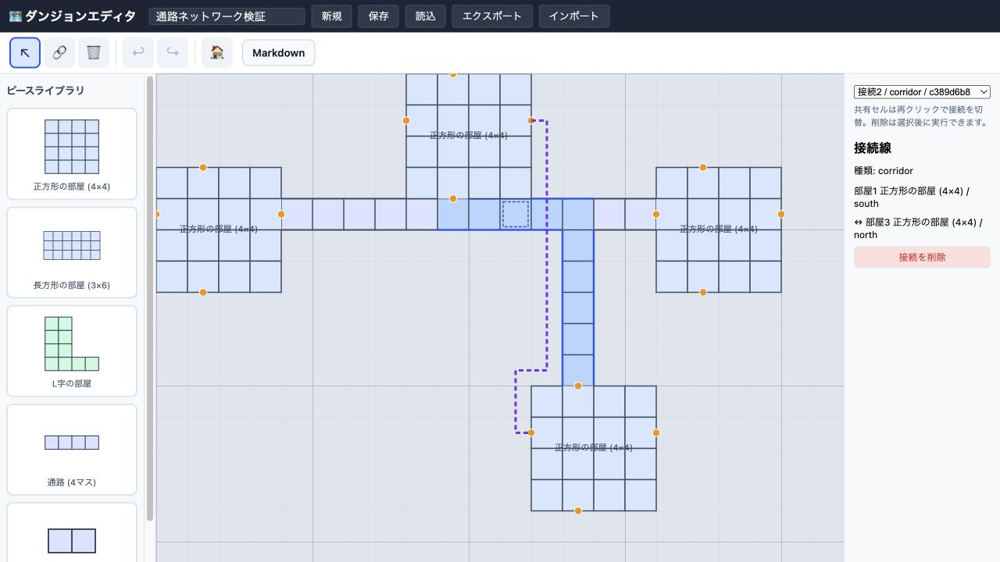
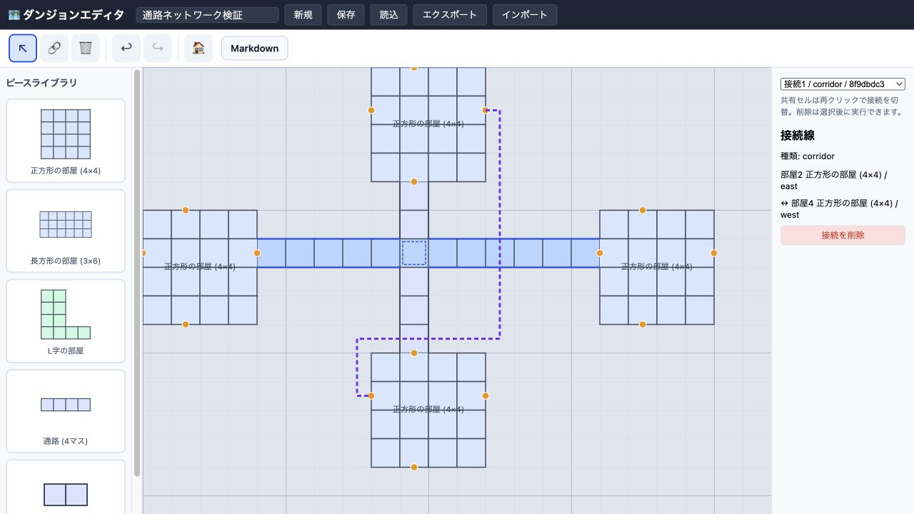
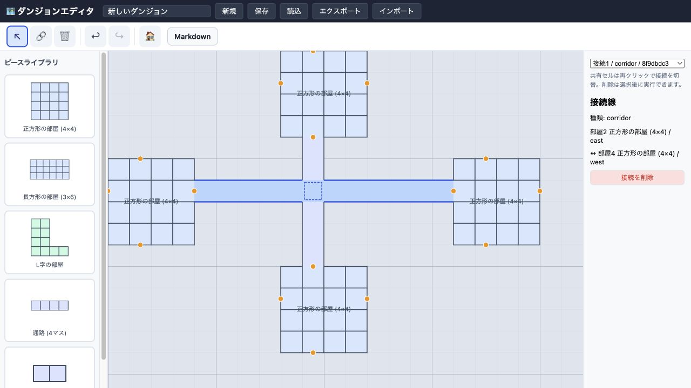
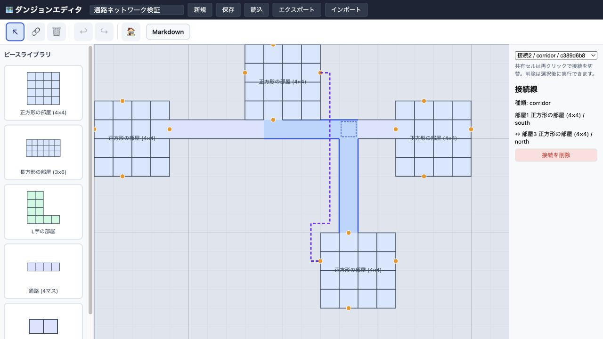

# 通路の交差・合流・分岐

## 計算と描画の責務

```text
Connection + PlacedRoom
  → Geometry / Occupancy Grid / Routing
  → ConnectionRoute（接続単位）
  → CorridorGeometry / CorridorCell[]（接続単位）
  → CorridorNetwork（同一セルの集約）
  → CorridorNetworkRenderer（選択・操作）
  → CorridorRenderer（床・壁のSVG）
```

`corridorNetwork.ts` はReact・SVG・Storeに依存しない純粋計算を担当する。
既存Router・セル展開・方向定数・壁生成を再利用し、Routerや描画側へ合流判定を追加しない。
`prepareConnectionScene` は正常な通路の寄与からネットワークを生成し、元の接続単位の描画情報・キャッシュ・部屋側の開口も保持する。

追加した型:

| 型 | 内容 |
|---|---|
| `CorridorContribution` | `connectionId`・`type`・接続単位の `cells` |
| `CorridorNetworkCell` | 既存の `x`・`y`・`connections` に `type`・重複のない `sourceConnectionIds` を追加 |
| `CorridorNetwork` | 安定した順序の `cells` と座標検索用の `byCoordinate: Map<string, CorridorNetworkCell[]>` |
| `ConnectionScene.network` | フロア全体の一時的なネットワーク |

`byCoordinate` は同じ座標に独立した複数種類・複数特殊接続を保持できる。
現在のアプリでは特殊接続は従来の線表示なので、セル展開やネットワーク描画への投入は行わない。
純粋な集約関数へ特殊種別のセルを渡した場合も、異なるConnection同士を統合しない。

## 合流ルール

通常の `corridor` 同士が同一座標を使う場合だけ、接続方向をOR演算で統合する。
`NORTH=1` / `EAST=2` / `SOUTH=4` / `WEST=8` を再利用する。

| 寄与 | 結果 |
|---|---|
| 水平10 + 垂直5 | 十字15、4方向を開口 |
| 水平10 + 北1 | T字11、南の壁だけ描画 |
| 垂直5 + 東2 | T字7、西の壁だけ描画 |
| 水平10 + 南4 | T字14、北の壁だけ描画 |
| 垂直5 + 西8 | T字13、東の壁だけ描画 |
| 水平10 + 水平10 | 水平10、床・壁を重複させない |

隣にセルが存在するだけでは方向を追加しない。実際の経路に含まれる方向だけを保持する。
負座標を含め疎なMapで集約し、入力データを変更しない。
生成元IDはSetで重複除去して昇順、セルはY・X・種別・生成元ID順に整列する。
入力の接続順やセル順によって形状・選択候補順が変わらない。

`door` / `stairs` / `secret` は合流しない。秘密の接続は破線を維持し、表示の重なりを許容する。
論理Connectionが直接結んでいない部屋へ物理的に移動できる分岐も生じるが、Connectionを追加・変更しない。
到達可能性の検索APIや移動シミュレーションは今回の対象外。

## 描画・選択・削除

統合後のセルから床を各1回生成し、閉じた壁辺も座標をキーに重複除去する。
床・壁を選択色で分割して最大各2本のPathへまとめる。選択セルを重ね描きしない。
選択経路も統合後のマスクを使用するため、十字路・T字路の開口に壁を再導入しない。
通路→部屋→特殊接続・警告→接続ポイントの既存レイヤーを維持する。

通路内部は「床→グリッド線→外周壁（選択中の色を含む）→フォーカス枠」の順に描画する。
全セルの境界を重複除去し、閉じた壁辺を除いた開口側の境界を1本のグリッドPathへまとめる。
部屋と共通の `GRID_SIZE=40`・`GRID_LINE_COLOR=#475569`・`GRID_LINE_WIDTH=1.5` を使用する。
外周壁は通常2px・選択中2.5pxとして区別し、選択色の床の上にもマス目を維持する。
グリッド線は `pointerEvents="none"` とし、セル境界上での接続操作を妨げない。
描画専用の境界情報は壁・障害物・接続方向として計算層へ渡さない。

単独セルのクリックは生成元の1本を選択する。
共有セルはクリックごとにID昇順で1本ずつ切り替え、そのConnectionが使う全セルを青くする。
右パネルに接続番号・種別・ID先頭8文字を持つ一覧を追加し、選択した接続の端点も表示する。
一覧から任意の接続を選べるため、完全に重なる接続も個別に指定できる。
ネットワークは1つのTab移動先を持ち、Enter / Spaceで最後に操作したセルの候補を切り替える。
フォーカス枠は操作対象セルの内側に表示し、部屋全体を囲む標準のSVG枠を表示しない。

共有セルを削除モードでクリックしても、選択の切替だけを行う。
右パネルの「接続を削除」またはDelete / Backspaceで、確認できた1本を削除する。
単独セルの削除モードは従来どおり即座にその接続を削除する。
削除後は残る寄与から全体を再生成し、他の接続が使うセルと方向を維持する。
セル単位の参照カウントやライフサイクル管理は導入しない。

## 更新・失敗・永続化

部屋・Connectionの変化に応じて経路→セル→ネットワークを再計算する。
部屋削除は既存Storeが関連Connectionを削除し、残る通路だけで再生成する。
移動・回転・第三の部屋による迂回・Undo / Redoでも同じ経路を通る。
経路・端点・方向が同じ場合は、既存の接続単位のセル配列を再利用する。
選択・ズーム・パンだけではRoutingやネットワークを再計算しない。

探索失敗、無効な接続、セル展開の不整合・上限超過はネットワークへ入れない。
赤い探索警告・橙色の展開警告は既存表示を維持し、失敗した寄与だけを除く。
正常な接続が使う共有セルは維持し、配置修正で成功すると自動的に再統合する。
隣接部屋の直接接続はセルなしの成功として扱い、開口・操作点を維持する。

`Connection` / `PlacedRoom` / `DungeonDocument` / Repository / IndexedDB / JSONスキーマ `1.1.0` は変更しない。
ネットワーク・セル・合流点・生成元ID一覧・SVGを保存データや履歴へ入れない。
読み込み後に論理状態から再生成する。手動配置済み通路Pieceも従来どおり扱う。
ネットワークを障害物や経路コストとしてRouterへ戻さない。

## 計算量と上限

総寄与セル数Nに対し、Mapによる集約は概ねO(N)。全接続間の総当たりや巨大な二次元配列は使用しない。
安定した出力順を得るため、集約後のセル・IDの整列には追加でソートが必要。
全体再生成の単純な方式を維持し、差分更新やWorkerは導入しない。

既存の1接続4,096セル・全体16,384寄与セル、Routingの探索幅512・展開10,000ノードの上限を維持する。
全体セル予算は重複を統合する前に消費する。接続ID昇順で配分し、入力順を変えても超過対象を変えない。
上限超過の接続は線表示へ戻し、論理データは保持する。

## 検証

`npm run build` / `npm run lint` / `npm test` が成功。ネットワーク導入時は既存133件に23件を追加し156件、グリッド描画改善で描画テスト3件を追加し合計159件。
buildの500kB超チャンク警告は既存のもの。

追加テストと更新した回帰テスト:

- 空・直接接続・単独・複数・負座標・重複・完全／部分共有・3本以上の生成元
- 十字・4方向T字・曲がり角、入力順不変、入力非破壊、隣接だけでは開口しないこと
- 全特殊種別との独立性、同種特殊接続同士の独立性、生成元の一意性
- 共有床1回・壁辺1回・T字1壁・十字0壁・選択時にも開口維持
- 候補切替、共有セルの誤削除防止、Connection／Room削除、Undo / Redo
- 移動・回転・第三の部屋・失敗と復旧・警告・直接接続
- 予算超過と入力順不変、JSON・IndexedDBからの再生成、論理データだけの保存・履歴

ブラウザでは4部屋・通常2接続を配置し、十字マスク15と共有元2件を確認。
共有セルを再クリックして端点表示が切り替わること、削除モードで一括削除されないことを確認した。
1本削除すると共有セルが垂直マスク5へ変わり、Undo / Redoで15と5が復元した。
部屋移動でT字マスク11・14と共有区間を生成し、17セル分の床が各1回だけ描かれることを確認した。
回転、隠し接続の独立した破線、閉塞で失敗寄与を除外した警告、Undoによる復旧も確認した。
キーボードで候補を切り替え、ズーム後も同じワールドセルを選択できた。
保存→ページ再読み込み→読込で4部屋・3接続と17セル、T字・共有元2件を再生成できた。ブラウザの警告・エラーログはなし。
JSON往復は自動テストで検証。ブラウザのファイルインポートとパンの実操作は未検証。

グリッド改善では、直線・全4曲がり角・全4方向T字・十字の境界、外周壁との非重複、共有境界の一意性、選択中のレイヤー順、共通のズーム・パン変換を自動テストで確認した。
ブラウザでは保存済みマップを開き、T字・共有区間→部屋移動→十字→回転後の曲がり角でマス目を確認。
グリッド境界上のクリックで接続を切り替えても線が維持され、削除・Undo後も復元した。
ズーム後も形状とグリッド線が同じSVG変換を受けること、共有境界が20本すべて一意であることを確認。警告・エラーログはなし。









## 既知の制約・今後の拡張

通常通路は1セル幅で、同一セルの合流のみを扱う。特殊接続の線は通常通路の上に重なることがある。
完全に共有する接続は選択色が同じ範囲になるため、右パネルのID・端点で識別する。
クリック候補はID順で、選択専用メニューやセルごとのキーボード移動は用意しない。
物理ネットワークのグラフ解析、経路の優先再利用、交差回避、複数階層・可変幅、手動合流設定、テーマ・出版機能は将来拡張とする。
