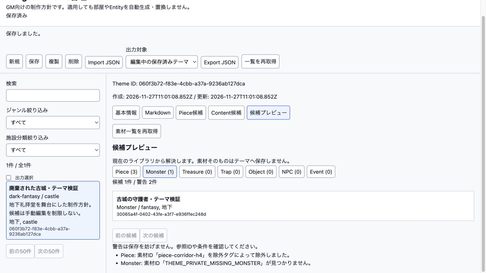
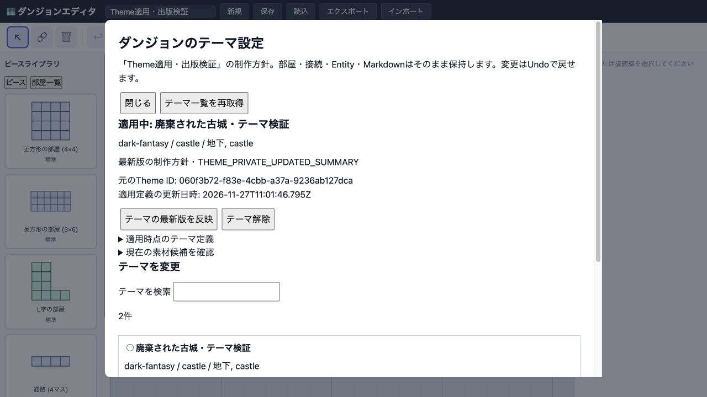

# Dungeon Theme管理

## 目的と範囲

ダンジョンの世界観・施設分類・Markdownによる制作知識と、既存Piece / Content Libraryから素材を選ぶ方針を再利用できるようにした。テーマは手動編集を制約しない。部屋配置・接続・Entity・Markdown・出版設定の自動生成や置換は行わない。

## データと責務

| 層 | 実装 | 責務 |
|---|---|---|
| Model | `src/model/dungeonTheme.ts` | Theme / Draft / Assignment、構造検証、ディープコピー、同一性 |
| Selection | `src/model/themeSelection.ts` | 共通タグ条件、Piece / Content方針、決定的な候補抽出と診断 |
| Repository | `src/repository/themeRepository.ts` | IndexedDBへの保存・削除・一括Import、楽観的競合検知 |
| 入出力 | `src/themes/themeJson.ts` | 単体・ライブラリJSON、バージョン・容量・重複キー検査 |
| Form / Search | `src/themes/themeForm.ts`, `themeSearch.ts` | 入力文字列とモデルの変換、検索と分類フィルター |
| Library UI | `src/components/themes/ThemeEditor.tsx` | 専用ウィンドウの編集・検索・素材指定・プレビュー |
| 適用UI | `src/components/themes/DungeonThemePanel.tsx` | 適用・変更・解除・確認後の更新、適用定義の参照 |
| Store | `src/store/dungeonStore.ts` | Assignmentのみを変更する1操作の履歴登録 |

`DungeonTheme`は `id`, `name`, `genre`, `category`, `summary`, `description`, `gmNotes`, `tags`, `pieceSelection`, `contentSelection`, `createdAt`, `updatedAt` を持つ。genre/categoryは任意の文字列で、同名テーマも許容する。名称や分類によって素材を暗黙に絞り込まない。具体的な部屋座標や生成結果、候補素材の定義は保存しない。

新規DraftはUUIDを持ち、7つの選択方針をすべてnoneにする。自動保存しない。正常な初回保存で作成・更新日時を設定し、以後の保存で作成日時とIDを維持する。更新日時は前回より必ず進み、競合検知にも使用する。

## 選択方針とResolver

Pieceは `{ mode, includePieceIds, excludePieceIds, tags }`。Contentは既存6種別 `monster / treasure / trap / object / npc / event` のRecordとし、各値は `{ mode, includeContentIds, excludeContentIds, tags }` を持つ。種別間で条件配列を共有しない。

共通の `tags` は `{ allOf: string[], anyOf: string[], noneOf: string[] }`。既存の部屋・素材タグと同様に前後の空白・空タグ・重複を正規化し、大文字と小文字を区別する完全一致で評価する。日本語も同じ。allOfはすべて、anyOfは1つ以上、noneOfは1つも持たない条件で、これらをANDで組み合わせる。空配列はその条件の制約なし。

| mode | 候補集合の作り方 | 使用しない入力 |
|---|---|---|
| none | 常に空 | すべて |
| all | 対象ライブラリ全体 | 明示ID・肯定タグ |
| explicit | 明示IDのみ | 肯定タグ |
| filtered | 明示IDと肯定タグ一致の和集合 | なし |

filteredでallOf/anyOfが両方空かつ明示IDも空なら、候補は空。noneOfだけ指定しても全件にはならない。全件を使う場合はallを選ぶ。

処理順序は対象種別の確定 → モード別集合 → 除外ID → noneOf → ID重複排除 → ID昇順。明示IDでも除外条件に一致すれば除外する。Contentの別種別IDは選出せず、他の種別へ移動しない。Piece対象は標準・ユーザー定義の部屋と手動通路。動的CorridorCellを素材に変換しない。

`resolvePieceSelection`は候補配列と警告、`resolveContentSelection`は6種別の候補配列と警告を返す。DB・React・Store・乱数に依存せず、入力を書き換えない。プレビューも将来のGeneratorも同じResolverを使用できる。

警告コードは `missing-id`, `kind-mismatch`, `include-exclude-conflict`, `tag-conflict`, `excluded-id`, `excluded-tag`, `empty-candidates`。存在しない参照や矛盾は保持し、代替素材を作らない。モードにより無効な条件は評価しない。警告はプレビューに表示し、保存・Importは許可する。不正な型・未知モード・不足/未知ContentKind・不正日時・上限超過は拒否する。

## 操作方法

1. メインの「テーマ管理」から専用ウィンドウを開く。開いていれば既存ウィンドウを再利用する。
2. 「新規」で名称・自由なジャンル/施設分類・概要・タグを入力する。
3. 「Markdown」でテーマ詳細とテーマGM情報を編集する。既存Markdown変換・サニタイズを共有し、外部画像・スクリプト・危険URL等をプレビューへ渡さない。
4. 「Piece候補」「Content候補」でモードと条件を設定する。無効な欄は値を保持したまま編集できなくなる。
5. Library選択ダイアログで既存素材を明示/除外指定する。素材の作成・編集・削除機能は持たない。未解決IDや検索で隠れた選択も保持する。
6. 「候補プレビュー」で7分類の件数・名称・種別・タグ・ID・警告を確認する。
7. 「保存」で登録する。複製は新IDで独立したDraftを作り、保存時に新しい日時を設定する。削除は確認後に実行する。

名称・概要・genre・category・tagsの簡易検索は大小文字を区別しない。genre/categoryの追加フィルターは完全一致。テーマ・素材・候補一覧は50件ずつ描画する。警告は件数を表示し先頭100件を描画するが、候補や保存データは切り捨てない。

未保存変更がある新規/選択/複製/Importでは保存・破棄・キャンセルを選ぶ。ウィンドウを閉じる際はブラウザ標準の離脱確認を使う。保存失敗時は原稿・変更前の版・保留操作を保持し再試行できる。

Content EditorとTheme Editorは `useLibraryEditor` の編集フローを共有する。フォーム・バリデーション・JSON・Repositoryはそれぞれのドメインに残した。区切り文字や引用符を含むタグ/IDの入力変換は `utils/stringList.ts` を共有し、IDの意味のある空白も引用して往復できる。

## 適用・更新・履歴

メインの「テーマ設定」で現在のダンジョンに1テーマを適用する。

```ts
theme?: {
  sourceThemeId: string;
  themeSnapshot: DungeonTheme;
}
```

適用/変更で定義全体をディープコピーする。ライブラリの更新・削除はスナップショットを変更しない。適用時点の詳細・GM情報・条件を参照できる。「テーマの最新版を反映」は確認後にRepositoryから再取得する。元のテーマがない場合は無効化し、保存済み定義はそのまま使える。

固定するのは制作方針。全候補のPiece / Contentを複製する機能はない。適用中の候補プレビューも現在の素材ライブラリを使うため、素材の追加・タグ変更・削除で変わり得る。

適用・変更・解除・定義更新はそれぞれ1回のUndo/Redo。履歴から当時のAssignmentを復元し、Repositoryを読み直さない。同一状態への適用と未設定の解除は履歴を増やさない。部屋・接続・Entity・全体Markdown・出版設定は保持する。物理レイアウトが変わらないので既存Routing / CorridorNetworkを再計算しない。

取得中に対象ダンジョン/Assignmentが変わった場合や設定画面を閉じた場合、遅れて返った定義は適用しない。メイン画面は設定モーダル表示中に操作できない。

テーマ未設定はフィールド不在を正規形とする。入力のnull/undefinedも不在へ正規化する。解除でライブラリ自体を削除しない。テーマによる素材参照は弱い参照でありPiece削除を阻止しない。配置済みPiece等の既存の強い参照保護は維持する。

## 永続化・同期・互換性

Dexie DB v3で `dungeonThemes` テーブル（`id, name, genre, category, updatedAt`）を追加した。v1/v2のdungeons・pieceLibrary・contentDefinitions・settingsを作り直さない。EntityとMarkdownを含む既存レコードは書き換えず保持する。

Repositoryのsave/deleteは更新日時を比較するトランザクションを使い、古いウィンドウの原稿を新しい定義へ上書きしない。保存/削除/一括登録完了後に `trpg-dungeon-generator-themes` チャンネルへ `DUNGEON_THEME_LIBRARY_UPDATED` を通知する。

テーマ一覧は通知とフォーカス復帰で再取得する。編集中のテーマがcleanなら外部版を読み、dirtyなら原稿を維持して通知する。適用済みAssignmentは更新しない。Piece/Contentの既存チャンネルでは該当素材だけを再取得し、候補を更新する。入力やフィルター変更のたびにDBを読まない。通知が使えない環境ではフォーカス/再取得ボタンを使う。

Dungeon JSONは **1.4.0**。Assignmentを含めて出力し、1.0.0〜1.3.0はテーマ未設定として読み込める。元ライブラリなしでもsnapshotを復元し、Theme Libraryへ登録/上書きしない。新しい編集画面の保存ではテーマ解除も永続化する。旧版の部分保存でthemeが省略された場合は保存済みAssignmentを保持し、Markdownの別窓保存でも維持する。

## テーマJSON

単体は `{ schemaVersion: '1.0.0', type: 'dungeon-theme', theme }`。複数は `{ schemaVersion: '1.0.0', type: 'dungeon-theme-library', themes }`。編集中の保存済みテーマ・チェックした複数・現在の検索/絞り込み結果・ライブラリ全体から出力できる。未保存編集は出力に混ぜない。

Importは構文・バージョン・type・全テーマ・重複キー（エスケープ表記も含む）・入力内ID重複・容量/件数を検査し、全件を1トランザクションで登録する。

同じIDで同じ内容（日時と集合配列の順序を除く）は再利用する。異なる内容はスキップか新ID登録を選び、既存定義を無条件に上書きしない。新規ID時は日時も新規にする。新規登録・再利用・スキップ・新規ID発行の件数を表示する。途中失敗は全件ロールバックし、Import確認画面を保持して再試行できる。

参照先のPiece/Contentは同梱・自動生成しない。別の素材ImportでIDが変わってもTheme内IDを書き換えない。必要な再割り当てはTheme Editorで行う。テーマJSONはGMの制作データとして扱う。

## 出版との関係

既存の出版ProjectionはThemeを取り込まない。GM/Playerのマップ・ガイド・印刷・ピースシート・必要数量CSVにはテーマ情報を掲載しない。Player ZIPへTheme Snapshotや素材選択条件を含めない。

Complete ZIPの `project/dungeon.json` にAssignmentを収録する。Theme Libraryや候補素材一式を同梱する機能は追加していない。元テーマ削除後も編集・保存・出版できる。

## 上限

| 項目 | 上限 |
|---|---:|
| ID | 128文字、空白のみ不可 |
| 名称 | 200文字、空白のみ不可 |
| ジャンル / 施設分類 | 各100文字 |
| 概要 | 1,000文字 |
| 詳細 / GM情報 | 各100,000文字 |
| テーマタグ / 各タグ条件配列 | 各50個・1タグ64文字 |
| 各明示ID / 除外ID配列 | 各100個・1ID128文字 |
| Theme定義全体 | UTF-8 JSON 512 KiB |
| テーマJSON | 10 MiB・1回500テーマ |
| Dungeon JSON | 既存の20 MiB |

超過時は切り詰めずエラーを表示する。ライブラリ件数自体の上限とは別に、500件/10 MiBを超えるExportは検索や複数選択で分割する。

## 検証

2026-11-27に `npm run build`（TypeScriptチェックを含む）、`npm run lint`、`npm test` が成功。既存505件に48件を追加して全553件。

| テスト | 確認内容 |
|---|---|
| `themeSelection.test.ts` | 4モード、filtered空条件、タグAND/和集合/除外優先、6種別整合性、欠落/矛盾警告、決定性・非破壊、標準/手動通路、検証/上限、複製、検索、CSV/JSON往復 |
| `themePersistence.test.ts` | CRUD/再起動/CAS、衝突再利用/skip/new-id、Importロールバック、素材/履歴独立、4操作のUndo/Redo、経路キャッシュ、ライブラリ削除、JSON後方互換、部分保存、弱い参照 |
| `themeMigration.test.ts` | v2→v3でEntity・Contentを含む旧レコードの保持 |
| `themeUi.test.ts` | 実際のEditorと適用Panel、未保存保護/保存失敗、外部更新/競合、Import再試行、6方針保持、読取専用Picker、通知別候補更新、サニタイズ、4出力範囲/ページ、確認付き更新、解除/Undo、遅延応答の無効化 |
| `themePublishing.test.ts` | GM/Player Projectionから除外、Theme有無の既存成果物一致、3種類ZIPの漏洩検査、Complete復元 |

既存のv1 DB移行・Content Editor・Entity・RoomInformation・出版ゴールデン比較も通過。ゴールデン値は変更せず、空Entity追加とプロジェクトのバージョン差分だけを既存補正処理で吸収する。テーマなしフィクスチャにthemeキーがないことも検査した。各ウィンドウとTheme設定は遅延読み込みし、無関係な画面やEasyMDEをメイン画面へ同梱しないことをビルド結果で検査する。

### ブラウザ確認

production buildを127.0.0.1:4173で実行し、1280×720の画面で確認した。

- テーマ新規作成、独自分類、Markdown、Piece filteredと除外タグ、Monster filteredと未解決ID、保存、複製、未保存確認のキャンセル/破棄を操作。
- 標準部屋3候補。明示した手動通路は除外タグによって除外される。別のContentウィンドウでfantasyのMonsterを登録すると、候補が0→1件へ更新された。
- 2部屋の検証用ダンジョンへ適用。ライブラリ概要変更で適用済み概要が変わらず、更新確認のキャンセル/確定を検証。解除後にUndoで同じsnapshotが復元された。
- メイン保存→ページ再読込→ブラウザ内保存済み一覧から復元し、Assignmentを確認。Dungeon JSONのschema 1.4.0、2部屋、元Theme ID、更新概要を確認した。
- 単体テーマJSONと2テーマの全体JSONをダウンロードし、条件・6種別・新旧ID・素材の非同梱を確認。
- GM/Playerガイド表示にテーマ情報なし。実際に生成したPlayer ZIP（7ファイル）を展開し、Themeの秘密文字列/ID/条件とプロジェクトJSONがないことを確認。Complete ZIP（19ファイル）はproject/dungeon.jsonだけにAssignmentを保持し、他の成果物へ混入しないことを確認した。
- メインとTheme画面にJavaScriptエラーなし。出版画面のログにはElectron組み込みスクリプトのエラーが記録されたが、アプリのガイド表示・ZIP生成・内容検証は成功した。





ブラウザのファイルアップロード/Importと不可逆なライブラリ削除は今回操作していない。これらはJSDOM・fake-indexeddbで失敗/競合/復元を含めて検証した。PDF保存ダイアログ・実機印刷は今回変更せず未検証。

## 既知の制約と今後

候補の順序は安定したID昇順で、抽選・重み・数量・難易度・乱数シードはない。Room Theme / Faction / Encounter Template、継承/合成、見た目の変更、自動生成、素材同梱、オンライン共有は対象外。将来の完全再現生成では候補集合や乱数シードを別途固定する必要がある。

標準テーマは自動投入しない。大規模ライブラリではデータ取得と候補抽出はメインスレッドで行い、表示だけをページ分割する。高度な検索・Worker・キーボード中心の操作改善は将来検討とする。
