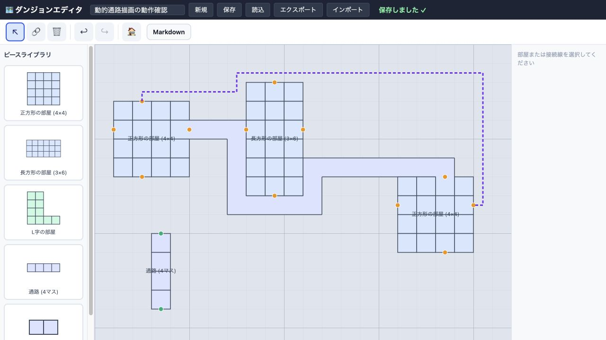
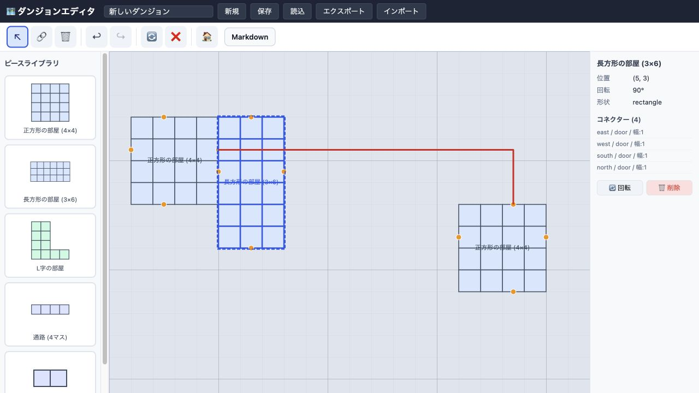

# 通路の動的生成・描画

## 構成と永続化

```text
Connection + PlacedRoom
  → Connection Geometry
  → Occupancy Grid / Obstacle Avoiding Router
  → ConnectionRoute（セル中心の経路、端点は接続口の実座標）
  → generateCorridorCells
  → CorridorCell[]（x, y, connections）
  → CorridorNetwork（通常通路の同一セルを統合）
  → CorridorRenderer
  → SVGの床・壁
```

通路生成層は `Connection`、Repository、IndexedDBへ描画情報を追加しない。現在のJSONは部屋情報を含む `1.2.0`、旧 `1.0.0` / `1.1.0` を読み込める（[部屋情報](room-information.md)）。
生成セル・接続ビット・床壁形状・描画キャッシュは派生情報であり、保存や履歴へ入れない。
手動配置の通路Pieceは既存の部屋データとして従来どおり保存・編集できる。

## 責務

- `routing/routeUtils.ts`: 正確な端点とセル中心経路の検証。非整合の候補経路はRouting層でA*の経路へ置き換える。
- `corridor/directions.ts`: `NORTH=1` / `EAST=2` / `SOUTH=4` / `WEST=8` のビット定義。
- `corridor/corridorGeometry.ts`: 接続口の外側セル間の全区間を展開し、セル列の前後関係と接続口方向からビットマスクを生成する。React・SVGへ依存しない。
- `corridor/corridorShape.ts`: 接続方向にないセル辺だけを壁として返す。終端・直線・全4曲がり角・T字・十字に対応する。
- `corridor/connectionScene.ts`: 接続単位の描画データ・部屋側の開口・集約後のネットワークを準備する。
- `corridor/corridorNetwork.ts`: 通常通路の同一セルを集約する。詳細は [通路ネットワーク](corridor-network.md) を参照。
- `useConnectionScene`: 占有グリッドと経路をメモ化し、前回と同じ経路のセル配列を再利用する。
- `CorridorRenderer`: 床と壁をSVG Pathへまとめて描画する。探索やセル展開を実装しない。
- `ConnectionRenderer`: 接続単位の選択・削除、線表示・警告表示・直接接続の操作点を担当する。

## セルへの変換

1. 接続口の実座標、外向き方向、経路の直交性・セル中心との整合を検証する。
2. 端点を無条件に丸めず、端点と外側セル中心の半セル分を除いた区間からセルを求める。
3. 長い区間の途中も上下左右に1セルずつ展開し、同じ接続内の重複セルを除去する。
4. 隣り合うセルの進行方向とその反対方向を双方へ設定する。
5. 始端・終端には、部屋へ戻る方向のビットも設定する。
6. 占有セルがあれば成功として返さず、床を生成しない。

たとえば東向きの部屋から西向きの部屋へつながる水平通路は、始端・終端も含めて `EAST | WEST` となる。
1セルだけで2部屋をつなぐ場合は、同じセルに両方の部屋への開口ビットを設定する。
曲がり角は前後関係から生成し、空間的に隣接しているだけのセル同士を勝手につながない。

隣接部屋の対向接続口が同一境界点にある場合は、Routerが正常な `direct` 接続を返す。
生成セルは空配列となり、両部屋の壁を開口する。境界の小さな操作点から接続を選択・削除できる。

## 床・壁とレイヤー

通常の `corridor` 接続だけを1セル幅の床・壁として描画する。
床は既存の手動通路と同系統の色、壁は部屋と同じ色とする。
通路セルの接続方向には壁を描かず、部屋側の接続口も同じ1セル分の壁辺を省略する。
部屋の床や選択枠、接続ポイントは維持する。

```text
Grid
  → Corridor Layer（床・壁・床セルのクリック領域）
  → Room Layer（正常な通路の接続口だけ開口）
  → Connection Overlay（従来の線・警告・直接接続の操作点）
  → Connector Points
  → Placement Ghost
```

床と壁はネットワーク全体で選択色ごとのPathにまとめ、その間に重複除去したグリッド線のPathを描画する。
床セルの生成元Connectionを選択し、通路全体を青く表示する。共有セルでは再クリックで候補を切り替える。
標準のSVGグループのフォーカス枠は使わず、操作対象の1セルにフォーカス枠を表示する。
削除モード・プロパティパネル・Deleteキー・Undo / Redoは既存のConnection操作を利用する。

`door` / `stairs` は従来の線、`secret` は紫の破線を維持し、通常通路へ変換しない。
探索失敗時には床も部屋側の開口も生成せず、既存の赤い警告線を表示する。
配置が変わって正常な経路が得られた場合は、次の描画で通路へ復帰する。

## 再計算と上限

部屋ID・位置・回転・実セル・接続口、または論理Connectionの内容が変わったときに経路を再計算する。
部屋番号・名称・説明・GM専用情報・タグの変更や、物理配置が同じ履歴スナップショットはシーン全体を再利用する。
同じ接続ID・端点・方向・経路なら、前回のセル配列を再利用する（占有セルに入っていないことも再検査する）。
キャッシュは現存する接続ごとの直前の成功結果だけを保持し、接続削除や失敗時には除去する。
選択・ズーム・パンだけでセルを再生成しない。床壁のSVG Pathもセル配列に対してメモ化する。
グリッドのピクセルサイズは既存値40を `editor/grid.ts` に集約し、床壁・部屋・キャンバス・配置・接続ポイントで共有する。

| 上限 | 値 | 超過時 |
|---|---:|---|
| 1接続のセル展開 | 4,096 | その接続を線で表示 |
| 全接続の生成セル | 16,384 | 接続ID昇順で処理し、残りの予算に収まらない接続を線で表示 |

長い区間は展開前に長さを検査する。上限は重複を含む展開作業量にも適用し、巨大な経路を無制限に走査しない。
上限超過・不整合でセルを生成できない場合は、理由を付けた橙色の線表示へ戻し、接続自体は保持する。
Routing層の探索失敗による赤い警告とは区別する。

## 検証

動的通路導入時は `npm run build` / `npm run lint` / `npm test` が成功（既存96件に37件を追加し、合計133件）。ネットワーク導入後の追加検証は [通路ネットワーク](corridor-network.md) を参照。
テストはアプリと同じ `tsconfig.app.json` を使い、純粋計算とReactのSVG静的描画を確認する。

- 水平・垂直・L字・Z字・複数曲がり角・長い区間・負座標・重複点
- 1セル通路・セルなしの直接接続・斜め経路・非整合の端点や曲がり角
- 全15ビットマスクの壁と開口、セル間に不要な壁がないこと
- 部屋の全4回転に応じたセル再生成と開口、占有セルへの侵入禁止
- 接続単位のセル生成と集約後のビットの整合、経路キャッシュの再利用・破棄
- 接続種類の維持、床壁Pathの集約、接続単位の操作、失敗時の床消去・復旧
- 個別・全体の展開上限、非有限の指定で上限が解除されないこと
- 移動・回転・第三の部屋・削除・Undo / Redo・JSON往復・IndexedDB・手動通路Pieceの維持
- セルや描画データが保存・履歴へ入らないこと

ブラウザで確認済み:

1. 接続から床・壁・部屋への開口を描画する。
2. 隣接部屋の直接接続、1セルの隙間、移動後の曲がり角、回転後の通路を確認する。
3. 第三の部屋を経路へ移動・回転し、床壁が障害物を避けることを確認する。
4. 接続口を塞ぐと床が消えて警告になり、障害物を動かすと復旧する。
5. 床の途中をクリックして接続全体を選択・削除し、Undo / Redoで復元・再削除する。
6. 手動通路Pieceの配置・移動・回転、隠し通路の破線表示を確認する。
7. ズーム時に部屋と通路が同じ変換を受け、ワールド座標の形状が変わらないことを確認する。
8. 保存・ページ再読み込み・読込後、通常通路・秘密の接続・手動Pieceを同じ状態から再生成する。

JSON往復は自動テストで確認済み。ブラウザでのファイルインポートとパンの実操作は未検証。





## 既知の制約

通常通路の同一セルはネットワーク層で合流する。特殊接続は独立した表示となり、重なりは許容する。
可変幅、通路間の交差回避・経路再利用、テーマ画像、専用の扉／階段アセット、Waypoint、手動経路編集、出版機能は実装しない。
