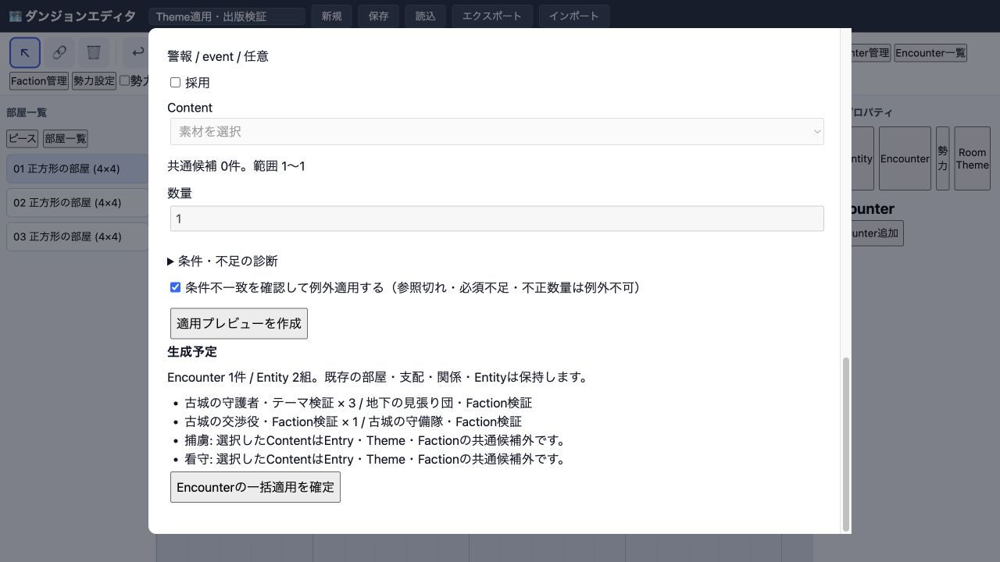
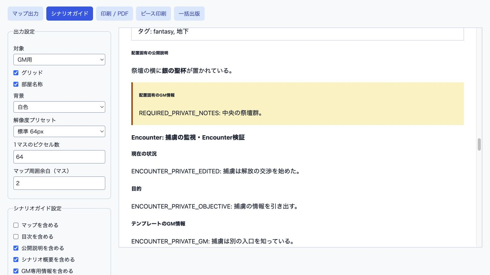

# Encounter Template管理システム

実装日: 2026-11-28。Dungeon JSON **1.7.0** / IndexedDB **v6**。

## 操作

1. 「Encounter管理」から独立した編集画面を開き、新規定義の名称・ジャンル・分類・概要・タグを入力します。背景・状況・目的・GM情報・公開説明はMarkdownで記述できます。
2. 「適用条件」でDungeon Theme／Room Themeの選択方針、支配状態、実際の床セル数、正常な経路で直接つながる部屋数を指定します。数値欄を空にすると、その条件を解除します。
3. 「参加勢力・関係」で必須／任意のRole、支配勢力／係争勢力／任意勢力の割り当て元、候補Factionを設定します。主体には必須Roleを指定し、必須Role同士に許容する対称関係を設定できます。
4. 「構成要素」で6種別の固定Contentまたは候補方針、必須／任意、最小・最大数量を指定します。Monster／NPCだけに所属Roleを指定できます。
5. 「候補プレビュー」で単体の素材候補を確認します。保存済みダンジョンと部屋を指定すると、実際の支配・勢力・関係・テーマで適用予定を検証できます。この画面はダンジョンを変更しません。
6. 「保存」で明示保存します。「複製」は内部Role／Entryも新IDにします。JSONは現在の定義・チェックした複数・検索結果・全件を出力でき、Importでは衝突をスキップするか新IDで登録します。
7. Dungeon Theme／Room Theme／Factionの「Encounter候補」から、参照専用の選択画面で候補を指定します。適用済みテーマ・勢力はSnapshotを使用するため、ライブラリ編集だけで現在のダンジョンの方針は変わりません。
8. メイン画面で部屋を選択し、「Encounter」→「Encounter追加」を開きます。候補の成立可否や不足を確認し、必要なら候補外も表示します。
9. 実際の勢力、採用するContent、数量を手動で決定します。任意Entryは不採用にできます。条件外を採用するときは例外確認が必要です。
10. 「適用プレビューを作成」で生成するEncounter・Entity・所属・警告を確認し、「Encounterの一括適用を確定」でまとめて生成します。同じ定義を再適用する場合は、別Encounterとして追加する確認が必要です。
11. 個別の状況・目的・名称・GM情報・公開説明を編集し、「Encounter情報を適用」で確定します。関連Entityの編集はEntity画面で行います。定義の編集とは独立しています。
12. 削除時はEncounterだけを除去するか、由来が一致するEntityも削除するかを確認します。「Encounter一覧」から部屋番号順の参加勢力・Entity組数・診断件数を確認して部屋へ移動できます。



## 定義・Instance・由来

| データ | 保存内容 |
| --- | --- |
| `EncounterTemplate` | ID、名称・分類・ジャンル・概要・タグ、背景・状況・目的・GM情報・公開説明、適用条件、Role、対称関係条件、主体Role、Entry、作成・更新日時 |
| `EncounterFactionRole` | 定義内ID、名称、必須指定、割り当て元、Faction定義の選択方針 |
| `EncounterContentEntry` | 定義内ID、表示名、Content種別、固定参照または選択方針、必須指定、数量範囲、任意の所属Role、Entityへコピーする個別情報と公開範囲 |
| `EncounterInstance` | UUID、Room ID、元定義ID、独立した`encounterSnapshot`、RoleとFaction Instanceの対応、個別名称・現在状況・目的・GM情報・公開範囲・公開説明、受け入れた警告、生成時の条件概要 |
| `EntityInstance.origin` | `room-theme-required`または`{type:"encounter", encounterInstanceId, entryId}`の排他的な由来 |

Templateには具体的なRoom／Faction Instance／EntityのIDを保存しません。RoleはFaction定義の方針を持ち、適用時に具体的なInstanceへ割り当てます。同じ定義から作った複数Instanceも別候補です。

Instanceは定義の深いコピーを持ちます。ライブラリの変更・削除後も独立し、自動更新・差分再生成を行いません。初期状況・目的・公開説明はTemplateからコピーし、公開範囲はGM専用です。Entityは既存のEntity Factoryを使用し、選択したContentのSnapshotとEntryの初期個別情報・数量・所属・由来を保持します。

## 適用条件とResolver

`model/encounter/resolver.ts`はDB・UI・乱数に依存しません。共通Selection ResolverとFaction Resolverを再利用します。4モードは既存どおりall／filtered／explicit／noneで、除外・タグ条件・未解決参照も保持します。

- Dungeon Theme／Room Themeの適用条件は、その部屋に保存されたSnapshotで評価します。テーマ未設定は制約のないallだけに適合します。
- Dungeon Theme／Room ThemeのEncounter候補も両方評価します。新規方針はnone、旧定義・旧Snapshotの未指定方針はallです。
- 支配状態の許容リストが空なら制約なしです。床セル数は占有セルの重複を除いた実数で、外接矩形の面積を使用しません。
- 接続部屋数は、既存Sceneで正常と判定された論理Connectionの相手Room IDを重複排除します。共有通路を通じた到達可能性は数えません。経路情報がないときは判定未完了にし、Resolver内で経路探索しません。
- Role候補は支配／係争／任意の割り当て元とFaction Snapshotの定義ID・タグ方針で評価します。主体Roleだけに、その勢力のEncounter候補も適用します。参加者全員のEncounter方針による積集合にはしません。
- 異なるRoleへ同じInstanceは割り当てられません。主体は必須Roleに限ります。関係条件は異なる必須Roleの対に限り、対を正規化して逆順重複を拒否します。
- 許容関係はallied／friendly／neutral／rival／hostile／unknownから1つ以上。既存関係がない組はunknownとして条件評価し、新しい関係は作成しません。
- 同時成立の確認はID順候補による上限付き探索です。最大2,000候補試行で停止し、成立／不成立／判定未完了を区別します。探索結果から実際の割り当てやランダム選択は行いません。

Entryの共通候補は、Entry自身 ∩ Dungeon Theme ∩ Room Theme ∩ 割り当て先Factionの構成員候補です。勢力制約は所属Roleを持つMonster／NPCに限ります。未指定のテーマは制約を加えず、指定済みnoneは空を維持します。固定ContentはIDと種別で厳密に照合し、名称一致で代替しません。

必須Entryは採用必須で、必須Roleしか参照できません。任意Entryは不採用にできますが、採用すると数量・参照・所属Roleの検証が必要です。数量0での不採用は扱わず、採用時は指定した最小〜最大の整数を要求します。

条件不一致・候補外・関係不一致は明示的な例外確認で適用できます。存在しない参照、種別不一致、必須の未解決、Role重複割り当て、不正数量、容量超過は例外にできません。候補一覧は不足素材・不足勢力・例外対象・探索未完了を区別します。

## Plan・Factory・原子的適用

`application.ts`のApplication PlanはRoom ID、Template Snapshot、手動Role Binding、選択Content Snapshot・数量・所属、受け入れた警告、生成時条件、検証時のrevisionを保持します。

プレビュー時はStoreを変更しません。Factoryを通した構造・容量検証後に、予定を表示します。適用直前にはTemplateとContentを再取得し、Dungeon・Library・選択内容のrevisionを比較してPlanを再検証します。変更されていた場合は再プレビューを求め、古い計画をそのまま実行しません。

FactoryはRepositoryへアクセスせず、UUIDを発行してEncounterとEntityを作成します。Storeは全件の参照・上限検証が成功した場合だけ、一度の更新・一度のUndo履歴として反映します。失敗時は一部だけ追加しません。Undo／Redoは確定時のIDとSnapshotをそのまま復元し、最新Libraryを読みません。

## 参照整合性・編集・削除

Dungeon正規化時にEncounter ID・Room・Snapshot・Role Binding・Faction参照と、Entity由来のEncounter／Entry／同一Roomを検証します。必須構成が手動編集で欠けた状態は許容し、診断を表示します。

| 操作 | 処理 |
| --- | --- |
| Encounterだけ削除 | 対応Instanceを削除し、その由来だけをEntityから除去。Entity・所属は保持 |
| 関連Entityも削除 | そのEncounter由来のEntityだけを削除。他のEncounter・手動配置・Room Theme必須配置は保持 |
| Entity個別編集・削除 | 編集で由来は保持。削除による不足は診断し、自動再生成しない |
| Entity移動・単体複製 | Encounter由来を解除し、所属勢力を保持 |
| 部屋全体複製 | EncounterとEntityに新UUIDを発行し、由来を新Encounterへ付け替える。Snapshot・Binding・個別編集・Room Theme由来・所属をコピー |
| 部屋削除 | その部屋のEncounter・Entityをまとめて削除 |
| Faction Instance削除 | 対応BindingとEntity所属を解除。EncounterとSnapshotを保持し、不足Roleを診断 |

各削除・複製・適用はUndo／Redoで一括復元できます。部屋複製もEncounter全体の件数・容量上限を検証してから確定します。

診断は必須Role／Entry不足、数量範囲外、現在の所属とBindingの相違、適用条件、Room Theme・支配・関係の変更、元定義の不存在を扱います。元定義の不存在はLibraryを参照する部屋パネルで示し、出版は固定Snapshotから判定できる状態だけを使用します。一覧には受け入れた例外も重複排除して数えます。診断は自動修復・再配置・Entity統合を行いません。

## Repository・保存・JSON・同期

DB v6は`encounterTemplates`だけを追加します。v5以前のDungeon・Piece・設定・Content・Dungeon Theme・Room Theme・Factionの7テーブルを書き換えません。InstanceはDungeonの`encounters`配列に保存します。

Repositoryは一覧／取得／明示保存／削除／一括Importを提供します。保存・削除は同一トランザクション内で更新日時を比較し、古い画面からの上書きを拒否します。日時は単調増加です。一括Importは全件検証とトランザクションで部分保存を防ぎます。

```json
{"schemaVersion":"1.0.0","type":"encounter-template","template":{}}
```

```json
{"schemaVersion":"1.0.0","type":"encounter-template-library","templates":[]}
```

空オブジェクトは形式説明用です。実際の出力は完全な検証済み定義です。Content／Theme／Faction実体は同梱しません。未解決の外部参照IDは保持します。構文・重複キー・版・種別・定義ID重複・各項目・容量を検証します。

同ID・同内容は日時と文字列集合の順序を無視して再利用します。異なる内容はスキップまたは新IDで登録します。独立した定義間のImport衝突ではTemplate IDのみ変え、定義内のRole／Entry IDは保持します。編集画面の「複製」はTemplate／Role／Entryを新IDにし、主体・関係条件・EntryのRole参照を変換します。外部素材参照は維持します。

Dungeon JSON 1.7.0はEncounter配列を必須とし、Snapshot・Binding・Entity由来を完全保存します。1.0.0〜1.6.0のEncounter未指定は空に補完します。Libraryが空でも復元でき、SnapshotをLibraryへ自動登録しません。旧版の部分保存は未指定のEncounterと既存EntityのEncounter由来を維持し、削除済みRoomのInstanceを除去してから検証します。Markdownの独立保存もEncounterを消しません。

専用BroadcastChannelで`ENCOUNTER_LIBRARY_UPDATED`を通知します。クリーンな定義は再取得、未保存編集は保持して競合を表示します。Content／Theme／Factionの更新やフォーカス復帰でもプレビューを再取得します。適用済みSnapshotは自動更新しません。

## 出版と公開範囲

出版は開いた時点の固定Snapshotを使用し、最新Libraryへ問い合わせません。

- GMガイドはRoomごとにEncounter名称・現在状況・目的・背景・参加勢力・現在の関連Entityを掲載します。GM情報設定に応じて定義・個別GM情報を掲載します。
- Entityは現在の数量・個別名称・説明・所属を使い、通常Entity一覧とEncounter欄へ二重掲載しません。Encounter外のEntity分類は維持します。
- Playerには`visibility="public"`かつ空でないEncounter固有の`publicDescription`だけを抽出します。内部名称・種別・数量・Role・ID・条件・GM情報や存在を示す空見出しへフォールバックしません。
- EncounterとEntityの公開範囲は独立しています。Encounterを公開しても構成Entityを自動公開しません。個別Entityの公開説明は従来の規則で掲載します。
- 既存のMarkdownサニタイズとテキストエスケープを利用し、Player Rendererも公開項目だけを参照します。
- シナリオ印刷とZIPは同じガイド生成を共用します。Playerの全ファイル・README・manifestに内部Encounter情報を加えません。CompleteのプロジェクトJSONは完全な制作状態を保持します。
- マップ・ピース印刷の形状・寸法・数量は変更しません。Encounterは物理セルや障害物ではありません。



## 上限とパフォーマンス

| 対象 | 上限 |
| --- | --- |
| ID／名称／ジャンル・分類／概要 | 128／200／100／1,000文字 |
| Definitionの各Markdown／定義全体 | 100,000文字／512 KiB（公開説明は20,000文字） |
| タグ／選択方針内ID | 50件・各64文字／100件・各128文字 |
| Role／関係条件／Entry | 8／28／50件 |
| Entry数量／部屋条件の数値 | 1〜1,000,000（接続部屋数は0から） |
| 1部屋／Dungeon全体のEncounter | 20／200件 |
| DungeonのEncounter状態 | 合計8 MiB |
| 個別状況・目的・GM情報／公開説明 | 各100,000／20,000文字 |
| 受け入れた警告 | 100件・各2,000文字 |
| Import／Export | 500定義・10 MiB |
| Role同時成立探索 | 最大2,000候補試行 |
| Entity／Dungeon JSON | 既存の500件・8 MiB／20 MiB |
| ガイド | 既存の各テキスト100,000文字・全体1,000,000文字・HTML 8 MiB |

超過は切り捨てずエラーにします。Library一覧と参照選択は50件ずつ、部屋の候補表示は検索対象の先頭100件、警告表示は先頭100件です。元データは保持します。

画面は遅延読み込みします。候補計算は既存のSceneを使用し、Encounter情報・Entity・勢力の編集で物理経路のキャッシュを無効化しません。プレビューのrevisionは制作状態と素材の変更を検出します。現状は全体状態の比較を行うため、大規模ドキュメントでは部分的なrevision管理が今後の改善候補です。

## 検証結果と制約

**最終検証:** TypeScript検査を含む`npm run build`、警告なしの`npm run lint`、`npm test` **757件すべて成功**、`git diff --check`成功。既存695件にEncounter関連62件を追加しました。

自動検証は`encounterModel.test.ts`、`encounterState.test.ts`、`encounterPublishing.test.ts`、`encounterUi.test.ts`を追加し、既存の版・DB・遅延読み込みテストを更新しました。

- 定義・内部参照・複製、4モード・新旧方針、床セル・直接接続数・支配・Snapshot条件、同一定義の別Instance、対称関係・unknown・主体・同時成立・探索上限を検証。
- 6種別の素材・固定参照・数量・必須／任意、純粋Resolver、Planの不変性と状態変更、原子的生成・Undo／Redo、削除・移動・複製・不足診断を検証。
- CAS競合・Import失敗の全件ロールバック・DB v5→v6の既存全テーブル維持・旧JSON・部分保存・Libraryなし復元・元定義更新／削除後のSnapshot保持を検証。
- 編集UI・数値入力・未保存保護・通知・参照選択・適用／反復確認・削除・一覧、出版の現在値・重複排除・Player安全性・印刷・全ZIPファイルを検証。
- Encounter未使用時の既存出版ハッシュ基準を維持。新しい版と空配列のみを互換差分として扱い、接続・ルーティング・通路・Theme必須配置・Entity・Faction・保存・出版の回帰テストを実行。

ブラウザでは定義の作成・保存・複製・JSON出力と内部ID変換、全3画面のEncounter方針保存、手動Role／Content／数量、例外確認とプレビュー、原子的適用、個別状況・Entity編集、元定義更新後のSnapshot保持、部屋複製、Encounterだけの削除とUndo、Faction削除後の不足とUndoを確認しました。Faction不要・Entryなしの定義も適用でき、保存・ページ再読み込み・アプリ内保存一覧から3 Encounter／4由来Entity／2 Room Theme由来を復元しました。

GMガイドは編集済み状況・Entityを掲載し、最新Libraryの変更を混入しませんでした。Player HTMLとPlayer ZIP 5ファイル、Complete ZIP 19ファイルを実際に生成し、Player全成果物に内部名称・Role ID・Template ID・GM識別文字列がないことを検査しました。Complete JSONには3 EncounterとSnapshotを保持しています。最終確認したメイン画面のエラーログは0件でした。

ファイルアップロードによるImportと元定義の恒久削除はブラウザでは実行していません。これらの保存処理・衝突・失敗・Snapshot保持は自動テストで検証しています。PDF保存ダイアログと物理印刷は未検証です。

自動配置・ランダム選択・バランス調整・差分再生成・図形上の個体配置・新しい経路探索・参照Libraryの一括同梱は対象外です。今後は大規模Libraryでの候補一覧の追加ページングや、診断から対象Role／Entryへの移動を拡充できます。
