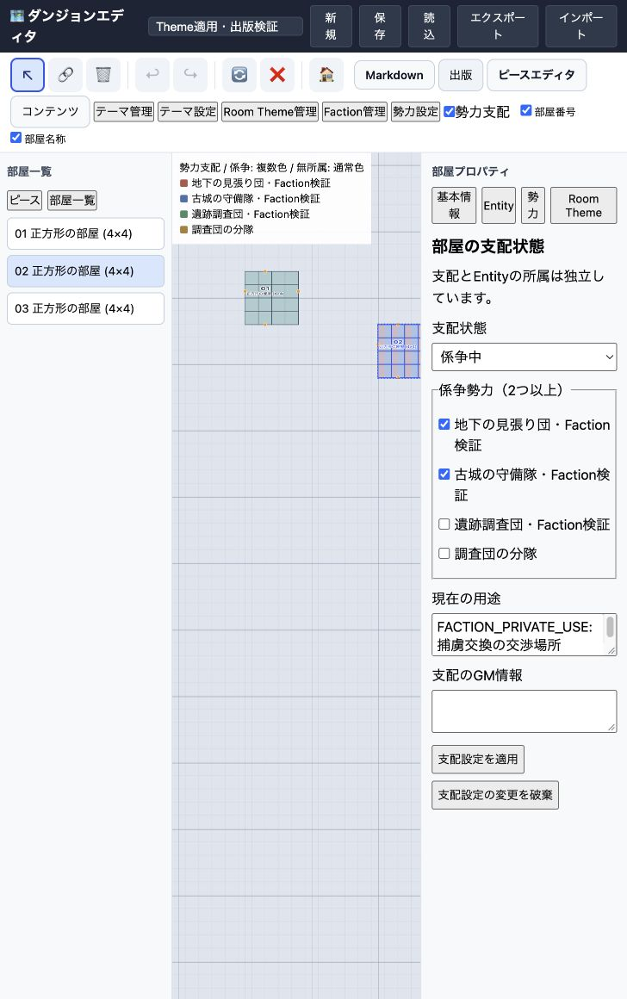
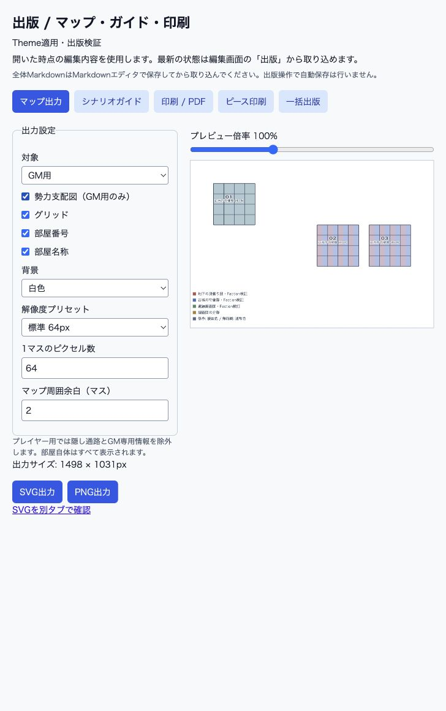

# Faction管理システム

実装日: 2026-11-28。Dungeon JSON **1.6.0** / IndexedDB **v5**。

## できることと操作

「Faction管理」は再利用する勢力定義の編集画面です。「勢力設定」は現在のダンジョンに登録した勢力の管理画面です。

1. 「Faction管理」で新規作成し、勢力名称・自由なジャンル／分類・概要・タグを入力します。背景・目的・行動方針・GM情報はMarkdownで記述できます。
2. 「構成員候補」でMonster／NPCの選択方針を別々に設定します。素材の選択画面は参照専用です。「推奨Room Theme」で部屋テーマの選択方針を設定します。
3. 「候補プレビュー」で単体またはDungeon Theme／Room Themeとの共通候補・件数・警告を確認します。「保存」を押すまで登録されません。
4. 定義を複製し、単体・チェックした複数・検索結果・ライブラリ全体をJSON出力できます。Importは全件検証後、衝突する定義をスキップするか新規IDで追加します。
5. Dungeon Themeの「Faction候補」で候補となる勢力定義を選びます。これは手動登録を制限しません。適用中のDungeon Themeも既存どおり確認後の更新が必要です。
6. メイン画面の「勢力設定」でライブラリから勢力を登録します。同じ定義から独立した複数勢力を作れます。個別名称・現在の目的／状況・GM情報・表示色・公開範囲を編集し、「勢力情報を適用」で確定します。
7. 関係の相手と種類を選び、「関係を保存」で対称関係を1件保存します。既存関係は「関係を編集」から変更します。未適用の勢力情報や未保存の関係は、適用／保存または破棄してから画面を移動します。
8. 部屋の「勢力」タブで無所属／単独支配／係争中、現在の用途、GM情報を設定します。係争には異なる勢力を2つ以上指定します。「部屋の一括支配設定」では既存状態の上書きを確認後、選んだ部屋をまとめて単独支配へ変更します。
9. Monster／NPCのEntity編集で所属勢力を指定します。1つのEntityグループの数量全体が同じ勢力に所属します。一部だけ所属させる場合はグループを分けてください。
10. 「勢力支配」をオンにすると、実際の床セルへ半透明色を重ねます。係争地はセル内の複数色、無所属は通常の床色です。凡例・グリッド・ラベル・選択表示を維持します。
11. 「勢力を削除」で、部屋の変更予定・解除するEntity所属・関係を確認して確定します。部屋とEntityそのものは残ります。削除を含むダンジョン操作はUndo／Redoできます。
12. 出版の対象をGMにすると、マップ出力で「勢力支配図」を任意で追加できます。GMガイドは登録済み勢力の情報を掲載します。Playerには明示した公開名称・公開説明だけを掲載します。



## データモデルと責務

| データ | 保存内容・参照 |
| --- | --- |
| `FactionDefinition` | `id`, `name`, `genre`, `category`, `summary`, `description`, `objectives`, `behavior`, `gmNotes`, `tags`, `memberSelection`, `roomThemeSelection`, 作成・更新日時。具体的な部屋／Entity IDは持たない |
| `FactionInstance` | UUID、`sourceFactionId`、独立した`factionSnapshot`、個別名称・現在の目的／状況・GM情報、表示色、公開範囲・公開名称／説明 |
| `FactionRelation` | UUID、2つのInstance ID、`allied / friendly / neutral / rival / hostile / unknown`、GM情報 |
| `RoomFactionAssignment` | Room ID、`unclaimed / controlled / contested`、単独支配勢力または係争勢力一覧、現在の用途、GM情報 |
| `EntityInstance.factionId` | 任意のInstance ID。Monster／NPCだけに設定可能。Content定義への固定所属は追加しない |
| `DungeonTheme.factionSelection` | `mode`, `includeFactionIds`, `excludeFactionIds`, `tags`。Dungeon専用でありRoom Themeには含めない |

DefinitionとInstanceのIDは別です。表示名は個別名称が空ならSnapshotの名称を使います。新規Instanceの個別情報は空、公開範囲はGM専用、色は既定パレットから設定します。

Snapshotは定義の深いコピーです。ライブラリの編集・削除では変わりません。「勢力定義の最新版を反映」を確認するとSnapshotだけを更新し、ID・個別情報・支配・所属・関係を保持します。登録・更新の直前に元定義を再取得し、削除済み・別ダンジョンへの切替・画面を閉じた後の読み込み完了を検出します。

Instanceの複製は新UUIDでSnapshotと個別情報をコピーします。個別名称を含む個別情報を維持し、表示色は既定パレットから割り当てます。支配領域・所属Entity・勢力間関係はコピーしません。

## 候補Resolverと診断

`model/factionResolver.ts`はDB・React・乱数に依存しない純粋関数です。既存の選択方針とResolverを使用します。

- `all`: 全件から除外ID・除外タグを適用。
- `filtered`: 明示IDと、必須タグAND・いずれかタグORの一致候補の和集合から除外。肯定条件がない場合は空。
- `explicit`: 明示IDだけから除外。
- `none`: 空集合。別素材へフォールバックしない。

Monster／NPCごとに、Faction候補 ∩ 指定したDungeon Theme候補 ∩ 指定したRoom Theme候補を返します。未指定のテーマは制約を加えず、指定済みのnoneは空集合を維持します。他の4種別を構成員候補へ混ぜません。

推奨Room ThemeはFactionのRoom Theme候補と、指定したDungeon ThemeのRoom Theme候補の積集合です。候補はID順で安定し、元のライブラリを変更しません。未解決ID・種別不一致・除外競合・空候補・積集合の消失・Dungeon ThemeのFaction候補外を警告します。

候補と実際の所属・支配は独立しています。候補外でも手動設定できます。敵対勢力の同室配置、単独支配と異なる所属、候補外の所属や推奨外Room Theme支配は診断表示に留め、捕虜・潜入などの意図的な設定を妨げません。既存EntityやRoom Theme必須構成を削除・置換しません。通常追加・必須構成の一括配置でFactionを自動推測しません。

## 参照整合性と履歴

勢力関係はInstance IDを辞書順に並べた対で保存します。逆向きの重複、自己関係、存在しない参照は拒否します。未設定と明示的な中立／不明を区別します。

部屋の設定は1部屋1件です。無所属は支配・係争なし、単独支配は有効な1勢力・係争なし、係争は単独支配なし・重複のない2〜10勢力です。設定のない部屋も無所属として扱います。

Instance削除は、関連する関係の削除・Entityの所属解除・部屋設定の変更を一括で行います。

| 削除前 | 削除後 |
| --- | --- |
| 削除勢力の単独支配 | 無所属 |
| 係争から除去後2勢力以上 | 係争を維持 |
| 係争から除去後1勢力 | 残った勢力の単独支配 |
| 係争から除去後0勢力 | 無所属 |

現在の用途とGM情報は維持します。部屋・Entity・元定義は削除しません。事前に全体の参照を検証してから1回の履歴として確定し、失敗時は部分更新しません。Undo／Redoは保存した状態を復元し、最新ライブラリを再取得しません。

Entityの移動・単体複製は所属を維持し、既存仕様どおり必須構成の由来を解除します。部屋全体の複製は支配設定・Entity所属・Room Theme・必須由来を深いコピーで維持します。部屋削除はその部屋の支配設定とEntityを除去し、勢力・関係・他の部屋を保持します。

集計は保存せず、単独支配／係争部屋数、Monster／NPCのグループ数と数量、関係数を現在の状態から算出します。

## 描画とパフォーマンス

`factions/factionOverlay.ts`で実際の占有セルと安全な表示色だけを抽出し、共通の`FactionCellOverlay`でセル内を描画します。L字・回転・負座標・部屋移動に対応します。枠から内側に1px寄せた半透明の矩形を使用し、グリッド・壁・選択枠を判読できます。係争地は勢力数に応じてセルを色分けします。描画要素は`pointerEvents="none"`です。

編集画面の表示切替はUI状態で、初期値はオフです。ドキュメント・JSON・Undoへ保存しません。物理セル、コネクター、Connection、占有判定、ルーティング方式は変更しません。既存の物理情報によるSceneキャッシュを維持し、勢力の名称・関係・所属・色・表示切替で経路を再計算しません。

## 保存・マイグレーション・JSON

DB v5は`factionDefinitions`テーブルだけを追加します。既存6テーブルのデータを書き換えず、v1〜v4から移行します。Instanceの別テーブルは作らず、Dungeonの3配列とEntityの所属へ保存します。

Repositoryは一覧・取得・保存・削除・一括保存を提供します。保存と削除は更新日時による比較を同一トランザクション内で行い、古い画面からの上書きを拒否します。更新日時は単調増加します。一括Importは全件検証し、保存途中で失敗しても全件ロールバックします。

単一定義:

```json
{"schemaVersion":"1.0.0","type":"faction-definition","faction":{}}
```

ライブラリ:

```json
{"schemaVersion":"1.0.0","type":"faction-library","factions":[]}
```

上の空オブジェクトは形式説明用です。実際には検証済みの完全な定義を出力します。ContentやRoom Themeの実体は同梱せず、未解決の参照IDも保持します。構文、重複キー、版・種別、ID重複、各項目、ファイル容量を検証します。

同じID・同じ内容は日時と集合の順序を無視して再利用します。異なる内容はスキップまたは新UUIDで追加し、素材参照IDを書き換えません。Dungeon Importでも既存のIDを保持し、定義をライブラリへ自動登録しません。

Dungeon JSON 1.6.0は勢力3配列と所属、Snapshot、Dungeon ThemeのFaction方針を含みます。1.0.0〜1.5.0の未指定配列は空へ補完し、所属のないEntityをそのまま扱います。1.6.0のJSONは3配列の明示を要求し、壊れた参照・不正配列を拒否します。旧Dungeon ThemeのFaction方針がない場合はall、新規はnoneです。

旧版の部分保存では未指定の勢力情報・既存Entity所属を保持し、削除済み部屋の支配設定を除去してから検証します。Markdownの独立保存でも勢力状態を消しません。

`FACTION_LIBRARY_UPDATED`を専用BroadcastChannelへ通知します。定義編集はクリーンなら再取得した版へ更新し、編集中なら入力を保持して競合を表示します。Content／Room Theme変更は候補プレビューを更新し、フォーカス復帰と再取得ボタンでも回復できます。適用済みSnapshotは自動更新しません。

## 出版と公開範囲

出版は開いた時点の固定Snapshotを使用し、最新Repositoryへ問い合わせません。

- GMガイド: 登録済みInstanceのみ。背景・目的・行動方針・現在の目的／状況、支配領域、対称関係、集計を掲載。GM情報を含める設定に応じて定義・Instance・支配・関係のGM情報を掲載。部屋別ガイドには支配状態・現在用途、Entityには所属表示。
- Playerガイド: `visibility="public"`かつ公開名称または公開説明が空でないInstanceについて、専用の公開項目だけを抽出。内部表示名へのフォールバック、空見出しや非公開勢力の存在表示をしない。所属・数量・領域・関係・色・IDは渡さない。Factionの公開はEntityの公開範囲に影響しない。
- GMマップ: 任意の`showFactions`で支配図と凡例を追加。通常はオフ。SVGの範囲・寸法へ凡例を含め、同じ結果をPNGへ変換。
- Playerマップ: 編集画面の表示状態や`showFactions=true`に関わらず支配図を描かず、色・凡例・ID・識別用属性を含めない。
- 参照／戦闘用マップ印刷とピース印刷: 従来どおり勢力の色を付けず、寸法・数量を変えない。
- ZIP: 既存のマップ／ガイド生成を共用。GM／CompleteはGMマップの設定に応じてSVG／PNGへ支配図を収録可能。Player成果物は公開情報だけ。README／manifestへ私的な勢力情報を追加しない。CompleteのプロジェクトJSONには完全な制作状態を保持。

公開前に専用のデータへ抽出し、Player RendererもGM用フィールドを参照しません。Markdownは既存の出版用サニタイザー、テキストはエスケープを使用します。色は`#RRGGBB`のみで、SVG描画前にも検証します。URLやCSSの塗り指定は拒否します。



## 上限

| 対象 | 上限 |
| --- | --- |
| ID / 名称 / ジャンル・分類 / 概要 | 128 / 200 / 100 / 1,000文字 |
| Definitionの各Markdown | 100,000文字、定義全体512 KiB |
| タグ／方針内のID | 50件・各64文字／100件・各128文字 |
| Definition Import / Export | 500件、10 MiB |
| Dungeon内Instance / 対称関係 | 50件 / 1,225件 |
| 支配設定 / 1部屋の係争勢力 | 1,000件 / 2〜10件 |
| Instance・関係・支配の各GM補足等 | 20,000文字（現在の用途は2,000文字） |
| Dungeonの勢力状態合計 | 8 MiB |
| Entity / Dungeon JSON | 既存の500件・8 MiB / 20 MiB |
| ガイド | 既存の各テキスト100,000文字、全体1,000,000文字、HTML 8 MiB |

上限超過は切り捨てずエラーにします。検索一覧は50件ずつ、登録勢力一覧はスクロール可能です。候補警告表示は先頭100件、配置診断表示は先頭200件で、元データは保持します。

## 検証結果

2026-11-28に確認。

- `npm run build`: TypeScript検査と本番ビルド成功。
- `npm run lint`: 成功。
- `npm test`: 既存620件にFaction関連75件を追加し、**695件すべて成功**。
- `git diff --check`: 成功。
- 勢力を使わない場合の出版成果物は既存のハッシュ基準を維持。プロジェクトJSONの比較では版と新しい空配列だけを互換差分として確認。

追加テストは定義検証・複製・4モード・タグ／除外・2種別／テーマとの積集合・純粋性、Instance／関係／支配の不変条件、削除正規化、Entity所属、部屋複製、単一履歴、旧版JSON／部分保存、DB v4→v5のデータ維持、CAS競合、Import失敗時ロールバック、編集UI・未保存保護・通知・遅延読み込み、描画・凡例・経路キャッシュ、GM／Playerガイド・PNG入力・全ZIPファイルの秘密識別文字列検査を含みます。既存の接続・通路・Theme必須配置・出版の回帰テストも実行します。

ブラウザでは以下を確認しました。

- 既存DBの保存データを維持した状態で、3定義を作成・複製・保存。Monster／NPC・Room Theme候補、Dungeon Themeとの統合候補、JSON出力、Dungeon Theme側のFaction参照選択。
- 3種類・4つのInstanceを登録。同一定義の別分隊、公開項目、敵対／同盟、2部屋の一括単独支配、2勢力の係争地と凡例。
- MonsterとNPCへ異なる勢力を指定。支配を変えても所属を維持し、NPCを別部屋へ移動、係争地の部屋全体複製で所属と支配を維持。
- 元定義の変更でSnapshotが変わらず、確認後の明示更新のみ反映。削除の影響一覧、Instance削除、Undo→Redo→Undo、部屋／Entityと参照の復元。
- 保存・ページ再読み込み・アプリ内保存一覧から復元。支配表示は初期オフ。縮小時の色・グリッド・選択表示と、728px幅の部屋パネル。
- GM支配図SVG／PNGを実際にダウンロード。GMガイドの勢力・支配・所属・関係、Playerガイドの専用公開項目。
- Player ZIP 5ファイルとComplete ZIP 19ファイルを実際に生成。Playerの全ファイルとCompleteのPlayer側・README・manifestに、秘密識別文字列・勢力ID・色指定がないことを検査。
- Complete JSONにInstance 4件・関係2件・支配3件・所属Entity3件とschema 1.6.0を確認。空ライブラリへの復元は自動テストで検証。
- 最終確認したメイン画面のエラーログは0件。

## 既知の制約と今後

ファイルアップロードによるImport操作と定義の恒久削除はブラウザでは実行していません。JSONの検証・Import／ID衝突・空ライブラリ復元・元定義削除後のSnapshot保持・保存失敗は自動テストで確認しています。PDF保存ダイアログ・物理印刷は未検証です。

勢力の表示色は重複できます。係争表示は複数色の帯であり、領域のグラフ編集は提供しません。Instanceの個別説明は明示適用、定義のブラウザ終了時は既存の未保存変更ガードを使用します。ライブラリ全体のバックアップはFaction Library JSONを別途出力してください。Completeはダンジョン内のSnapshotを保存し、全ライブラリは同梱しません。

自動勢力配置、Encounter Template、個体ごとの所属、非対称外交、数値的な好感度、勢力によるルーティング変更、領域シミュレーションは対象外です。将来は診断の対象部屋への移動や、勢力一覧・関係一覧の検索を拡充できます。
