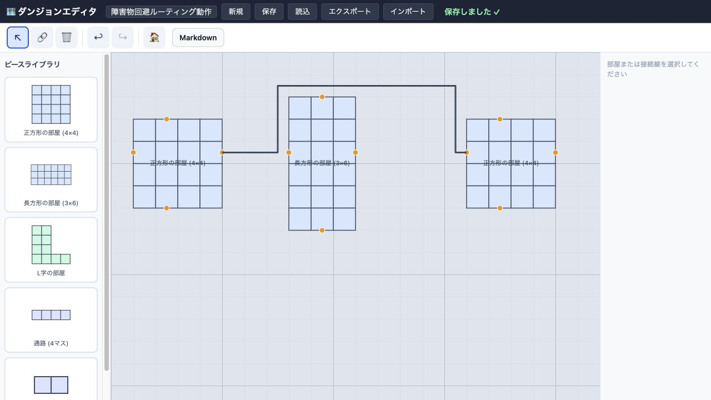
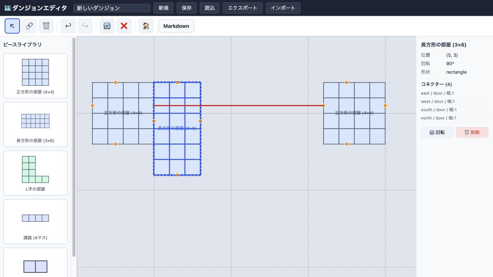

# 障害物回避コネクタールーティング

## 構成

```text
rooms → getWorldCells → SparseOccupancyGrid（全接続で共有）
connections → connectionGeometry → obstacleAvoidingRouter
  → orthogonalRouter → 全区間の障害物・方向検査
      ├─ 安全: 候補をそのまま採用
      └─ 衝突: 接続口の外側セル → A* → セル中心を接続 → 簡略化・再検査
  → RoutingResult → Corridor Geometry → CorridorRenderer（通常通路）
                  → ConnectionRenderer（従来の線表示・警告）
```

`Connection`、`PlacedRoom`、`DungeonDocument`、Store、Repository、IndexedDB、JSONスキーマは変更しない。
占有グリッド・探索ノード・経路・成否・警告は派生情報であり、保存やUndo / Redo履歴に追加しない。
スキーマ `1.1.0` と旧 `1.0.0` の読み込みを維持する。

## 占有セルと衝突検査

`occupancyGrid.ts` は `Piece.cells` を既存の `getWorldCells` で回転・移動して占有情報を作る。
部屋・手動配置の通路をすべて含み、接続元・接続先も除外しない。L字の非占有領域は空きセルとして扱う。
Setと行・列の疎な索引を使用し、遠く離れた部屋の間に巨大な2次元配列を確保しない。
エディタは整数セルを使うが、インポートされた小数座標の占有領域は交差する整数セルへ保守的に拡張する。

候補経路は端点や曲がり角だけでなく、線分の全長について占有セルとの重なりを検査する。
グリッド境界上の線分は両側の行・列を検査し、部屋同士の壁の隙間を通過しないようにする。
コネクター端点で壁に触れるだけの場合は許容する。疎な索引により、長い空き区間を1セルずつ走査しない。

## 端点とA*

`connectionGeometry.ts` が既存の描画端点と回転後の外向き方向を計算する。
`connectorOutsideCell` はそこから外側に隣接する1セルを開始・終了セルとして求める。
そのセルが占有されていれば探索不能とする。接続口の外側には原則として空きセルが必要。
例外として、隣接部屋の対向接続口が同じ境界点で接している場合は `method: 'direct'` の正常な直接接続とする。
この場合は経路が端点1点となり、通路セルを生成せず部屋の接続口を開口する。

`aStarRouter.ts` は上下左右4方向、移動コスト1、マンハッタン距離のヒューリスティックを用いる。
二分ヒープの優先順位は `f → h → 挿入順`、隣接セルの追加順は `north → east → south → west` で固定する。
同じ入力から同じ経路を再現できる。角数の重み付けや斜め移動は行わない。

探索結果のセル中心を描画座標へ変換し、先頭・末尾に実際のコネクター端点を付ける。
既存の直交Routerから抽出した `simplifyRoutePoints` を共有し、重複点と同方向の連続区間を統合する。
最後に外向き出発・外側からの到着、全区間の水平／垂直、部屋との衝突を再検査する。
動的通路描画のため、再利用する直交経路にもセル中心への整合を要求する。
整合しない候補は描画時に移動せず、Routing層でA*のセル中心経路へ置き換える。
小数位置などで端点と外側セルを直交線で結べない場合は、斜め線を表示せず探索不能扱いとする。

## 探索制限

定数は `aStarRouter.ts` に集約する。

| 定数 | 初期値 | 用途 |
|---|---:|---|
| `SEARCH_MARGIN_CELLS` | 8セル | 接続端点と全障害物の範囲に加える余白 |
| `MAX_SEARCH_SPAN_CELLS` | 各軸512セル | 両端点を含む探索ウィンドウの最大幅・高さ |
| `MAX_EXPLORED_NODES` | 10,000 | 1接続あたりの展開ノード数上限 |

全障害物の範囲が大きい場合は、両端点を含む512セル以下のウィンドウへ切り詰める。
両端点だけで上限を超える場合は探索を始めず `limit-exceeded` を返す。
探索領域の再拡張は行わない。既存の直交経路が安全ならA*を実行しないため、探索幅上限も適用しない。

開始・終了セルが占有されている、または閉じた領域から出られない場合は `unreachable`。
全障害物を余白込みで囲む探索領域を探索し尽くした場合も、迂回口がないと判断する。
切り詰めた領域の外へ出る必要がある場合や、ノード数上限に達した場合は `limit-exceeded`。
制限内では見つからないが、より広い範囲・多いノード数なら見つかる経路はあり得る。

## 失敗表示とAPI

- `success`: 正常な経路と利用方式（`orthogonal` / `a-star` / `direct`）を返す。
- `unreachable`: 接続は残し、既存の直交経路を警告用の `fallback` として返す。
- `limit-exceeded`: 同様に接続を残し、探索上限による失敗として返す。
- `invalid`: 部屋ID・コネクターIDの参照先がない。経路探索の失敗と区別する。

Rendererは警告用経路を赤色で表示し、線の説明・アクセシブル名に失敗理由を含める。
赤い線は接続関係を示すためのもので、部屋を横断していても正常な経路として扱わない。
選択・削除・隠し通路の破線表示を維持する。配置が改善すれば次の計算で通常表示へ戻る。

`resolveConnectionRoute` は状態付きの結果を返し、`routeConnections` は共有グリッドで全接続を処理する。
従来の `routeConnection` は既定で障害物回避を適用し、成功時の経路、または失敗時の `null` を返す。
第3引数へ明示的にRouterを渡す従来のAPIは維持する。

## 再計算と性能

`useConnectionScene` は `rooms` を依存に占有グリッドをメモ化し、`rooms`・`connections` が変わったときに経路を再計算する。
接続対象以外の部屋の追加・移動・回転・削除も反映する。名前・Markdown・選択・ズーム・パンだけの変更では再探索しない。
複数の接続に対して占有グリッドを作り直さず、Web Workerや独自スケジューラーは導入しない。

macOS arm64 / Node.js 24.12.0でのローカル計測例（描画時間を含まない）:

- 60部屋・20接続、すべてA*による迂回: 5回ウォームアップ後30回の平均で約0.65ms / 配置更新。
- 大きな壁で遮られた例: 10,000ノードの上限で停止し、約5.84ms。

実測値は環境と配置に依存し、保証値ではない。最悪時は接続数分の上限つき探索が発生する。

## 検証

`npm run build`、`npm run lint`、`npm test` を実行する。
既存41件に障害物回避55件を追加し、合計96件。

- 全5ピース・全4回転・負の座標・疎な大域座標・L字の空き領域
- 長い線分の途中の衝突、壁境界、単一／複数障害物、手動通路、1セル幅の開口
- 全16方向の組み合わせ、端点一致、外向き方向維持、同一の開始・終了セル、再現性
- 閉塞と探索範囲・ノード数の上限、失敗後の復旧、接続元・接続先の内部を横断しないこと
- 第三の部屋の追加・移動・回転・削除、接続の作成・削除、Undo / Redo
- JSON往復、IndexedDB保存・再読込、経路・占有・失敗状態を永続化しないこと

ブラウザでの確認:

1. 正方形の部屋A・Bを離して配置し、対向する接続口をつなぐ。
2. 長方形の部屋Cを別の場所に置き、接続線上へドラッグして迂回を確認する。
3. Cを90°回転し、占有範囲の変更による経路の変化を確認する。
4. CをAの接続口の外側へ移動し、接続が残ったまま赤い警告になることを確認する。
5. Undoで通常経路、Redoで警告を復元する。
6. Cを移動して通常経路へ復帰し、保存・ページ再読み込み・読込後に同じ経路が再生成されることを確認する。





JSON往復は自動テストで確認する。ブラウザでのファイルインポートは今回実施していない。

## 今回の制約

通路幅、接続線同士の交差回避、合流、既存通路の再利用、曲がり角コスト、地形別コスト、Waypoint、手動経路編集、通路アセット生成は対象外。
既存直交経路の再利用を優先するため、常に最短の表示経路を選ぶわけではない。
線幅やクリック領域は経路探索の障害物判定に含めない。
