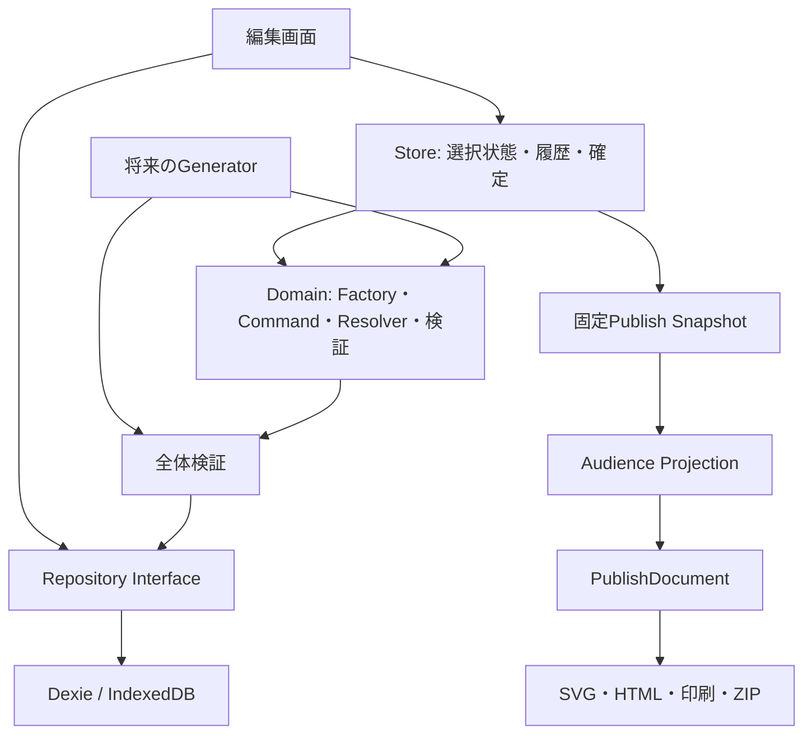

# 現行アーキテクチャとデータ保全

2026-11-28 / Phase 2.5。外部形式はDungeon JSON **1.7.0**、Library JSON **1.0.0**、IndexedDB **v6**を維持する。以前の実装メモは各機能を追加した時点の記録であり、現在の共通基盤はこの文書と[利用可能な関数一覧](interfaces.md)を基準にする。

## 責務と依存

- `model/`: 制作モデル、Snapshot正規化、Selection、各Resolver、Factory、複合Command。React／Zustand／Repositoryを参照しない。
- `editor/pieces`・`editor/connectors`・`utils/geometry`: 名前にeditorを含むが、Piece検証・物理構造・RoutingはUIから独立した処理。自動生成から再利用できる。ディレクトリ名だけの移動は行わない。
- `store/dungeonStore.ts`: UI選択・パン／ズーム・作成済みDocument、単一操作の確定・更新日時・Undo／Redo。部屋の複製・関連削除は`dungeonCommands.ts`、空Document・Room・Connection生成は`dungeonFactory.ts`へ委譲。
- `components/`: 操作・手動例外の確認・非同期取得と現在の対象確認・入力保護。Dexieを直接操作せずRepositoryのAPIを利用する。
- `repository/`: ドメイン検証後の保存。5種類の定義は`definitionRepository.ts`で同一のCAS・Importトランザクション手順だけを共有し、具体型・正常化・内容比較・通知は各Repositoryに残す。Dungeon／Pieceの固有処理は統合しない。
- `publishing/`: 固定Snapshot→公開対象ごとの許可項目→文書→成果物。Libraryや編集Storeへ問い合わせない。SVG描画アダプターはReactのサーバーレンダリングを使用するが、編集Componentを起動しない。

`architecture.test.ts`は型のみのimportを除外し、静的実行時importの循環と、ドメイン／PublisherからUI・Store・DBへの禁止依存を検証する。動的importや実行時に構築したパスまで検出するものではない。

## モデル

| 領域 | 再利用する定義 | 実際の配置／関連 |
| --- | --- | --- |
| 物理 | Piece・Connector | PlacedRoom・Connection |
| 素材 | ContentDefinition | EntityInstance・Content Snapshot |
| 制作方針 | DungeonTheme | DungeonThemeAssignment |
| 部屋用途 | RoomTheme・RequiredContentEntry | RoomThemeAssignment・必須由来のEntity |
| 勢力 | FactionDefinition | FactionInstance・対称FactionRelation・RoomFactionAssignment・Entity所属 |
| 状況 | EncounterTemplate・Role・関係条件・Entry | EncounterInstance・FactionRoleBinding・Encounter由来のEntity |

Definitionは再利用する知識であり、具体的なRoom／Entity／Faction Instanceを持たない。Instanceは適用時の定義を深いSnapshotで保持する。Room IDと表示番号、Definition IDとInstance IDを区別する。由来は所有権や所属の代用ではない。

DungeonDocumentは部屋・論理接続・Entity・適用Theme・勢力・関係・支配・Encounter・Markdown・メタデータを保存する。選択・表示切替・ズーム・占有Grid・経路・通路Network・候補集計は保存しない。

## 境界検証と旧データ

`validateDungeonDocument`はUIなしで結果とコード付き診断を返す。`assertDungeonDocument`は不正なら例外、有効なら独立した正規化済みDocumentを返す。各モデルの既存正規化・上限・参照検証を再利用し、Room ID・Piece参照・同一定義の構造差・重複端点・Connection参照を追加で検証する。

保存、まとめて保存、メイン画面部分保存、読込、StoreのDocument置換、Export／Importから共通検証を利用する。不正な明示Connectionを正規化で黙って捨ててから保存する経路は廃止した。検証失敗時は保存前・Store置換前に停止し、Undo履歴も増やさない。保存画面は失敗理由を表示する。

`normalizeDungeonDocument`は旧データ補完の純粋関数として残す。旧Room内の相互接続を一度だけ移行し、旧部屋番号を補完し、新規配列の未指定を空にする。明示的な現行入力の厳密検証とは区別する。JSON envelopeは1.0.0〜1.7.0だけを受理し、1.2以降の部屋情報、1.6以降の勢力配列、1.7のEncounter配列を要求する。破壊的スキーマ変更は行っていない。

強い内部参照はRoom→Entity／Connection／支配／Encounter、Faction→関係／所属／Binding、Encounter→Entry由来。同一RoomのEncounterとEntityを要求する。元LibraryのIDは弱い参照で、削除後もSnapshotを利用できる。Room Theme必須由来は履歴であり、現在のテーマ解除後にも残せる。必須Entryの欠落や数量の手動変更は制作診断で、構造不正とは区別する。

部屋のPiece・位置・metaを境界でコピーする。Factoryから作った部屋もLibraryや入力座標を共有しない。Immutableな呼出側から同一内容のデータを受け取っても、物理Sceneキャッシュは値の署名で再利用される。

## Selectionと診断

4モード・タグ・除外・明示候補とタグ候補の和集合・安定したID順は`themeSelection.ts`が共通規則。未設定は「制約なし」、noneは「候補なし」であり、空集合を全件へフォールバックしない。共通化した`intersectById`は入力順と対象オブジェクトを維持し、制約集合をSet化する。Pieceの構造条件・ContentKind・Role・支配・勢力間条件は各Resolverに残す。

Encounter Resolverは既存`errors`／`warnings`／`conditionWarnings`に加え、`diagnostics`を返す。診断は`code`、`severity`、`category`、`message`、対象のRoom／Role／Entry等を保持する。構造不正、参照不足、条件不一致、素材不足、未評価を機械判別できる。テーマや勢力のどの段階で共通候補がなくなったかはinfo診断で追加する。

Planは診断コードで警告を扱い、日本語メッセージを解析しない。手動例外の許可はApplication側で決定する。Generatorは厳密な候補と診断コードを利用できるが、自動選択・生成規則は今回追加しない。Faction Resolverの既存文字列診断等は互換性を維持しており、全ての既存診断を一斉に変更してはいない。

## 複合Commandと履歴

| 操作 | 原子的な変更 |
| --- | --- |
| 部屋複製 | 新Room・新Entity・新Encounter、由来IDの変換、支配設定コピー。Entity／Encounter／勢力状態の上限を事前検証 |
| 部屋削除 | Roomと、その接続・Entity・Encounter・支配設定を除去 |
| Encounter削除 | Instanceのみ＋由来解除、または由来が一致するEntityも除去 |
| Faction削除 | Instance・関係を除去し、支配／係争を正規化、Entity所属・Encounter Bindingを解除 |
| 必須Content一括配置 | 未配置項目だけを全件検証して追加。既存の手動調整を維持 |
| Encounter適用 | 確認済みPlanと現在のrevisionを再検証し、Instanceと全Entityを追加 |

CommandはStoreやDBを変更せず結果を返す。Storeが更新日時と履歴を一度だけ確定する。無変更操作は履歴を増やさない。Undo／Redoは当時のSnapshotとIDを復元し、現在Libraryを取得しない。UI状態だけの変更、Library保存、Markdownの独立保存を制作履歴へ混在させない。

履歴は最大50個のDocumentコピーという既存方式を維持する。Generatorが通常のDocumentを作り、検証後にRepositoryへ保存／Storeへ表示する経路を利用できる。独自の生成専用永続化形式や差分履歴エンジンは追加していない。

## 永続化・通知

DB v6の8テーブル: dungeons、pieceLibrary、settings、contentDefinitions、dungeonThemes、roomThemes、factionDefinitions、encounterTemplates。今回はバージョン・ストア・既存レコードを変更しない。従来のv1〜v6移行テストと全テーブル保持テストを維持する。

各Libraryは更新日時のCAS・単調日時・明示保存・衝突時の再利用／スキップ／新ID登録・一括ロールバックを共有する。通知はトランザクション成功後だけ。編集中の入力は通知で破棄せず、フォーカス復帰時も再取得できる。Piece参照保護は独自の通信手順を維持する。

Markdownは専用フィールドだけを更新し、旧メイン画面の部分保存はTheme／Faction／Encounter／Entityの未指定情報を保持する。異なるメイン編集ウィンドウのDocument保存は既存どおり最後の保存が優先される。これを新しいCAS仕様へ無断変更していない。

## 物理構造と出版

Logical Connectionは明示した端点間の関係、Connectorは候補端点、Physical Corridor Networkは同一セルで集約した描画経路。物理合流から論理Connectionを増やさない。Reachability Graphは未実装。Encounterの接続数は既存Sceneで正常な論理Connectionの相手Roomを重複排除し、物理Networkの到達数とは区別する。

Sceneキャッシュの無効化対象は位置・回転・床セル・Connector・Connection。部屋名称、Markdown、Theme、Entity、Faction所属／支配／関係、Encounter、公開範囲は物理経路を再計算しない。

Publish Sessionは固定コピーからAudience Projectionを生成し、Player用データには許可した公開項目しか渡さない。GM内部情報をCSSで隠す方法ではない。EntityとEncounterの公開範囲は独立。秘密接続はPlayerの図形入力から除外し、内部IDを置換する。PNGも同じPlayer SVGを入力にする。ガイド／印刷／ZIPは既存の同一生成系統を共用する。

Markdownは既存DOMPurifyとURL制限、テキストはエスケープ、SVGの色やZIPパスは既存検証を再利用。JSONの重複キー・容量・版・種別・危険な任意属性キーの拒否も維持する。新しい独自サニタイザーは追加しない。
