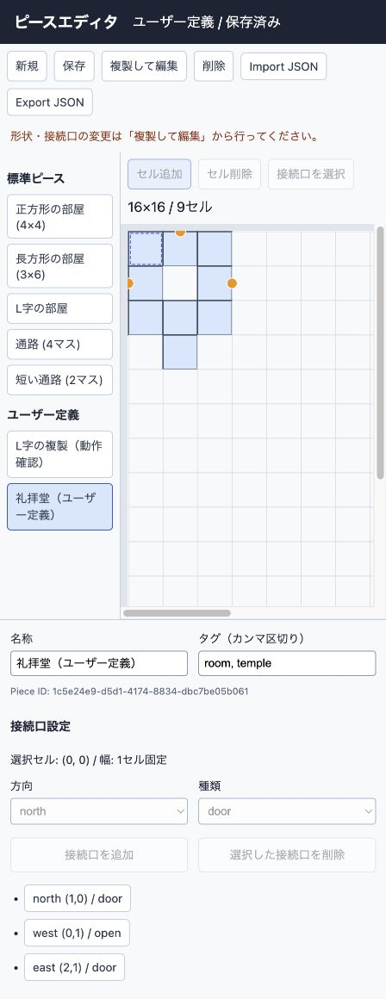
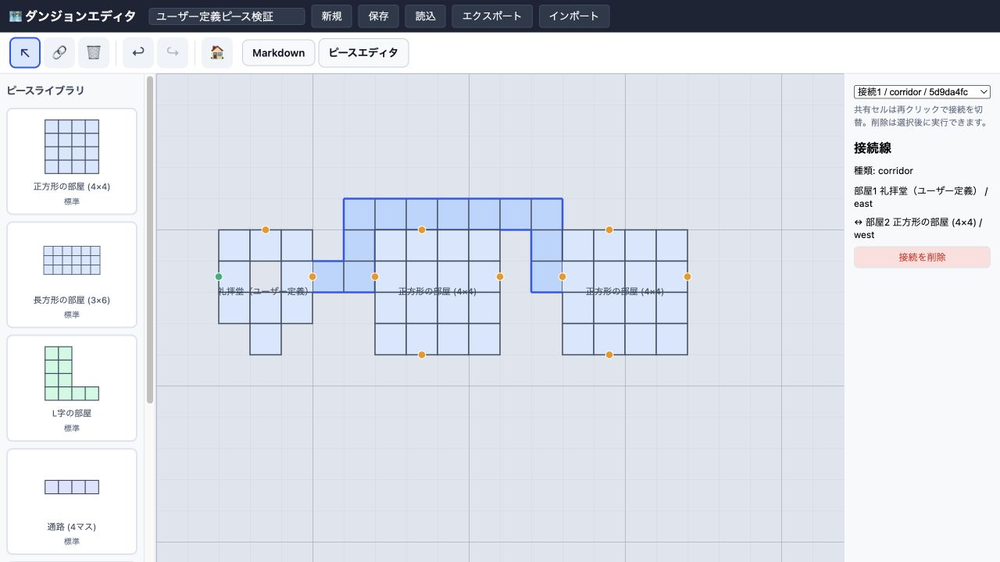

# ピースエディタ

## 操作

メイン画面の「ピースエディタ」から別ウィンドウを開く。同じ親画面で再度押すと、開いているウィンドウを再利用する。
Markdownエディタと共通の `editorWindows.ts` がURL・ウィンドウ参照・フォーカスを管理する。
ポップアップがブロックされた場合はメイン画面に理由を表示する。

1. 「新規」でピースを作る。セル追加・セル削除モードでグリッドをクリックする。
2. 「接続口を選択」モードで床セルを指定し、方向・種類を選んで「接続口を追加」を押す。
3. 接続口の円または一覧から選択すると、方向・種類の変更や個別削除ができる。幅は1セル固定。
4. 名称・カンマ区切りのタグを入力して保存する。メイン画面へ自動反映される。
5. 保存したピースの形状・接続口を変更するときは「複製して編集」を使う。新しいPiece IDを生成する。

標準ピースは保存・削除・形状編集を禁止し、複製を許可する。
保存済みユーザー定義ピースは名称・タグのみ変更できる。保存前の別ピースへの切り替えには破棄確認を表示する。
接続口がセル削除で消えたり、セル追加で内部を向くようになった場合は、除去件数を明示する。
狭いウィンドウではプロパティ欄を下へ移し、グリッドはスクロールで編集する。



## モデルと責務

```text
PieceEditorWindow
  → pieceDefinition（検証・正規化・複製・セル編集）
  → pieceRepository
  → IndexedDB.pieceLibrary
  → 保存後のPIECE_LIBRARY_UPDATED
  → usePieceLibrary / PieceSidebar
  → 既存の配置・回転・接続・通路生成
```

`PieceShape` に `custom` を追加。既存の `Piece.cells` / `Piece.connectors` / `tags` を再利用し、独自のSVG形式は導入しない。
描画・占有判定・回転・接続口の座標変換は既存の実セル処理を使用する。
新しいConnection属性、通路セルの永続化、自動生成通路のライブラリ登録は行わない。

ReactはRepositoryを介して保存・取得し、Dexieを直接操作しない。
既存DBのバージョン1に `pieceLibrary` テーブルが存在するため、DBスキーマ変更・マイグレーションは不要。
標準定義は `DEFAULT_PIECES` のまま利用し、テーブルへ追加しない。旧テーブルに標準IDの行が存在しても一覧では重複させない。
保存されたライブラリ定義が不正な場合は読み込みエラーとして扱い、標準ピースの利用を維持する。

配置済みの `PlacedRoom` は既存どおり `pieceId` と配置時の `piece` スナップショットを保持する。
名称・タグのライブラリ更新も配置済みスナップショットへ遡及適用しない。
Repository側でも既存IDの形状・セル・接続口構造の上書きを拒否するため、UIを経由しない保存でも既存接続を保護する。

## 検証と正規化

`pieceDefinition.ts` はReact・DBに依存しない。

- ID・空白でない名称・有効なshape・文字列タグを検証する。
- セルは安全な整数座標で重複を禁止し、1セル以上必要。
- `MAX_PIECE_SIZE=16` により幅・高さ16、最大256セルに制限する。
- 上下左右の探索で1つの連結領域であることを確認する。穴・凹部は許可する。
- 接続口は実在するセルにあり、指定方向の隣接セルが存在しない外周に限る。
- 接続口IDとセル・方向の組み合わせは重複を禁止し、kind・方向・幅1を検証する。
- 保存・JSON入出力では最小X・Yを0へ揃え、接続口にも同じ平行移動を適用する。
- Piece ID・Connector ID・方向は正規化や再保存で変更しない。
- セル・接続口・タグを安定した順序へ揃え、入力配列や配置済み定義は変更しない。

複製時は新しいPiece IDを生成する。Connector IDはPiece内で一意な既存IDを引き継ぐ。
Connectionの参照はRoom IDとConnector IDの組み合わせなので、異なるPiece間で同じローカルIDを持っても衝突しない。

## 参照整合性と削除

Repositoryの削除処理は、標準IDを拒否したうえで次の条件をすべて確認する。

1. 同一オリジンの開いているダンジョン画面から、現在の部屋・配置待ち・Undo／Redo履歴のPiece IDを取得する。
2. 保存済みダンジョン全件を調べ、対象IDが参照されていないことを確認する。
3. 参照データや応答が不明・不正なら削除を拒否する。
4. `pieceLibrary` と `dungeons` を同じトランザクションで確認・削除する。

編集中の画面はWeb Locks APIのセッションロックで登録する。閉じた画面・クラッシュした画面のロックはブラウザが解放する。
削除時は排他ロックを取り、新しい編集画面の登録を待機させる。
BroadcastChannelで各画面へ参照を照会し、確認中は新しい配置・配置待ち選択・読込・Undo／Redoによる参照追加を止める。
全画面から応答がなければ2.5秒で中止し、ロック解放後に操作を再開する。
参照の増えない移動・回転・部屋削除は既存処理を維持する。

ライブラリからのユーザー定義ピース選択も共有ロック内でRepositoryを再確認し、削除前の古い一覧から配置を開始する競合を防ぐ。
確認を始めた画面が閉じても、排他ロックの終了を待って各画面の停止状態を解除する。
Web Locks APIやBroadcastChannelが利用できない環境では、削除を安全に確認できないため拒否する。
この調整用のロック・参照一覧をIndexedDBやダンジョン履歴へ保存しない。

## 同期

`PIECE_LIBRARY_UPDATED` はDB保存・インポート・削除が完了した後に送信する。
受信した各ライブラリはRepositoryから再取得し、イベントを保存データの代わりに使用しない。
フォーカス復帰時も再取得し、通知が利用できない場合や通知を取り逃した場合を補う。
別ウィンドウ内で保持している編集中のドラフトは、ライブラリ再取得だけでは置き換えない。

## JSON互換性

ピース単体は次の識別子を持つJSONを使用する。

```json
{
  "formatId": "trpg-dungeon-piece",
  "schemaVersion": "1.0.0",
  "piece": {
    "id": "custom-chapel",
    "name": "礼拝堂",
    "shape": "custom",
    "cells": [{ "x": 0, "y": 0 }],
    "connectors": [],
    "tags": ["room", "temple"]
  }
}
```

ピースImportは1MBまで。検証・正規化した後、同一ID・同一内容なら再利用する。
同一ID・異なる内容は拒否し、既存定義を上書きしない。複製して別IDにする運用とする。

ダンジョンJSONは既に各PlacedRoomに完全なPiece定義を含むため、別の重複リストは追加せず既存のスナップショットを転送に利用する。
`trpg-dungeon-generator` / `1.1.0` を維持し、旧 `1.0.0` も読み込める。
Import時はPiece IDとスナップショットID、接続口の配置とID、Connectionの参照・端点占有を検証する。
標準IDに異なる形状・接続口定義を割り当てるJSONを拒否する。
ユーザー定義ピースのIDに異なる構造が存在する場合も拒否する。

全定義を検証した後、ライブラリ登録を1トランザクションで実行する。
後続定義が衝突しても先行追加はロールバックされ、メイン画面のダンジョンはインポート成功後に置き換える。
古い配置スナップショットとライブラリの名称・タグだけが異なる場合は、同じ構造の既存定義を再利用し、メタデータを上書きしない。
IDの付け替えを行わないため、RoomとConnectorの関連を保ったまま移行できる。

## 検証

`npm run build` / `npm run lint` / `npm test` が成功。既存159件に35件を追加し合計194件。
buildの500kB超チャンク警告は既存のもの。新しい依存パッケージは追加していない。

自動テスト:

- 正方形・長方形・L字・自由形状、セル追加／削除、不正接続口の除去
- 空・重複・非整数・非有限・分離領域・上限超過の拒否、上限ちょうど・穴の許可
- 凹形状の外周判定、接続口ID・位置方向の重複、幅・kind・欠落セルの拒否
- 座標正規化とID維持、標準／ユーザー定義の複製
- Repository保存・一覧・取得・DB再接続、構造上書きの拒否、名称変更と既存配置の不変性
- 現在・配置待ち・履歴・保存済み・不明な参照の削除拒否、未使用ピースの削除
- ピースJSON往復・ID衝突・複数定義インポートのロールバック
- 全4回転、占有グリッド・接続口変換・Connection・通路生成・Undo／Redo
- ユーザー定義入りダンジョンJSON・保存再読込・旧JSON・参照不整合・ID偽装の拒否
- BroadcastChannelによる複数画面の参照照会、照会中の配置等の停止、応答欠落時の中止、保存後の更新通知

参照照会のネイティブWeb Locksを使う2テストは、実行環境に同APIがない場合だけスキップする。今回のNode環境では194件すべて成功、スキップなし。

ブラウザではメイン画面から別ウィンドウを起動し、9セルの自由形状・3接続口・名称・タグを作成して保存した。
メインライブラリへの自動反映、配置・回転・接続・Undo／Redoと第三の部屋の障害物回避・マス目付き通路を確認した。
保存後のページ再読み込み・読込により、3部屋・1接続とユーザー定義ライブラリが復元した。
標準L字の保存・削除禁止と複製、新IDの派生ピース保存、セル削除による接続口1件の明示的除去も確認した。
参照中の画面がある場合と、参照する保存済みダンジョンだけがある場合の両方で削除を拒否した。
同じ親画面の起動ボタンでウィンドウを増やさないこと、狭いウィンドウのレイアウトも確認した。
ピースJSONを実際にExportし、9セル・3接続口のID・方向・正規化座標・タグが保たれていることを確認した。
ファイル選択UIによるJSON Importは未検証。自動テストでピース単体・ダンジョンの往復と原子性を検証した。
localhostのアプリを発生元とする警告・エラーは確認されなかった。別ウィンドウでElectron側の初期化ログが出る環境がある。



## 既知の制約

ピースエディタ内のUndo／Redoは未実装。既存の履歴はDungeonDocument専用のため、そのまま流用せず別Issueへ分離する。
セルはクリック編集のみで最大16×16・単一連結領域。幅1以外の接続口、高度な図形編集・画像・テーマ・自動生成は対象外。
凹部や穴の境界にも接続口を置けるが、そこから空き領域へ到達できなければ既存Routerが警告を出す。
構造変更は複製、衝突したJSONは拒否する。既存配置の一括更新・ピース版管理・インポート時の自動ID変換は行わない。
Undo／Redoに残っている参照も削除を拒否するため、部屋を消した直後でも削除できない場合がある。
本バージョンの同一オリジンの編集画面を対象に参照調整する。応答不能な画面がある場合は閉じてから再操作する。
