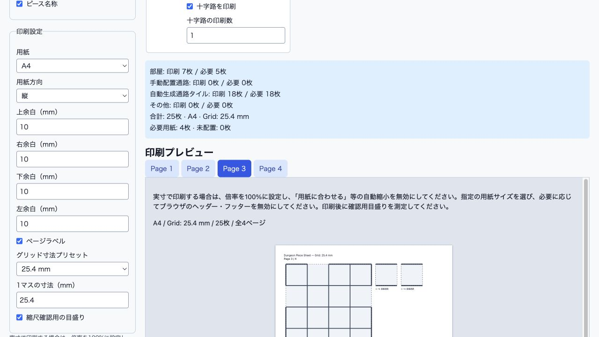

# ピース印刷プレビューの再生成を整理

## 変更内容

優先度「中」とした、ページ切り替えのたびに全ページの印刷用HTMLまで再生成していた処理を整理した。

`src/components/publishing/usePieceSheetPreview.ts`で次の2つを別々に保持し、PieceSheetPanelから利用する。

- 全ページの印刷用HTML：準備済みの素材・配置・設定が変わったときに生成する。
- 選択中ページのプレビュー：準備済みデータまたはページ番号が変わったときに生成する。

ページ番号だけの変更では全ページHTMLを再生成しない。保持するのは現在の全体HTMLと選択中1ページで、全ページ分のプレビューを蓄積するキャッシュは追加していない。

数量・用紙・グリッド寸法・描画設定を変更すると、従来どおり面付けと準備済みデータが更新され、新しい完全HTMLを生成する。ページ数が減った場合の先頭ページへの移動・表示範囲の調整も維持する。

## 検証・出力の維持

面付け、Renderer、公開範囲、物理寸法、ZIP生成、保存形式は変更していない。印刷とHTML保存には、表示中の1ページではなく全ページのHTMLを渡す。

プレビュー時も従来の独立した配置検証を実行する。未配置のみの場合は部分プレビューを表示し、完全出力を停止する。重なり・寸法不正等をプレビュー側で検出した場合も、保持済みの完全HTMLを出力できないようにする。完全HTMLの生成が容量制限等で失敗した場合も出力を停止し、設定を修正して準備済みデータが更新されると復帰する。

## 自動テスト

- `npm test`：全409件成功（既存403件＋追加6件）。
- `npm run build` / `npm run lint`：成功。既存のメインバンドル容量警告は継続。
- 1,000枚の素材で10回ページを切り替え、完全HTMLの生成が初回1回、プレビューが初回＋変更10回であることを確認。同じページでの通常再描画も生成結果を再利用する。
- 数量、用紙、グリッド寸法、切り抜き線の変更で、新しい完全HTMLを生成することを確認。
- 未配置時の部分プレビュー、配置結果の破損検出、完全HTML生成失敗時の停止、修正後の復帰を確認。
- 実際のReact画面を操作し、Page 2のプレビューが1ページだけで、保存・印刷には全ページの同じHTMLを渡すことを確認。数量変更後は新しい出力へ更新し、Page 1へ戻ることも確認。
- 前回追加した固定入力16成果物のバイト一致、公開範囲、保存・履歴・ZIPの回帰テストも成功。

回数の検証はReactへ実際に描画したテスト用画面で、既存Rendererへの呼び出しを数えて行った。実行環境によって変わる時間の短縮率を保証するテストにはしていない。

## 実ブラウザでの確認

保存済みの5部屋・4接続の検証用ダンジョンを使用した。

1. 標準部屋の印刷数を必要4枚から6枚へ増やし、素材25枚・A4縦・25.4mm・4ページを生成した。
2. Page 1とPage 2でそれぞれHTMLを保存し、どちらも全4ページで、ファイル内容が完全に一致することを確認した。
3. Page 2／Page 3のプレビューが選択した1ページだけであることを確認した。
4. A3・20mm・切り抜き線オフへ変更し、新しい1ページのHTMLと表示設定へ更新されることを確認した。
5. 100mm指定で未配置7枚となり、部分プレビューは表示できてもHTML保存は停止することを確認した。20mmへ戻すと保存可能な状態へ復帰した。

ネイティブ印刷ダイアログ・PDF保存・実機印刷は今回実行していない。印刷時に全ページHTMLを渡す処理は、代替印刷APIを用いた画面操作テストで検査している。

