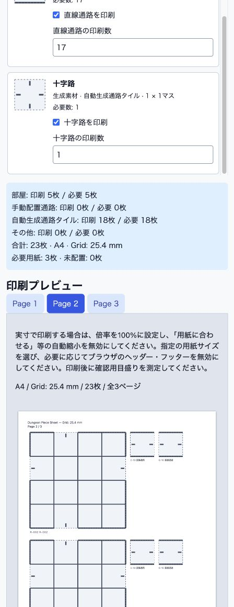
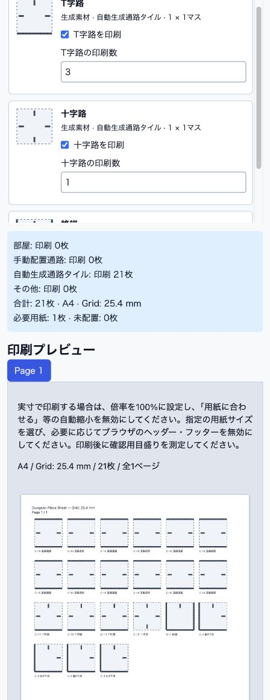

# ピース印刷シート・自動面付け

## 操作

1. 編集画面の「出版」から出版ウィンドウを開き、「ピース印刷」へ切り替える。
2. 「ダンジョン使用ピース」「ピースライブラリ」「通路素材」から取得元を選ぶ。
3. ダンジョンの場合はプレイヤー用／GM用、自動生成通路の有無を選ぶ。必要数を初期印刷数として表示する。
4. ライブラリは標準・ユーザー定義の一覧から個別選択または「すべて選択」を使う。通路素材は5種類の数量を指定する。
5. 用紙・方向・四辺の余白・1マスのmm寸法、ピース間余白、回転、分類配置、グリッド・切り抜き線・Connector記号・素材名称を設定する。
6. 集計と各ページのプレビューを確認し、「印刷 / PDF保存」または「印刷用HTMLを保存」を使う。

必要数と印刷数は別々に表示する。0は印刷対象外、予備の追加と必要数未満の指定も可能。不足する場合は再構成できない可能性を警告する。特殊接続、未解決経路、自動通路の除外は警告を確認するまで出力できない。未配置・不正数量・配置検証エラーは確認による解除ができず、設定を修正する必要がある。

印刷時は倍率100%、用紙に合わせる自動縮小なし、指定用紙を選択し、必要に応じてブラウザのヘッダー・フッターを無効にする。印刷後に1マス分の目盛りを測定する。

## 責務と一時データ

| ファイル | 責務 |
| --- | --- |
| `src/publishing/pieceSheet/inventory.ts` | 取得元、素材一覧、数量検証、分類、通路マスクの正規化・集計 |
| `src/publishing/pieceSheet/artwork.ts` | 既存の回転・セル描画を使ったPrintablePiece、切り抜き境界 |
| `src/publishing/pieceSheet/layout.ts` | 物理寸法、決定的な面付け、独立した配置検証 |
| `src/publishing/pieceSheet/renderer.ts` | 共有ベクター定義と各ページから独立HTMLを生成 |
| `src/components/publishing/PieceSheetPanel.tsx` | 取得元・数量・設定・警告・プレビュー |

`PieceInventoryItem`は内部ID、生成元、元Piece IDまたは通路マスク、名称、素材番号、分類、標準／ユーザー定義、コピーした素材形状、必要数量、印刷数量を持つ。生成元は既存ピースと自動通路を区別する。分類は部屋・手動配置通路・自動通路・その他。

PrintablePieceは回転済み占有セル、接続口、セル単位の幅・高さ、SVG、物理境界を持つ。PackedPieceは要求インスタンスID、素材ID、0／90度、余白・インク・ラベル込みの占有矩形と描画矩形を持つ。Layoutはページ一覧、未配置一覧、要求総数、セル寸法、印刷可能領域を持つ。

すべて出版用の一時データであり保存しない。生成通路をライブラリへ登録せず、DungeonDocument、Repository、IndexedDB、JSONスキーマ1.2.0、Undo / Redoに変更を加えない。新しい外部ライブラリは追加していない。

## 固定した入力と公開範囲

ダンジョンは既存Publish SnapshotのPlacedRoomと埋込みPiece定義を使う。座標・回転にかかわらずPiece ID単位で数え、同じ形でもIDが異なれば別素材。同じIDに異なる物理定義がある場合は停止する。名称・タグだけの差分は数量を分けない。分類は既存shapeと明示的なroom／corridorタグに基づき、名称から推測しない。情報のないcustomは「その他」。

ライブラリは標準ピースとRepositoryの読み取り結果をコピーし、取得時点の定義を保持する。数量・用紙・描画設定の変更では再取得しない。「ライブラリを再取得」または取得元の選び直しで更新する。

ダンジョンの通路は既存の`buildPublishDocument`で公開範囲を確定してから、同じスナップショットの既存MapGeometry／CorridorNetworkを使う。プレイヤー用secret Connectionは経路生成・集計前に除外する。GM用の特殊接続数を計算してから非表示にする処理は行わない。出版ウィンドウのスナップショット・公開対象別キャッシュを使い、数量・用紙・余白・表示設定では再Routingしない。

プレイヤー用のダンジョン素材名称はR／M／Oの汎用番号。部屋番号、部屋名称、説明、GMメモ、全体Markdown、タグ、元の部屋／接続ID、完全なDungeonDocumentをHTMLやSVGへ含めない。素材形状も必要なプロパティだけをコピーする。未使用のsecret接続口を除き、公開対象の接続で利用される接続口は通常の開口として維持する。ライブラリは汎用テンプレートの選択印刷として名称・接続口を出力し、ダンジョン固有の情報は参照しない。

部屋単位の秘匿設定は既存仕様に存在しないため、プレイヤー用もすべてのPlacedRoomを数える。

## 通路タイルの数量

合流済みNetworkの各座標を一度だけ集計し、方向をORした最終マスクを利用する。同じセルを通るConnection数では数えない。共有直線・T字路・十字路の重複を防ぐ。手動配置通路は元Piece、自動生成通路は1セルの生成素材として別々に数える。直接接続のようにセルがない経路はタイル0枚。

北1・東2・南4・西8を時計回りに回転し、次の代表値へ正規化する。鏡映は使わない。

| 形状 | 代表値 | 統合する向き |
| --- | --- | --- |
| 直線 | 10（1010） | 10、5 |
| 曲がり角 | 3（0011） | 3、6、12、9 |
| T字路 | 11（1011） | 11、7、14、13 |
| 十字路 | 15（1111） | 15 |
| 終端 | 1（0001） | 1、2、4、8 |

door／stairs／secretは通常タイルへ変換せず、出力対象の件数を警告する。失敗・上限超過の経路を正常な通路素材として数えない。プレイヤー用では除外済みsecretに関する警告・IDも含めない。特殊接続の専用タイル、長い通路への最適化は対象外。

## 寸法・面付け・独立検証

用紙・方向・四辺余白・セル寸法・ページラベル・確認目盛りは既存PrintProfileを共有する。面付けでは共通`printAreas`を使い、地図分割用の重複・カットマークは適用しない。設定の別コピーを状態として管理しない。

1マスは初期25.4mm。15／20／25／25.4／30mmまたは5〜100mmのカスタム値を指定する。4×4は25.4mm指定で101.6mm四方。ピースごとの自動縮小をしない。

占有矩形は実セルの外接矩形に、両側それぞれ「ピース間余白の半分＋セル寸法÷40×1.5」のインク領域と、名称表示時の高さ8mmを加える。ピース間余白は初期3mm、0〜30mm。ページラベル10mmと目盛り8mmも設定に応じて面付け前に予約する。

First Fit DecreasingのShelf方式を採用した。面積、大きい辺、安定したインスタンスID順に並べ、既存ページ・棚へ0度／90度で入る位置を探す。新しい棚では収まる向きのうち高さが小さいものを選び、なければ新しいページへ進む。分類配置時は部屋／通路／その他を同じページへ混在させない。凹部へのネスティングや最適ページ数の保証はしない。

独立検証は配置結果を信用せず、要求インスタンスの重複・欠落、要求総数、ページ数、用紙・縮尺、回転可否、元セルから再計算した寸法、余白・名称領域、ページ境界、矩形同士の重なり、分類を検査する。誤差許容は1e-8mm。全要求は配置済みまたは未配置として必ず残す。

大型素材・100ページ上限による未配置は名称、余白・名称込みの必要mm寸法、理由を一覧に表示する。一部ページをプレビューできても、未配置がある完全HTMLの生成・保存・印刷は禁止する。用紙、方向、余白、セル寸法、数量を変更して解消する。縮小・分割・黙った省略はしない。

## 形状・切り抜き線・HTML

`getWorldCells`／`getWorldConnectors`で回転と接続方向を変換し、既存`cellShapes`／`corridorWalls`で床・内部グリッド・壁を描く。内部グリッドは既存の色#475569・幅1.5、壁は幅2。接続方向を壁で塞がず、物理外周にグリッド線を追加しない。

切り抜き線は隣接する占有セルだけを除いた外周から別に生成する。破線・幅0.6として壁と区別し、凹部、穴、Connector開口部も含める。1セル通路は開口方向にかかわらず4辺を切り抜き境界とする。表示をオフにしても壁や経路情報は変化しない。Connector記号は外向きを示す短い線であり、選択ハンドルではない。名称ラベルは描画領域の外側で常に正立させる。

HTMLは用紙単位のmm座標SVGと、素材・向きごとの共有defs／useから構成する。IDは素材の配列番号と回転から生成し、元IDを出力しない。同一素材を数量分描き直すことを避ける。ユーザー由来の名称はエスケープし、外部リソース・スクリプトを追加しない。CSPとReferrer Policyを維持する。

プレビューと完全HTMLは同一Layout・Rendererを使用する。プレビューのDOMはページボタンと選択中1ページだけ。用紙CSS、最終ページの不要な改ページ防止、1セルの確認目盛り、HTML容量制限、ダウンロード、BrowserPrintAdapterは既存処理を再利用する。HTMLは独立文書として保存でき、将来のZIP同梱でも利用できる。PDF生成ライブラリ・ZIP機能は追加していない。

## 制限

| 対象 | 上限 |
| --- | --- |
| 素材種類 | 256 |
| 1種類の印刷数 | 0〜500の整数 |
| 印刷総数 | 1,000枚 |
| ページ | 100枚 |
| 完成HTML | UTF-8で16MiB |
| ダンジョンの部屋床 | 32,768セル |
| セル寸法 | 5〜100mm |
| ピース間余白 | 0〜30mm |

種類・数量は展開前に検査する。通路セル数・Routingには既存上限も適用される。ライブラリは256種類を超える場合に一覧生成を停止する。用紙はA5／A4／A3／Letter、縦／横。

## 検証

- `npm test`: 全350件成功（既存303件＋本機能47件）。
- `npm run build` / `npm run lint`: 成功。既存のメインバンドル容量警告は継続。
- 方向15パターン、共有セルのOR・重複防止、実Routingの十字路、直接接続、特殊・失敗経路、秘密接続除外、同一／異なるPiece ID、回転、custom、手動通路、空データ、不正定義、不正数量、0・予備・不足・1,000枚をテスト。
- 物理寸法、25と25.4mm、全用紙・方向、非対称余白、90度でのみ入る素材、回転禁止、混在・分類・複数ページ、100ページ超、未配置停止、独立検証への不正結果注入、凹形状・穴・開口・回転境界、グリッド・切り抜き切替、共有defs、プレビュー同一性、HTML/SVGの秘密情報除外・エスケープ、保存・履歴・JSON・既存SVG不変をテスト。
- 実画面で保存済みの5部屋（同じ標準Piece4個＋回転したユーザー定義1個）、通常通路の交差・共有、隠し通路を使用。プレイヤー用は部屋5枚・生成通路18枚（直線17、十字路1）を23枚・A4縦25.4mm・3ページに配置。
- 数量不足の警告、GM用の特殊接続1件の警告と確認前の出力停止、生成通路の除外警告、ページ選択、A3横25mm、ライブラリ7種類の全選択／解除と個別選択、部屋・通路別ページ、通路素材5種類の数量変更を確認。
- A5縦・4セル通路・38mmで、回転なしは未配置1枚、回転ありは未配置0・1ページ。40mmでは回転しても未配置となる。内部グリッド・切り抜き線をオフにして壁と回転定義が残ることを確認。
- 実際に画面から保存したHTMLを解析。A3横420×297mm、25mm、2ページ、素材23枚、共有定義4個、確認目盛り25mm、秘密情報の識別文字列なし、外部リソースなしを確認。
- 既存マッププレビュー・SVG出力、ガイドプレビュー・HTML出力、既存印刷設定・HTML出力へ切り替えて利用できることを確認。編集データ・ライブラリはブラウザ検証中に保存・更新していない。

**PDF保存とPDF／紙上の物理寸法測定は未実施。** 前回の印刷検証で、この環境からネイティブ印刷ダイアログを扱うアプリへのアクセスが禁止されていることを確認済みのため、今回は同じ制限への再試行をしていない。今回の実画面ではプレビューとHTML保存を確認し、印刷には既存の共通アダプターを接続した。起動・終了・キャンセル・二重起動・タイムアウト等のアダプター挙動は既存の自動テストで検査している。mm寸法の検証は印刷HTML/SVGと計算結果についてのものであり、保存済みPDFや紙の実測結果ではない。

## 既知の制約と今後

外接矩形の棚配置は最適解を保証せず、空き領域が残ることがある。大きな形状は分割せず出力を停止する。長い名称は80文字までの表示とし、描画幅へ収める。部屋番号・シナリオ本文・扉／階段の専用素材・両面・塗り足し・手動配置・自由形状ネスティングは対象外。基本通路素材は1セル単位。

今後の候補は長尺通路素材への集約、配置効率の改善、手動配置、分割素材、ZIPへ同じ独立HTMLを同梱する機能。実PDF・実機での寸法検証は別途必要。
