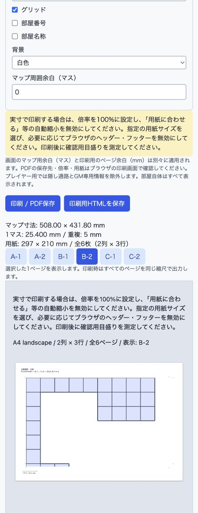
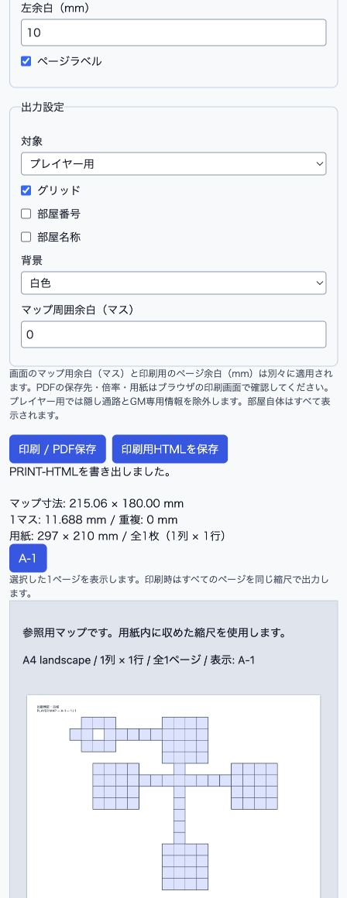

# PDF出版・印刷レイアウト

## 操作

1. 編集画面から「出版」を開き、「印刷 / PDF」へ切り替える。
2. シナリオガイド、参照用マップ、卓上プレイ用マップから印刷対象を選ぶ。
3. 公開対象・用紙・縦横・ページ余白を指定する。シナリオの場合は既存のガイド設定も利用する。
4. 卓上マップではセルの物理寸法・分割・重複・カットマーク・ラベル・目盛りを選ぶ。
5. 分割ページ一覧から1枚ずつ確認し、「印刷 / PDF保存」を押す。ブラウザの印刷画面でプリンターまたはPDF保存先を選ぶ。

「印刷用HTMLを保存」で同じ印刷文書をダウンロードできる。通常のブラウザでHTMLを開き、標準の印刷操作を行う用途にも使える。実寸印刷では倍率100%、自動縮小なし、指定した用紙を選択し、必要に応じてブラウザのヘッダー・フッターを無効にする。印刷後に確認用の目盛りを測定する。

ブラウザは保存先、PDF名、プリンター、倍率、印刷不能領域、ユーザーが変更する用紙を完全には制御できない。「印刷 / PDF保存」はブラウザ標準の印刷機能を開く。印刷完了・PDF保存・キャンセルを判別して保存成功と通知する機能ではない。





## 責務とモデル

```text
固定Publish Snapshot
  → 既存の公開情報抽出
  → Map SVG / Scenario Guide HTML
  → PrintProfile
  → PrintLayout（マップのみ）
  → Print Document（HTML / SVG）
  → Browser Print Adapter → ブラウザ印刷 / PDF保存
```

`PrintProfile`はtarget、paperSize、orientation、marginsMm、showPageLabelsと、map設定のscaleMode、cellSizeMm、allowTiling、tileOverlapMm、showCutMarks、showScaleBarを持つ。audienceは既存PublishProfileを共用する。

初期用紙はA4縦、四辺10mm。参照・シナリオはfit-page、卓上はphysical-grid。物理セルは25.4mm、重複は0mm、分割・ラベル・カットマーク・目盛りは有効。対象によって不要な設定は画面に表示しない。

`PrintLayout`は用紙・印刷可能領域・内容領域の寸法、行列数、ページ配列、マップ物理寸法、実際のセル寸法、重複幅、全体のsourceBoundsを持つ。`PrintPage`はindex、label、row、column、sourceBounds、cutBounds、contentBoundsMmを持つ。シナリオ文書はブラウザが自然に改ページするため、このページモデルへ統合しない。

元のDungeonDocument・Connection・Piece・Repository・履歴・JSONスキーマ1.2.0は変更しない。設定とレイアウト・文書・ページSVGはReactの一時状態として扱い、永続化しない。

## 単位・用紙・余白

| 単位 | 使用箇所 |
| --- | --- |
| Grid | 部屋・通路・既存MapBoundsの論理座標 |
| SVG Unit | 既存の1セル40単位、PrintPageのsourceBounds / cutBounds |
| Pixel | 画面・既存SVG/PNGの出力解像度 |
| mm | 用紙、ページ余白、contentBoundsMm、セル、重複、装飾 |

共通関数は`gridToMm(cells, cellSizeMm)`、`svgToMm(units, cellSizeMm)`、`mmToSvg(mm, cellSizeMm)`。pixelsPerCellは印刷の物理寸法に使用しない。

用紙定数はA5=148×210、A4=210×297、A3=297×420、Letter=215.9×279.4mm。横向きでは幅・高さを交換する。印刷可能領域は用紙から四辺のページ余白を引いて求める。負値、非有限値、領域が0以下の設定は拒否する。

出版設定の「マップ周囲余白（マス）」と、印刷設定のページ余白（mm）は別々。マップ周囲余白は元SVGの描画範囲へ、ページ余白は用紙へ適用する。床・壁・ラベル等は既存の描画余裕0.2セルも含む。

画面プレビューでは用紙全体を縮小表示する。印刷メディアではzoomを1へ戻し、@pageへ指定した用紙寸法・四辺余白を使う。画面用の用紙paddingは印刷時に0とし、ページ余白を二重適用しない。

## 参照用マップ

出力対象のMapBoundsをSVG単位へ変換する。ラベル用の高さを引いた内容領域に対し、横と縦の倍率の小さい方を採用する。1つの倍率でwidth/heightを求め、内容領域の中央へ配置する。実寸グリッドの保証はしない。

実画面の検証例ではA4横・四辺10mm・ラベルありに対し、215.06×180.00mmのマップを1枚へ配置した。縦横比を維持し、元のSVG座標と描画内容を変更しない。

## 卓上マップ・分割

物理セルは15 / 20 / 25 / 25.4 / 30mmプリセットと5〜100mmのカスタム値。25mmと25.4mmを区別し、用紙へ収めるための自動縮小を行わない。

1. 元の描画範囲をグリッドの外側へfloor/ceilし、壁やラベルを欠落させない。
2. ページラベル10mm、目盛り8mm、カットマークの四辺3mmを必要に応じて確保する。
3. 残りの幅・高さから重複幅を引き、完全なセルが入る整数個数をページ間の移動量とする。
4. 表示範囲はその移動量に指定mmの重複を足す。接合位置は整数グリッド、重複の末端はセル途中になる場合がある。
5. 実際の表示範囲と移動量を基準に列・行数を求める。各ページは同一のmm/SVG倍率を使用する。

例えば重複5mmでは、前ページの接合位置を越えた5mmを次ページと同じ座標・縮尺で描く。5mmを1セル相当へ丸めない。1ページへ収まる軸には不要な分割を加えない。

計算には小さな浮動小数点誤差の許容を設け、不要な追加ページを避ける。最終ページの表示範囲が全体の右端・下端まで覆うことも検査する。分割が無効で収まらない場合、重複で移動量を確保できない場合、1セルも配置できない場合は、縮尺を変えず設定変更を要求する。

検証例は508.00×431.80mm、25.4mmグリッド、A4横、四辺10mm、重複5mmで2列×3行=6枚。各ページは259×157.4mmの表示範囲、次ページへの移動は横254mm・縦152.4mm。すべてのページで1セル25.4mm、重複5mmになる。

## 装飾とベクター文書

カットマークは、実際の接合位置に対応する目印をマップの外側に描く。重複部分へ床や壁に似た線を追加しない。用紙の印刷可能領域内へ納める。ページラベルはA-1、A-2、B-1…の形式で、Z以降はAAを使う。名称・対象・ページ番号・物理グリッドをマップと重ならない予約領域へ配置する。

縮尺確認用目盛りは1セル相当の線とmm表記。高さ8mmの領域を確保する。白黒でも床・壁・グリッドを区別できる既存の線幅を維持し、隠し通路は破線、GM専用情報は見出しと罫線でも識別する。

元SVGのベクター要素を文書内の共有defsへ1回だけ入れ、各ページはuse、viewBox、mm単位のwidth/heightで必要な範囲を表示する。ページごとのPNG化・Routing・CorridorNetwork再構築は行わない。元SVG内のIDと参照は印刷用接頭辞を付け、ページ数によるID重複を防ぐ。

印刷用HTMLはUTF-8・日本語・内蔵CSS・CSP・Referrer Policyを維持する。ユーザー由来のタイトル等はHTMLエスケープする。印刷時は操作案内を非表示にし、マップの各用紙へ明示的に改ページを設定する。最終用紙はbreak-afterをautoにする。

シナリオ印刷は既存の安全なHTMLへ用紙・余白・本文・表・コード・マップの印刷CSSを加える。Markdownを再変換しない。800文字以内の短い部屋には分割抑制用クラスを付け、長い部屋やGMメモ・コード・表は分割可能にする。マップは用紙の高さも考慮して収める。

## 公開範囲とキャッシュ

既存のplayer/gm PublishDocument・ScenarioGuideをそのまま利用する。secret Connectionは経路生成前に除外済み。プレイヤー用の部屋名称・GMメモ・全体Markdown・タグ・編集用警告を、隠したDOMやページラベルへ追加しない。共有defs内にも公開対象のマップだけを入れる。

同じPublish Snapshotからマップ・シナリオ・印刷文書を作る。用紙・余白・物理寸法・選択ページの変更ではRepositoryを再取得せず、Routingを再計算しない。マップなしのガイド出力と、既存の未解決経路の警告・明示的な出力継続を維持する。

## 印刷ウィンドウと上限

`BrowserPrintAdapter`が新規ウィンドウへ生成済みHTMLを書き込み、文書・フォントの準備を待ってwindow.printを呼ぶ。openerを切り離し、スクリプトを印刷HTMLへ埋め込まない。印刷中の二重実行を抑止し、afterprint、ウィンドウ閉鎖、所有画面の終了で後処理する。保存・キャンセルを成功/失敗として推測しない。

準備・フォント待機は各15秒。afterprintが来ない場合は2分で操作待機を解除するが、開いている印刷ウィンドウを強制終了しない。「印刷画面を閉じる」または出版画面の終了で所有ウィンドウを閉じられる。印刷HTMLの転送にオブジェクトURLを使わず、ダウンロードは既存のURL解放処理を利用する。

| 項目 | 上限 |
| --- | --- |
| 分割マップ | 100ページ、ページ配列の生成前に判定 |
| 印刷用の部屋床 | 32,768セル |
| 完成した印刷HTML | UTF-8で16MiB |
| カスタムセル | 5〜100mm |
| 重複設定 | 0〜100mm、実際の内容領域と移動量でも検査 |

ガイドの部屋数・文字数、既存の通路生成・経路探索の上限も継承する。プレビューはページ一覧と選択中1枚だけを描画し、DOMやメモリの増加を抑える。上限超過を縮小やデータ切捨てで回避しない。

## 検証結果と未確認範囲

- `npm test`: 303件成功（既存273件＋印刷30件）。
- `npm run build` / `npm run lint`: 成功。既存のバンドルサイズ警告は継続。
- 用紙4種と縦横、非対称余白、無効設定、単位変換、縦横比と中央配置、各方向の実寸分割、重複、装飾領域、グリッド整合、負座標、浮動小数点、ページ上限、SVGのID・物理寸法、最終ページCSS、長い部屋の保持、公開情報、Repository・履歴・JSON互換性をテストした。
- 印刷アダプターは二重実行、ポップアップ拒否、印刷API例外、正常終了/キャンセル相当のafterprint、所有元終了、afterprint欠落時の後処理を単体テストした。
- 実画面では保存済みの5部屋・通常通路・隠し通路・回転したユーザー定義ピース・日本語名・公開説明・GMメモ・タグ・全体Markdownを使用。GM/プレイヤーのシナリオ、参照用マップの縦横、6枚の卓上マップ、ページ選択、重複5mm、カットマーク、ラベル、目盛り、分割無効と過大余白のエラーを確認した。
- 保存した印刷HTMLは全6ページのviewBoxとmm寸法を解析し、縦横とも1セル25.4mm、用紙297×210mm、四辺10mm、ベクター定義1個・参照6個を確認した。プレイヤー用マップ/ガイド全体から秘密情報の識別文字列が除外されていることも確認した。
- 既存SVG/HTMLのブラウザダウンロードと、既存PNGを含む回帰テストを確認した。

**実PDFのページ・グリッド寸法測定は未実施。** 印刷起動操作を行ったが、検証環境は印刷ダイアログを操作するアプリへのアクセスを安全上の理由で禁止した。そのため、OS/ブラウザの印刷ダイアログ操作、PDF保存、キャンセル操作の実機確認、実PDFの表示・ページ数・寸法測定は行えていない。検証した25.4mm等は印刷HTML/SVG内の寸法であり、実PDFや実機印刷の測定結果ではない。実プリンターによる出力も未検証。

実際のPDF・紙出力はブラウザとドライバーの用紙・倍率等に依存する。独自PDFエンジン、サーバー生成、フォント埋込み、商業印刷、高度なヘッダー/フッター、ページ番号、ピースの面付け・印刷シートは追加していない。今後は共通の用紙・領域・単位変換・ページ描画をピース印刷シート等へ再利用できる。
