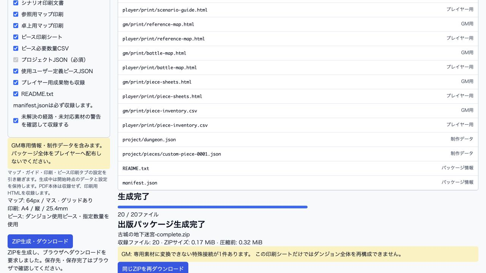
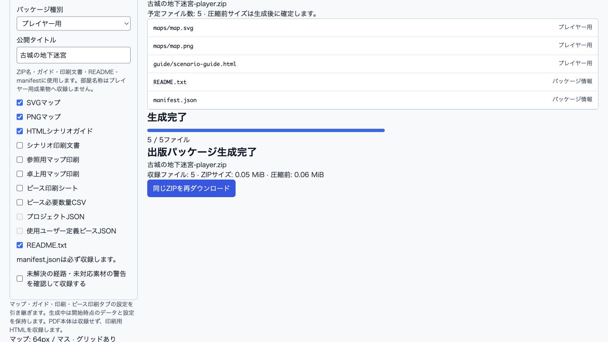

# ZIPパッケージ・一括出版

## 操作

1. 編集画面の「出版」から出版ウィンドウを開き、「一括出版」を選ぶ。
2. プレイヤー用／GM用／完全版を選び、配布してよい「公開タイトル」を入力する。
3. 収録する成果物、README、GM／完全版にプレイヤー用も含めるかを選ぶ。
4. 収録予定のパス、公開範囲、予定ファイル数を確認する。
5. 必要なら各タブでマップ・ガイド・用紙・ピース印刷数量を調整する。タブを移動してもパッケージの選択とピース印刷設定を保持する。
6. 「ZIP生成・ダウンロード」で生成する。警告やエラーの場合は原因と対象パスを確認し、設定を修正して再実行する。

公開タイトルの初期値は「ダンジョン出版物」。元プロジェクト名に秘密が含まれる場合があるため、自動でコピーしない。ZIP名、ガイド、印刷文書、README、manifestに同じ公開タイトルを使用する。復元用JSON内の元プロジェクト名は維持する。

GM用／完全版はGM専用情報・制作データを含むため、パッケージ全体をプレイヤーへ配布しない。プレイヤー用成果物は部屋名称を常に除外する。部屋番号・公開説明は既存の公開仕様に従う。部屋単位の秘匿設定は追加していない。



## 設定・計画・成果物

| 層 | ファイルと責務 |
| --- | --- |
| PackageProfile／Plan | `src/publishing/package/packagePlan.ts` — 種別、公開タイトル、収録種別、Player併録、README、固定パス、制限、参照ピース |
| Artifact Generator | `artifactGenerator.ts` — 既存のSVG／PNG／ガイド／印刷／ピース／JSON生成処理を呼ぶ |
| Validator／CSV／メタデータ | `packageFiles.ts` — 計画と成果物の整合、公開範囲、容量、CSV、README、manifest |
| ZIP Builder | `zipBuilder.ts` — 成果物のバイト列だけをZIP化。描画・Routing・ダウンロードを行わない |
| Build Controller | `buildPackage.ts` — 入力の確定、順次生成、進捗、キャンセル、多重実行防止 |
| UI／ダウンロード | `src/components/publishing/PackagePanel.tsx` — 収録計画、警告、進捗、結果、既存downloadBlob |

PackageProfileは`kind`、`title`、`artifacts`、`includePlayerArtifacts`、`includeReadme`を持つ。マップ・ガイド・印刷・ピースの設定は複製して独立管理せず、出版ウィンドウで共有する。ガイドの設定はPlayer／GM別に保持する。ピースの取得元・数量・取得済みライブラリ定義も親画面で保持し、個別印刷と一括出版で共有する。

PackagePlanはReact非依存。選択種別を固定の順序で走査し、公開範囲、パス、必須フラグ、生成順を確定する。CompleteのJSONと全種別のmanifestは必須。ユーザーが選択した成果物も、生成失敗時に省略できない必須成果物として扱う。未選択のファイルや空ディレクトリは作らない。

PackageArtifactは計画の識別情報にMIME Type、Uint8Array、実バイト数を加えた一時データ。生成中に個別ファイルをダウンロードせず、すべて検証できてからZIPを1つダウンロードする。

## 初期構成とディレクトリ

| 種別 | 初期収録内容 |
| --- | --- |
| Player | SVG、PNG、HTMLガイド、README、manifest |
| GM | GM用SVG、PNG、HTMLガイド、シナリオ印刷HTML、数量CSV、README、manifest |
| Complete | GM／Player双方のマップ・ガイド・印刷HTML・ピースシート・数量CSV、プロジェクトJSON、README、manifest |

Playerは`maps/`、`guide/`、`print/`直下。GM／Completeは公開範囲ごとに`gm/`、`player/`で分ける。GMのPlayer併録は初期オフ、Completeは初期オン。制作データは`project/dungeon.json`。任意の使用ユーザー定義ピースは`project/pieces/custom-piece-0001.json`のような固定連番。

```text
古城の地下迷宮-complete.zip
├── README.txt
├── manifest.json
├── gm/
│   ├── maps/map.svg, map.png
│   ├── guide/scenario-guide.html
│   └── print/scenario-guide.html, reference-map.html, battle-map.html,
│             piece-sheets.html, piece-inventory.csv
├── player/  （同じ公開用ディレクトリ構成）
└── project/
    ├── dungeon.json
    └── pieces/custom-piece-0001.json  （選択時のみ）
```

ライブラリ全体を収録しない。スナップショット内で参照されるユーザー定義PieceだけをPiece ID順に抽出する。元Piece／Connector IDはJSON内部で維持し、名前やIDをファイルパスへ使わない。同じPiece IDの物理定義が矛盾する場合は停止する。個別JSONを選択しなくても、使用ピース定義は従来どおりDungeon JSON内に含まれる。

## 同一スナップショットと生成処理の再利用

開始時、最初の非同期待機より前にDungeonDocument・PackageProfile・全設定・選択済みライブラリ・数量をコピーする。以後はRepositoryや編集ストアを読み直さない。生成中に編集画面が変わっても、実行中の成果物へ反映しない。

既存Exporterはすでに生成とダウンロードが分離されているため、描画エンジンの作り直しは不要だった。次をそのまま利用する。

- `buildPublishDocument`／`buildPublishMapGeometry`／`renderPublishSvg`／`svgToPng`
- `buildScenarioPublishDocument`／`buildScenarioGuide`／`renderScenarioMap`／`createScenarioHtmlRenderer`
- `buildPrintLayout`／`renderMapPrintDocument`／`renderScenarioPrintDocument`
- Piece Inventory、選択数量、既存面付け、`renderPieceSheetDocument`
- `buildExportEnvelope`／`parseImport`／`buildPieceExport`

同じ実行内では公開範囲ごとにGeometry／Routing／CorridorNetwork、SVG、HTMLガイド、Piece Inventoryをキャッシュする。ガイド内の番号付きマップも既存処理を使い、物理形状を再Routingしない。印刷文書とピースシートは一度ずつ計算し、生成したHTMLをそのまま収録する。

Project JSONは既存のExportEnvelope形式・スキーマ1.2.0。既存Importの検証も通してから収録する。独自の復元形式、ZIP全体からのImport、直接PDF生成は追加しない。ZIP生成中にwindow.printや印刷ダイアログを呼ばない。

## 公開範囲・CSV・メタデータ

Player PackageはPlanとValidatorでもGM／project成果物を拒否する。成果物の種類・生成元・公開対象・固定パスの整合を検証し、単純な秘密文字列検索に依存しない。Playerだけの実行ではGM側Generatorを呼ばない。

Playerの通路はsecretを除外したPublishDocumentから生成・集計する。部屋名称を有効にしたGM用の表示設定でも、Player成果物へ部屋名称を引き継がない。GMメモ、全体Markdown、タグ、元接続ID、完全なPiece定義やDungeonDocumentをPlayer ZIPへ埋め込まない。ライブラリ選択素材もPlayer用は汎用番号・公開形状へ射影し、secret接続口や元名称を除外する。

CSVはUTF-8 BOM、CRLF、全フィールドを引用し、引用符は二重化する。カンマ・引用符・改行を保持し、先頭の空白・制御文字を考慮した数式の始まり、タブ・改行始まりにはアポストロフィを加える。列は`piece_id,name,category,required_quantity,print_quantity`。Playerは元Piece IDではなくR／M／O／Cの公開素材番号を使う。必要数と手動指定の印刷数を混同しない。

manifestはスキーマ1.0.0、パッケージ種別、公開タイトル、生成日時、ファイルの相対パス・MIME・公開範囲・実バイト数を持つ。自身はfilesへ含めず、READMEを含む他の全ファイルと一致させる。READMEの公開範囲は`package`。明示的に許可した不完全な経路・素材の警告もREADME／manifestへ残す。READMEの利用案内は実際に収録された種類から作り、未収録のPNG／CSV／JSON等を案内しない。

## 検証・エラー・安全なパス

成果物生成後にPlanへの所属、種類・公開範囲・MIME・ID・パスの一致、必須ファイルの充足、安全な相対パス、重複、不正な空ファイル、実バイト数、容量、SVG／HTML／PNG／JSONの形式を検証する。README／manifest追加後も再検証し、manifestの一覧と全実ファイルを照合してから圧縮する。

絶対パス、親参照、ドライブレター、バックスラッシュ、空区間、制御文字、不正文字、末尾ドット・空白、Windows予約名を拒否する。NFCと小文字化したキーで重複も検出する。実際の収録パスは固定値・連番なので、日本語名や悪意のあるPiece IDがパスへ入らない。ZIP名は既存のファイル名正規化を再利用し、末尾にplayer／gm／completeを付ける。

どれか1つでも生成に失敗するとZIP生成を中止する。対象パス・成果物の種類・原因を画面へ表示し、無断で省略しない。未解決の経路・未対応の特殊接続・自動通路除外は、警告を確認して収録する選択が必要。数量不足は既存方針に従って警告し、明示的な手動数量を許可する。未配置・不正な用紙・数量・容量超過は許可で解除できない。

## 圧縮・進捗・キャンセル

追加依存は[fflate 0.8.3](https://github.com/101arrowz/fflate)のみ。ブラウザ・TypeScript・UTF-8名・ストリーミングZIP・非同期圧縮を扱えるMITライセンスのライブラリとして採用した。ZIP形式は独自実装しない。

テキストはAsyncZipDeflateのレベル6、PNGはZipPassThroughで再圧縮しない。素材生成も圧縮も1ファイルずつ処理し、次のファイルへ進む前に非同期ストリームの完了を待つ。圧縮ワーカーは各ファイルの終了時に解放する。ZIP Builderは描画処理を知らず、将来PDF等のバイト列を追加してもアーカイブ化を変更する必要はない。

準備・成果物生成・検証・圧縮・完了を通知し、現在のパスと完了数／総数を表示する。圧縮率の進捗は取得せず不定進捗を使用する。同期処理の間にはイベントループへ制御を返す。実行中は設定と他タブへの操作を無効にし、Controllerでも多重実行を拒否する。

AbortSignalを各生成処理の前後・ZIP前・ダウンロード前で検査する。PNGなどの既存処理中は終了後の境界で止まり、圧縮中はZIPストリームとワーカーを終了する。キャンセルは通常操作として表示し、ダウンロードを行わず中間データを解放する。ページ終了時も中止する。成功・失敗・キャンセル後は再実行できる。成功時はZIP Blobの実サイズを表示し、「ブラウザへダウンロードを要求した」と案内する。ユーザーによる保存完了とは区別する。

## 制限

| 対象 | 上限 |
| --- | --- |
| 収録ファイル | README／manifestを含め64個 |
| 個別ファイル | 32MiB |
| 圧縮前総バイト数 | 96MiB |
| ZIP実サイズ | 100MiB |
| PNG総画素数 | 33,554,432画素。各画像は既存の一辺8,192px・16,777,216画素も適用 |
| 印刷マップ・ピースシート | 各レイアウト100ページ、パッケージ全体200ページ |
| ピース数量 | 既存の256種類・各500枚・合計1,000枚 |
| HTML | ガイド8MiB、印刷16MiBの既存制限も適用 |
| 部屋床 | マップ／通路集計32,768セル |
| 同時生成／圧縮 | それぞれ1ファイル |

シナリオ印刷の実ページ数はブラウザの組版で決まり、事前の200ページ集計へは含めない。ガイドの文字数・HTML容量で制限する。入力スナップショット・成果物・ZIPはメモリ上で保持するため、ディスクへ直接流す大容量バックアップ用途は対象外。

## 検証結果

- `npm test`: 全387件成功（既存350件＋パッケージ37件）。build／lint成功。既存のメインバンドル容量警告は継続。
- 初期設定、選択・計画順序、Complete必須JSON、PlayerへのGM／project混入拒否、固定パス、参照customだけの抽出、危険なパス・大文字小文字の衝突、CSV引用・数式防止、必須欠落・形式・容量・ファイル数を検査。
- 本物のZIPを生成・展開し、日本語パス、テキスト、PNG、元バッファ不変、全Player成果物の秘密情報除外、既存SVG／ピースHTMLとの一致、manifestの全ファイル一致、Project／Piece JSON復元を検査。
- 開始直後に元データと設定を変更しても実行中の出力が変わらないこと、全進捗段階、生成境界・圧縮中のキャンセル、キャンセル中のPNGエラー、多重実行、PNG／ZIP失敗後の再実行、未解決経路・未配置・不正余白・パッケージ合計ページ数を検査。
- Repository、元Document、履歴、JSONスキーマが変わらないことを確認。既存の個別SVG／PNG／ガイド／印刷／ピース機能のテストも維持。
- 実画面で5部屋・4接続・回転したユーザー定義ピース・共有十字路・隠し通路・公開説明・GMメモ・全体Markdownを使い、Player／GM／Completeのダウンロードを確認。
- ピース印刷の標準部屋の印刷数を必要4→5へ増やし、CSVとシートへ引き継がれることを確認。100mm指定による未配置時のZIP停止、25.4mmへ戻して修正できること、GMの特殊接続警告と許可後の再実行、Completeの必須JSONを解除できないことを確認。
- 保存された実ZIPをPython標準zipfileで独立に展開し、CRC、収録パス、全ファイルサイズ、Playerの秘密識別文字列除外、CSV必要4／印刷5、PNG署名・1434×1242pxを確認。展開PNGも目視確認。

| 実画面で生成した構成 | ファイル数 | ZIP実バイト数 | 圧縮前バイト数 |
| --- | --- | --- | --- |
| Player＋卓上マップ・ピースシート・CSV | 8 | 56,128 | 106,093 |
| GM初期構成・特殊接続警告を許可 | 7 | 104,207 | 134,118 |
| Complete初期構成＋参照custom JSON | 20 | 179,570 | 339,130 |

生成日時などでサイズは変わり得る。展開後のPlayer印刷HTMLは卓上マップ12ページ、ピースシート3ページ・24枚、参照用マップ1ページ。SVGのuse参照がすべて解決し、外部画像・スクリプト・スタイルシートが不要であることをDOM解析した。完全版の実JSONは既存`parseImport`／`parsePieceImport`を通し、5部屋・4接続・礼拝堂Piece・GMメモ・全体Markdownの復元を確認した。

実画面の小規模ZIPは短時間で完了したため、途中のキャンセル操作は完了前に実行できなかった。キャンセルと失敗後の復帰は自動テストで確認している。ブラウザUIからのファイル再Importと展開HTMLの直接オープンは未実施であり、既存Import関数・独立展開・DOM検査による検証と区別する。PDF保存・実機印刷・紙上の物理寸法は今回の検証対象にしていない。



## 永続化・対象外・今後

PackageProfile、Plan、Artifact、進捗、manifest、中間バイト列、ZIPを保存しない。IndexedDB、保存形式、Undo / Redoへ変更しない。出版時の強制保存、Piece更新、部屋情報・Connection変更を行わない。

直接PDF、ZIP Import、ライブラリ全体のバックアップ、暗号化、署名、オンライン配布、クラウド連携、出版履歴、VTT、Entity／Encounterは追加していない。今後は新しいExporterをArtifactとして接続し、必要なら大規模データのストリーミング保存や実PDF収録を検討する。
