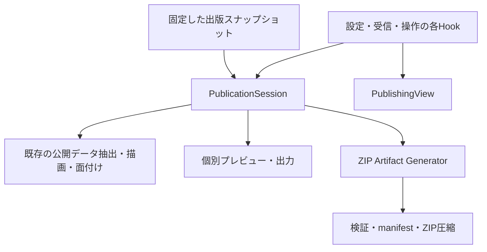
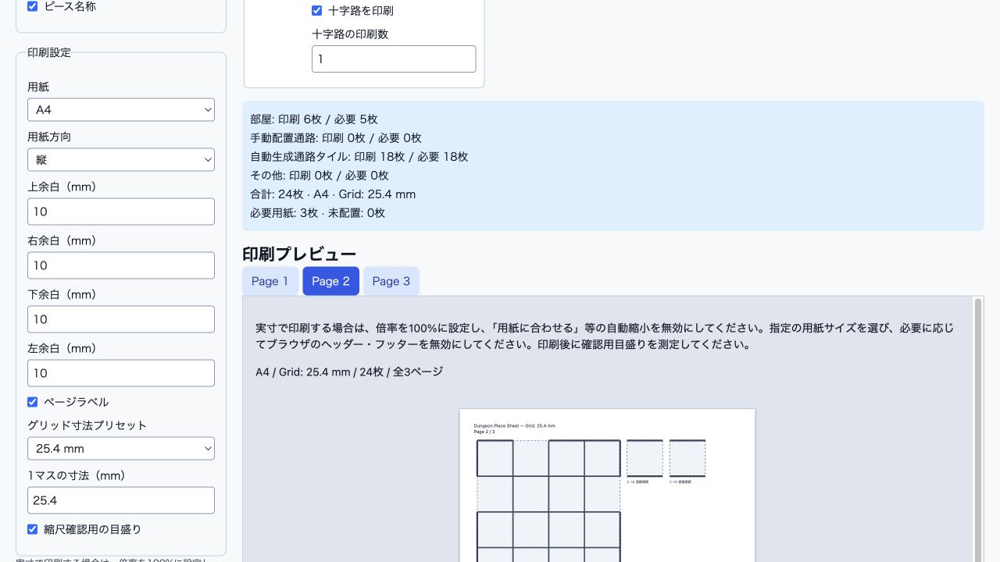

# 出版処理の共通化・画面責務の分離

## 対応範囲

優先度「高」とした次の3点を整理した。

1. 個別出力とZIP出力の、データ準備・キャッシュ・生成処理を共通化する。
2. 出版画面から設定管理、スナップショット受信、プレビュー、非同期操作を切り出す。
3. 警告・配置エラーの判定を表示文言から独立させる。

保存形式、DB、Undo / Redo、経路探索、面付けアルゴリズム、ZIP内部のパス・スキーマは変更していない。依存ライブラリの追加もない。初期読み込みの分割や、ピースシートのページ変更時における全HTML再生成の最適化は今回の対象外。

## 構成

| ファイル | 責務 |
| --- | --- |
| `src/publishing/publicationSession.ts` | 固定スナップショットから公開対象別のGeometry、マップ、ガイド、印刷文書、素材一覧、数量を生成・再利用 |
| `src/publishing/publicationIssues.ts` | 安定した問題コード、表示文言、重要度、確認要否、部分プレビュー可否 |
| `src/components/publishing/usePublicationSettings.ts` | 設定とタブ状態、公開対象別ガイド設定、スナップショット更新時のリセット |
| `usePublicationSnapshot.ts` | BroadcastChannel、初回受信待機、更新世代、購読の解放 |
| `usePublicationOutput.ts` | 共通サービスの結果を現在のプレビューへ接続、Blob URLの管理 |
| `usePublicationActions.ts` | 非同期処理の排他、エラー・通知、古い結果の破棄、印刷ウィンドウの寿命 |
| `usePublicationController.ts` | 各Hookと表示・操作を接続する |
| `PublishingWorkspace.tsx` | Controllerを組み立て、表示用のPublishingViewへ渡す。表示部分は85行のファイル内へ分離 |
| `PublishingWindow.tsx` | 出版用CSSと遅延読み込みの入口を維持する薄いラッパー |

ZIPの実行制御、容量・ページ数の合算、メタデータ、圧縮は従来どおりpackage層に残す。共通サービスへZIP固有の処理やダウンロード処理を入れていない。

## 共通生成処理

PublicationSessionは受け取ったスナップショットをコピーして保持する。元Documentの変更を実行中の生成物へ反映しない。Geometry／Routing／CorridorNetworkは公開対象ごとに一度だけ生成し、用紙・描画設定・数量の変更では再Routingしない。

マップ、ガイド、印刷用マップは公開対象ごとに直近の結果を保持する。設定変更の履歴を無制限にキャッシュしない。ガイドは説明の出力設定だけを変更しても、番号・名称・描画設定が同じならマップを再利用する。マップなしのガイドはGeometryを生成しない。

素材一覧と数量調整後の一覧を分けて保持する。数量が不正でも元の素材一覧は維持し、入力欄を消さず修正できる。個別ピース印刷とZIPは同じ`preparePieceSheet`からLayout・問題一覧・HTMLを取得する。面付け結果の独立検証と、Rendererでの出力直前の検査は維持する。

## 公開範囲の維持

次の仕様差を意図的に残す。

- 個別マップ・ガイドでは、ユーザーが明示した名称表示を利用できる。
- Player ZIPでは部屋名称を常に除外する。GM設定からPlayer成果物を生成しても、この制約を優先する。
- ライブラリの個別印刷は汎用テンプレートの名称を利用できる。Player ZIPへ収録する素材は公開番号・公開形状へ射影する。

個別／パッケージのポリシーを呼び出し時に明示し、共通化によってこれらの差を消していない。secret Connectionは既存の公開データ抽出段階で除外する。

## 問題コード

Piece Inventoryと面付け検証は、文字列配列の代わりに`PublicationIssue[]`を返す。各問題は`code`、`severity`、`message`、必要に応じて`count`を持つ。

例は`unresolved-connections`、`unsupported-connections`、`excluded-corridors`、`insufficient-quantity`、`unplaced-pieces`、`layout-overlap`、`layout-dimensions`等。

未配置のみなら部分プレビューを許可し、完全HTMLの出力は停止する。重なりや寸法不正等があれば部分プレビューも停止する。この判断は問題コードで行い、「未配置の素材」で始まるかどうかには依存しない。警告の確認要否もコードで判断する。

表示・README・manifestでは従来の文言へ変換する。ZIPの既存manifestに含めるwarningsの形式は文字列配列のまま維持する。文字列は表示・書き出しのためにのみ使い、判定には使わない。既存の入力検証や外部APIの例外は表示用Errorとして扱い、すべてを無理に共通コードへ置き換えてはいない。

## 画面と非同期処理

Reactの設定管理と副作用を分離し、CSSなしでも実際の出版画面をJSDOMへ描画できる構成にした。製品側では従来どおり同じCSSと遅延読み込みを使う。テスト専用に画面を複製していない。

非同期PNG処理は、開始時の受信世代と現在の世代を比較する。更新前の結果をダウンロードしない。更新前の処理が後から失敗した場合も、その古いエラーで新しい画面を上書きしない。成功・失敗後の操作復帰、印刷中の二重実行防止、画面終了時の印刷ウィンドウ解放をまとめて管理する。

## 検証

- `npm test`: 全403件成功。既存387件に、画面操作9件・共通生成処理7件を追加した。
- `npm run build` / `npm run lint`: 成功。既存のメインバンドル容量警告は継続している。
- リファクタリング前の`abc7816`からコードを独立した一時ディレクトリへ展開し、固定入力・固定時刻で16成果物のSHA-256を取得した。現行コードから期待値を作り直す比較にはしていない。
- `tests/fixtures/publication-baseline.json`と照合し、GM／PlayerのSVG、ガイド、シナリオ印刷、参照・卓上マップ、ピースシート、数量CSV、Project／Piece JSONの16ファイルがバイト単位で一致する。
- 共通サービスの固定スナップショット、公開対象ごとのRouting回数、直近結果のキャッシュ、説明設定変更時のマップ再利用、マップなしのガイド、個別名称の明示表示とPlayer ZIP除外の仕様差を検査した。
- 表示文言を変更しても、未配置プレビューの許可と、重なりの停止・警告確認の判定が変わらないことを検査した。
- React画面を描画して、タブ移動後の数量・用紙・パッケージ設定、GM／Playerガイド設定、スナップショット更新、不正数量の修正、キャンセル後の再実行を確認した。
- 非同期PNGの古い結果・エラーの破棄、失敗後の再試行、印刷中の重複防止・表示HTMLの引き渡し・終了時の解放を画面操作から検査した。印刷APIにはテスト用の代替実装を使用した。

実ブラウザでは保存済み5部屋・4接続の検証データを利用し、マップ、GM／Playerガイド、印刷用HTML、ピース数量の空入力と修正、ページ選択、タブ間の設定維持、警告確認後のZIP生成を確認した。

同じ設定で生成したPlayer ZIPをPython標準zipfileで展開し、前回の実ブラウザ出力から保存した7ファイル（SVG、PNG、ガイドHTML、卓上マップHTML、ピースシートHTML、CSV、README）とバイト単位で一致した。manifestは生成日時を含むため同一バイト列の比較から外し、ファイル一覧と実バイト数を検証した。Player ZIPの秘密情報識別文字列が除外されていることと、完全版19ファイルのCRC・manifest整合も確認した。

ネイティブ印刷ダイアログ、実PDF保存・実測、ブラウザUIからのファイル再Importは今回実行していない。既存の環境制限は維持し、印刷の呼び出し・後処理とJSON互換性は自動テストで検証した。

