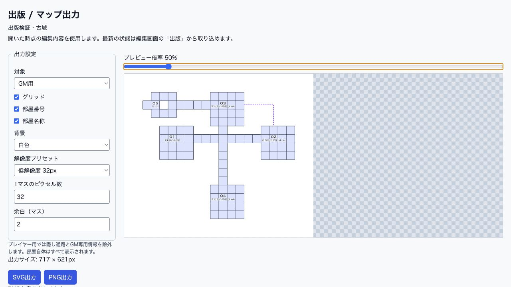
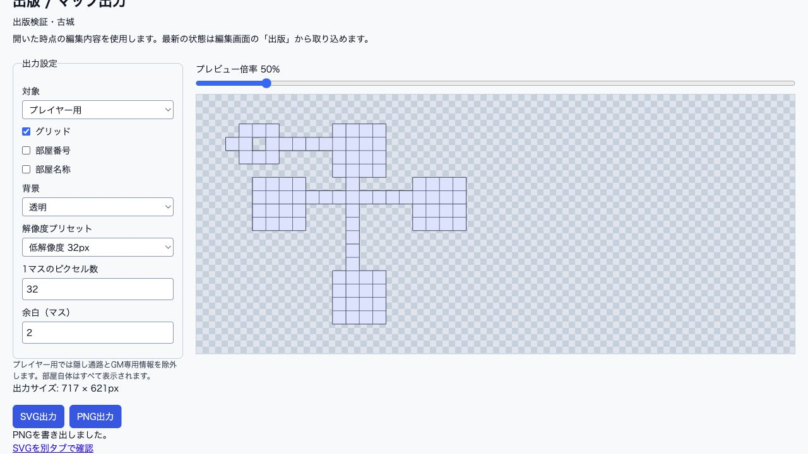

# 出版システム基盤・マップ出力

## 操作

1. メインエディタで部屋・接続を編集する。部屋情報の入力欄は「部屋情報を適用」で確定する。
2. ツールバーの「出版」を押す。現在のDungeonDocumentと配置時のPiece定義を別ウィンドウへ渡す。保存操作は不要。
3. 対象を「プレイヤー用」または「GM用」にし、グリッド・部屋番号・部屋名称・背景・解像度・余白を指定する。
4. プレビューで内容を確認し、「SVG出力」または「PNG出力」でダウンロードする。
5. 編集画面の変更を取り込む場合は、編集画面で再度「出版」を押す。同じ出版画面を更新する。

出版画面を開いた後の変更は自動同期しない。プレビュー倍率は出力解像度と独立している。
ポップアップがブロックされた場合は編集画面にエラーを表示する。取得元の編集画面を閉じた後に出版画面だけを再読み込みすると再取得できないため、編集画面から開き直す。





## データと責務

```text
現在のDungeonDocument（Pieceスナップショットを内包）
  → メモリ上のPublish Snapshot
  → buildPublishDocument(audience)
  → PublishDocument
  → buildPublishMapGeometry（既存のRouting / CorridorNetwork）
  → renderPublishSvg(profile)
  → 同じSVGのプレビュー / SVGダウンロード / Canvas経由PNG
```

- `PublishProfile`: audience、showGrid、showRoomNumbers、showRoomNames、background、pixelsPerCell、paddingCells。
- 初期値: player、グリッドあり、番号・名称なし、白背景、64px/セル、余白2セル。GMへ切り替えると番号・名称を初期表示する。
- `PublishDocument`: audience、部屋の物理形状・配置・公開ラベル、出力対象Connectionのみ。将来のガイドに必要な説明等は、その出力先専用のallowlistを追加する。
- `PublishMapGeometry`: 部屋セル・床／グリッド／壁のパス、ConnectionScene、統合通路、特殊接続／警告の描画要素、未解決件数。
- 出版の設定・スナップショット・派生形状・SVG・PNGをRepositoryやIndexedDBに保存しない。元データ・Markdown・Undo/Redo・Piece Repositoryは変更しない。JSONスキーマは1.2.0のまま。
- 通信には起動元ウィンドウごとのランダムtokenとdungeonIdを用いたBroadcastChannelを使用。双方の識別子と返却DocumentのIDを確認する。URLに元データを埋め込まない。
- 起動時にstructuredCloneした固定状態を保持する。再度「出版」を押した場合だけ置き換える。PNG変換中に新しいスナップショットが届いた場合、古い変換結果はダウンロードしない。

## 公開情報の分離

プレイヤー用では`secret` Connectionを抽出時点で除外し、その後に経路探索・通路生成・合流処理を実行する。GM用SVGを隠す方式ではない。

抽出には明示的な項目一覧を使い、両対象ともグローバルMarkdown・GMメモ・公開説明・タグ・保存日時・元のIDを持ち込まない。元のIDは参照関係を保つ出版専用IDへ置き換える。使用しない接続口は削除し、接続口のkindも描画に不要なためopenへ正規化する。Piece名は公開名称のフォールバックにのみ使用し、定義のnameは空文字にする。

番号・名称をオフにしたラベルの文字列はSVGに出力しない。ラベルのtitle・data属性も出版時は付けない。文字列はReactによってXMLエスケープされる。元Document、非表示の秘密要素、CSSによる隠蔽、コメント、JavaScript、外部CSS・画像をSVGへ埋め込まない。

すべての部屋と手動通路Pieceは両対象に含む。部屋そのものの秘匿は対象外。番号・名称をプレイヤー用で有効にした場合は、その文字列を公開する。既存JSON ExportはGM情報を含む完全なプロジェクトファイルであり、配布用マップとは用途が異なる。

## 共通化と描画

- 既存のgetWorldCells / getWorldConnectors、ConnectionScene Resolver、OccupancyGrid、Router、CorridorGeometry、CorridorNetworkを利用する。経路探索の別実装は作らない。
- `cellShapes`へ既存CorridorRendererの床・グリッド・壁の形状生成を抽出し、エディタと出版で共有する。部屋のセルにも同じ処理を使用する。
- 部屋は占有セル間の境界を内部グリッド、外周を壁として分離する。成功した通常通路の接続口のみ開口し、グリッド非表示でも外周壁を維持する。
- 共有通路は既存の方向マスク統合結果を描画する。壁とグリッドの同一辺は重複排除する。隣接するだけの通路に開口を追加しない。
- 部屋ラベルは既存RoomLabel / roomLabelLayoutを再利用。実際の床セル内に水平表示し、長い文字列は既存と同じ幅調整を行う。
- レイヤー順は背景、通路床、部屋床、内部グリッド、壁、特殊接続、ラベル。door / stairsは既存と同じ線、secretは紫色の破線を維持する。
- 出版画面は遅延読み込みする。スナップショット×対象ごとにDocumentとGeometryをキャッシュし、表示設定や倍率の変更で経路探索を再実行しない。SVG文字列も再利用する。

## 範囲・SVG・PNG

範囲は出力対象の実セルと描画される特殊接続・警告線から計算する。負座標・回転・自由形状・画面外の部屋にも対応し、編集画面のパン・ズーム・選択状態を参照しない。隠し通路の線はプレイヤー用の範囲へ影響しないが、接続先の部屋は含む。

指定余白に加えて0.2セルの描画余裕を設け、壁・ラベルの縁取り・直接接続の記号を切らない。空マップは1×1セル相当を基準とする。SVG内部は既存の40単位/セル、出力width/heightはセル範囲×pixelsPerCellの切り上げ値とし、viewBoxで結び付ける。

SVGは名前空間・viewBox・width/height・描画属性を含む独立ファイル。ファイル名は使用不可文字・制御文字を置換し、名前を80文字までにして`-gm` / `-player`を付ける。空名はdungeonを使用する。

PNGはプレビューと同じSVGをImageへ読み込み、Canvasに描いてtoBlobする。フォントの準備を待ち、日本語ラベルを維持する。白背景ではSVG外縁のアンチエイリアスによる薄い透明画素を避けるため、Canvasも白で塗ってから合成する。透明背景はCanvasを塗らず透過を維持する。

画像読み込み・Canvas取得・描画・toBlob失敗を画面へ表示する。成功・失敗の両方でオブジェクトURLを解放し、Canvas寸法を0へ戻す。フォント待機・画像読み込み・PNG変換は各15秒で打ち切る。二重クリックによる並行出力を防止し、プレビューと生成PNGへの参照も不要になった時点で解放する。

## 制限

| 項目 | 上限・初期値 |
| --- | --- |
| pixelsPerCell | 整数1〜512px、初期64px、32/64/128pxプリセット |
| paddingCells | 有限値0〜100、初期2 |
| PNGの一辺 | 8,192px |
| PNGの合計画素数 | 16,777,216（RGBA Canvas約64MiB相当。SVGデコード等は別途必要） |
| PNGの待機時間 | フォント・画像読込・toBlobそれぞれ15秒 |
| 部屋の配置座標 | 各軸±1,000,000以内の安全な整数 |
| 通路生成 | 既存と同じ1接続4,096セル・全体16,384セル、既存探索上限を継承 |

PNG上限はCanvas確保前に判定する。超過時は解像度・余白の変更を案内し、SVG出力は利用可能。ブラウザの利用可能メモリ等によっては上限内でも生成に失敗するため、SVGを代替として利用できる。

Piece定義・参照・回転・配置や公開Connectionの参照が不正な場合はエラーとし、不完全な成果物を出力しない。公開対象に未解決経路がある場合、件数を警告し、明示的な継続チェック後に出力できる。失敗経路を正常な床や開口にしない。GMには既存と同じ警告線、プレイヤーには警告線を描かない。除外したsecretの失敗件数もプレイヤー用には持ち込まない。

## 検証

`npm test`: 251件成功（既存226件＋出版25件）。`npm run build` / `npm run lint`: 成功。
既存のメインバンドル500kB超のビルド警告は継続。出版画面とSVG生成用ライブラリは別チャンクへ分離した。

追加テストは設定値の拒否、元データの不変性、秘密情報・元IDの除外、不正Piece参照、通常／秘密の交差・重複、T字・十字・曲がり角・共有区間、開口、隣接直接接続、経路失敗、回転・自由形状・負座標・空マップ・範囲、SVG構造・表示切替・XMLエスケープ、PNG寸法・画素上限・背景合成・失敗時後処理、通信識別子・固定スナップショット・明示更新、Repository・履歴・Markdown・JSON互換性を対象とする。PNGのブラウザAPIは単体テスト用の注入可能な環境で成功・失敗を検証する。

ブラウザでは通常通路の十字交差、隠し通路、番号・日本語名・GMメモ、回転したユーザー定義ピースと接続を用意した。未保存の起動、対象・グリッド・ラベル・背景・解像度の変更、SVG/PNGダウンロード、固定状態の保持と再取得、ズーム変更後の全体範囲、巨大PNGの無効化、未解決警告と継続チェック、Undo/Redo、保存・再読み込みを確認した。

ダウンロードしたSVGはXMLとして解析し、名前空間・寸法・viewBoxと秘密情報の不在を確認した。PNGはブラウザで生成したファイルを使用し、日本語ラベル・隠し通路表示と透明／白背景の寸法・画素を検証した。最終出力はいずれも717×621px。白背景は全画素のalpha=255、透明背景は余白のalpha=0・描画部分を含むalpha範囲0〜255であることを確認した。

SVGを別タブで開く操作は検証ブラウザのblob URL遷移制限により未確認。同じSVGの画像プレビューと、そのSVGから生成したPNGの表示・保存は確認済み。JSON Importのブラウザでのファイル選択は行わず、互換性は自動テストで確認している。

## 今後

日本語の字形は出力を生成・表示する環境のフォントに依存し、SVGへフォントを埋め込まない。長い名称は既存描画と同様に縮む。部屋単位の秘匿・Fog of War・シナリオガイド・PDF・印刷シート・ZIP・テーマ・画像素材・設定の永続化は今回の対象外。

将来のガイドは用途別の情報抽出を追加し、PDFは独立SVGとグリッド単位の範囲を再利用する。大規模マップの非同期化やメモリ使用量の改善は、現在の出力制限を維持して別途検討する。
