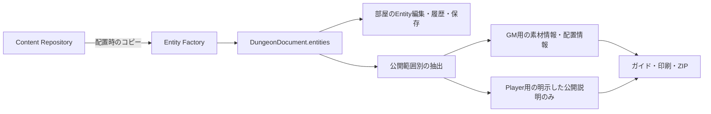
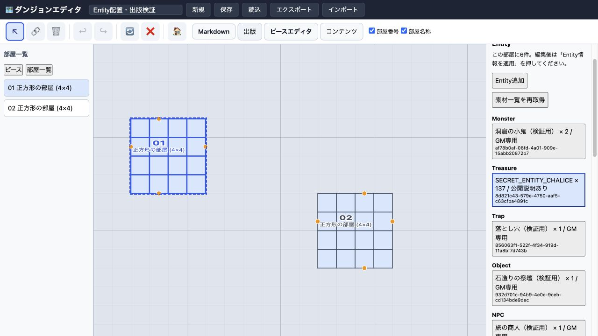
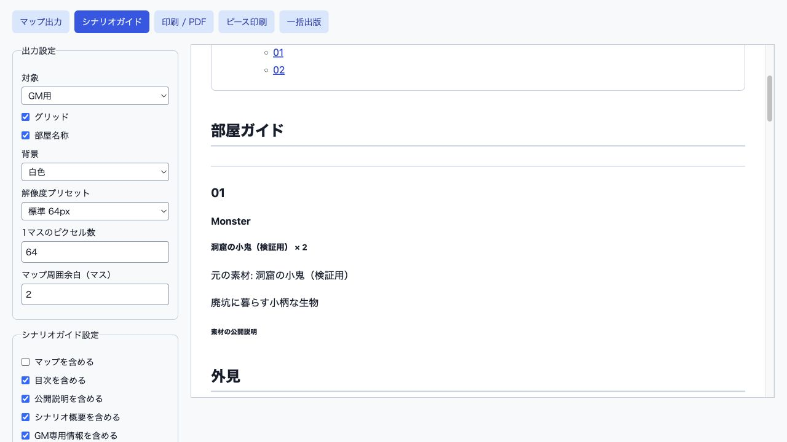

# 部屋へのEntity配置・関連付け MVP

## 構成と対応範囲

Content Libraryがマージされたmaster `99a20c7`を基点に実装した。既存のContentDefinition、Repository、ライブラリ更新通知、部屋情報、Storeと履歴、JSON検証、出版スナップショット、ガイド・印刷・ZIP生成、リファクタリングと遅延読み込みの資料を調査した。

Entityは部屋単位の関連付けで、個別の座標やトークンは持たない。ContentDefinitionへ数量や部屋情報を追加せず、DungeonDocumentの`entities`へ一度だけ保存する。Theme、Faction、Encounter、属性Override、戦闘状態、自動生成は先行実装していない。



| ファイル | 責務 |
| --- | --- |
| `src/model/entity.ts` | Entity型、検証、Factory、編集・複製・移動・削除・定義更新、件数・容量制限 |
| `src/store/dungeonStore.ts` | Entity Commandを1回の履歴として適用、部屋削除時の関連Entity削除 |
| `src/components/content/useContentLibrary.ts` | 読み取り用一覧取得・更新通知・フォーカス時の再取得 |
| `src/components/entities/RoomEntityPanel.tsx` | 部屋別・種別別一覧、非同期素材取得、操作、更新確認 |
| `ContentSelectionDialog.tsx` / `EntityEditor.tsx` | 検索・選択・数量入力、個別情報の適用、配置時点の素材確認 |
| `src/publishing/scenario/entityGuide.ts` | GMとPlayerのEntity情報をRendererへ渡す前に射影 |
| `scenarioHtmlRenderer.ts` | 射影済み情報のHTML化・Markdownサニタイズ・属性のエスケープ |

## モデルとスナップショット

```ts
type EntityVisibility = 'gm-only' | 'public';
interface EntityInstance {
  id: string;
  roomId: string;
  sourceContentId: string;
  contentSnapshot: ContentDefinition;
  quantity: number;
  customName: string;
  publicDescription: string;
  gmNotes: string;
  visibility: EntityVisibility;
}
```

種別は既存ContentKindを再利用し、contentSnapshotから取得する。スナップショットには元ID・作成／更新日時を含むContentDefinition全体を保持する。タグと属性も独立してコピーする。Snapshot専用の第二モデルやEntity用のRepositoryは追加していない。

`createEntityInstance(roomId, content, rooms, quantity = 1)`が部屋の存在と素材を検証し、uuidで新規Entity IDを作る。初期値は個別名称・配置説明・配置GM情報が空、公開範囲は`gm-only`。同じContent IDでも追加ごとに別Entityとし、数量を統合しない。

ライブラリを編集・削除してもスナップショットは自動更新しない。素材が存在しない場合も配置済み定義だけで編集・保存・復元・出版できる。素材の再取得は追加操作と明示的な更新時に限る。

## 操作方法

1. 部屋を選択し、右パネルの「Entity」を開く。
2. 「Entity追加」で素材一覧を開き、名称・概要・タグ検索と種別フィルターから素材を選ぶ。数量を入力して「部屋へ追加」を押す。
3. 種別別の一覧からEntityを選び、個別名称・数量・公開範囲・配置の公開説明／GM専用情報を入力する。
4. 「Entity情報を適用」でまとめて確定する。未適用の入力がある間は他Entityの選択や複製・移動・削除を止め、「未適用のEntity変更を破棄」から保存済み値へ戻せる。
5. 「配置時点の素材を確認」で元の名称・説明・GM情報・タグ・属性・更新日時を読み取り専用で確認する。
6. 「Entityを複製」は新IDのコピーを同じ部屋へ追加する。「別の部屋へ移動」はEntity IDを維持してroomIdだけを変える。「Entityを削除」はDungeon内の配置だけを削除する。
7. 最新版が必要な場合は「ライブラリの最新版を反映」を押し、確認画面で「更新を確定」を選ぶ。

定義更新時は、元IDと種別が一致する現在の素材を再取得する。種別が異なる場合は更新を拒否し、素材が削除済みなら更新ボタンを無効にする。変更するのはcontentSnapshotだけで、Entity ID・roomId・数量・個別名称・配置情報・公開範囲は維持する。

既存の部屋情報入力は「基本情報」に残し、タブ切り替えでは両方の入力状態を維持する。Connection選択時は従来の接続プロパティを表示する。素材選択は読み取り専用で、Content Editorの編集機能を複製していない。

## 履歴・物理配置との分離

`changeEntities(command)`へ操作を渡し、純粋な`applyEntityCommand`で次のEntity一覧を構築する。追加・編集・複製・移動・削除・定義更新はそれぞれ1回のUndo / Redoになる。文字入力中は履歴を増やさず、適用時にまとめる。不正入力と同じ部屋への移動等の変更なし操作は履歴を作らない。

Entity変更時は部屋配列とConnection配列を維持する。既存の物理配置に基づくScene Resolverは、Entityの操作・Undo / Redoで同じ結果を再利用する。Entityを占有グリッド・Routing・A*・CorridorNetworkの障害物やマップ描画へ追加しない。

部屋の移動・回転・番号変更はEntityへ影響しない。部屋削除は所属Entityと関連Connectionを同じ操作で削除し、Undoで一緒に戻す。既存コードに部屋複製操作はないため、今回新しい部屋複製UIは追加していない。Entity単体の複製には対応する。

## 永続化とJSON 1.3

Entityは既存Dungeon RepositoryからDungeonDocumentの一部として保存する。DBは既存のバージョン2を継続し、EntityテーブルやDBスキーマの追加は不要。

JSONは`trpg-dungeon-generator`のスキーマを`1.3.0`へ更新し、`dungeon.entities`へ完全なEntityとSnapshotを収録する。ライブラリ全体は収録しない。Import時もSnapshotをContent Repositoryへ登録・上書きしない。現行ImportはRoom IDを変換しないため、roomIdも元の値を維持する。

1.0 / 1.1 / 1.2の旧JSONと、Entity一覧を持たない旧DBレコードには空配列を補う。既存のRoom・Piece・Connector・ConnectionのID、部屋情報とMarkdownは維持する。新しい1.3 JSONを読む側には1.3対応版が必要。

Entityの検証はReact・DBへ依存しない。IDの存在・重複、部屋参照、Snapshotの妥当性・元ID一致、数量、公開範囲、文字列と容量を検査する。JSONの生テキストからは重複した属性キー等も拒否し、ファイルサイズを解析前に確認する。不正なEntityは、Piece登録やStoreへの反映前に拒否する。

メイン画面の保存は部屋・接続・Entityを同じトランザクションで更新し、保存済みMarkdownを維持する。Entityを持たない旧形式の部分保存が来た場合は、DB側のEntity一覧を保持して部屋参照を再検証する。部屋だけを消して孤立Entityを作る保存は拒否する。Markdownだけの部分保存もEntityを置き換えない。

## ウィンドウ間通知と非同期処理

既存のContent LibraryのBroadcastChannel通知を購読し、素材の追加・編集・削除を候補一覧へ反映する。フォーカスを戻したときと明示ボタンでも再取得できる。検索時は取得済み一覧を絞り込み、DBへアクセスしない。

通知では配置済みSnapshotやEntityの入力を上書きしない。一覧取得には世代を持たせ、古い結果を捨てる。素材の非同期取得後は、ダンジョン・選択部屋・パネルの寿命を確認し、閉じたパネルや別ダンジョンへ遅れて追加しない。取得失敗時はダイアログの選択・数量を残して再試行できる。

EntityパネルとMarkdownプレビューはEntityタブを初めて開くときに遅延読み込みする。通常画面の起動時にプレビュー用Markdownライブラリを追加読み込みしない。

## ガイド・公開範囲・印刷・ZIP

出力はPublish SnapshotのEntityとSnapshotだけを使う。RendererやExporterからContent Repositoryを呼ばない。

GM用は全EntityをContentKind順に分類し、表示名・数量・素材の概要／説明／GM情報・タグ・属性・配置固有の説明／GM情報を表示する。個別名称が空なら素材名を管理表示に利用する。元の素材と配置情報には別の見出しを付ける。

Player用は`visibility === 'public'`かつ空でない`publicDescription`だけを抽出する。出力用の部屋情報へは公開説明の文字列配列しか渡さない。Entity ID、sourceContentId、Snapshot、customName、元名称、数量、種別、概要、タグ、属性、GM情報を含めない。空項目や秘密Entityの見出し・data属性・コメントも作らない。Renderer側でもPlayer文書にGM Entity群を描画しない。

既存設定の「公開説明を含める」をオフにすると、配置と素材の公開説明も除外する。「GM専用情報を含める」は素材と配置のGM情報にも適用する。GMの名称・数量・概要・タグ・属性は引き続き管理情報として出力する。

既存のmarked / DOMPurifyによる出版用サニタイズを使い、外部画像・script・iframe・イベントハンドラ・危険なURL等を除去する。名称・タグ・任意属性はHTMLエスケープし、属性値を式やコードとして評価しない。ガイド全体の文字数・HTML容量制限も維持する。

個別ガイドとシナリオ印刷、GM / Player / Complete ZIPは同じ抽出・Rendererを使う。Entityのある部屋を短文用の改ページ禁止ブロックにせず、長い素材情報を印刷時に分割できる。Completeの`project/dungeon.json`はEntityとSnapshotを保持する。マップ・PNG・参照／卓上マップ・ピースシート・必要数量CSVへEntityを追加しない。

## 制限

| 項目 | 上限 |
| --- | ---: |
| 1部屋のEntity | 50件 |
| ダンジョン全体のEntity | 500件 |
| 数量 | 1〜1,000,000の整数 |
| Entity ID・roomId・sourceContentId | 各128文字、空不可 |
| 個別名称 | 200文字 |
| 配置の公開説明・GM情報 | 各20,000文字 |
| Snapshot | UTF-8 JSONで256 KiB |
| Entity一覧全体 | UTF-8 JSONで8 MiB |
| Dungeon JSON Import / Export | UTF-8で20 MiB |
| 選択候補の同時表示 | 50件 |

Snapshot内の文字列・タグ・属性は既存ContentDefinitionの上限も適用する。Snapshotと一覧の容量はコンパクトなJSONで検証し、実ファイルにはファイル側の上限も適用する。文字数はJavaScriptの文字列長。超過値を切り詰めない。

## 検証結果

- `npm test`：全505件成功（既存458件＋追加47件）。
- `npm run build`：成功。TypeScriptの型チェックを含む。500 kB超の警告なし。
- `npm run lint` / `git diff --check`：成功。
- 6種別のFactory、ID、初期公開範囲、数量、不正参照・Snapshot・文字列・容量、同じ素材の独立性を検査。
- 全Entity Commandの履歴、変更なし・不正操作の履歴抑止、部屋削除の一括復元、物理変更後のEntity維持とScene再利用を検査。
- ライブラリ変更・削除後の継続利用、明示更新時の個別情報維持、種別変更時の拒否を検査。
- DB再オープン、旧部分保存、Markdown保存、旧JSON 1.0〜1.2、1.3の完全復元、Content Repositoryを変更しないImport、不正Entityの事前拒否を検査。
- GM分類・数量・属性・素材／配置情報、Playerの抽出前の型と情報量、空の公開Entity、HTML攻撃、全体テキスト上限を検査。
- GM / Player / Complete ZIPを生成・展開し、シナリオ印刷への反映、秘密情報の除外、Completeからのライブラリなし復元、マップ／シート／数量への非影響を検査。自動テストのPNG変換にはテスト用の代替実装を使う。
- 実際のReactパネルから全6種別の追加、数量エラー、適用単位の履歴、更新通知中の入力維持、複製・移動・削除・確認後の定義更新、取得失敗後の再試行、遅延結果の破棄を検査。
- 元の固定ハッシュは変更せず、旧成果物15種類のバイト一致を維持。Project JSONは1.3と空Entity一覧の追加だけを検査し、それ以外を旧ハッシュと照合する（`tests/fixtures/publication-baseline.md`参照）。

### 本番ビルドの実ブラウザ確認

新規の「Entity配置・出版検証」を作り、2部屋を配置した。以前の検証用ライブラリ素材を再利用し、既存の保存済みダンジョンは変更していない。

1. 部屋01へ6種別を追加。Monsterを数量4で作成し、個別名称・配置説明・配置GM情報を適用した。同じ素材を数量2でも追加し、別IDであることを確認。
2. Treasureを数量137・公開指定にし、配置の公開説明へ「祭壇の横に銀の聖杯が置かれている」と入力。内部名称には秘密識別文字列を使用。
3. Monsterを複製・部屋02へ移動。Entity削除と部屋削除をUndoで復元し、Redoでも部屋削除を確認。不要な検証用の複製はUndo可能なEntity削除で除去。
4. 部屋02を移動・90度回転しても、所属するEntityが維持されることを確認。
5. 素材のHPを7から12へ編集しても配置済みの定義は7のままで、更新確認後だけ12へ変わることを確認。個別名称・数量4・補足・公開範囲は維持。元のライブラリのHPは検証後7へ戻した。
6. 保存・JSON出力後にページを再読み込みし、2部屋・7Entityを復元。1.3の出力JSONで、一方のMonster SnapshotはHP12、もう一方はHP7であることを確認。
7. GMガイドに全6種別、数量、素材・配置固有のGM情報、更新済みHP12が出ることを確認。Playerガイドには明示した聖杯の説明だけが出て、秘密名称・GM情報・種別見出しが出ないことを確認。
8. PNG・ガイド・シナリオ印刷・ピースシート・CSV等を含むPlayer ZIP全8ファイルを生成・展開。すべてのEntity ID・元Content ID・秘密識別文字列の混入が0件で、ガイドと印刷用HTMLに公開説明が含まれることを確認。
9. Complete ZIP全19ファイルを生成・展開し、Project JSONが1.3で、7Entityの配列が通常のJSON出力と完全に一致することを確認。ライブラリ全体は収録していない。

この検証用ダンジョンはローカルに保存している。ファイル選択を伴うブラウザImport、ライブラリ素材の物理削除、ネイティブPDF保存・実機印刷は実行していない。別環境相当の空Content RepositoryでのImport・復元、元素材の削除後の継続利用は自動テストで検証した。

## 既知の制約と将来拡張

- 入力は適用してから、部屋の切り替え・Undo・読み込み・保存・出版を行う。未適用のテキストはダンジョンや履歴へ含めない。基本情報／Entityのタブ切り替えでは入力を維持するが、別の部屋へ切り替えると、その部屋用の入力へ切り替わる。
- 素材の属性は読み取り専用で、インスタンス別Overrideは持たない。更新の差分表示・自動マージ・Snapshotの共有圧縮は追加していない。
- 1.3を知らない旧アプリでは新しいJSONを読めない。旧JSONを新アプリで読む後方互換性を提供する。
- 今後のRoom ThemeやEncounterは既存Factory／Commandを利用できる。参照先は部屋番号や名称ではなくRoom IDとEntity IDを用いる。




