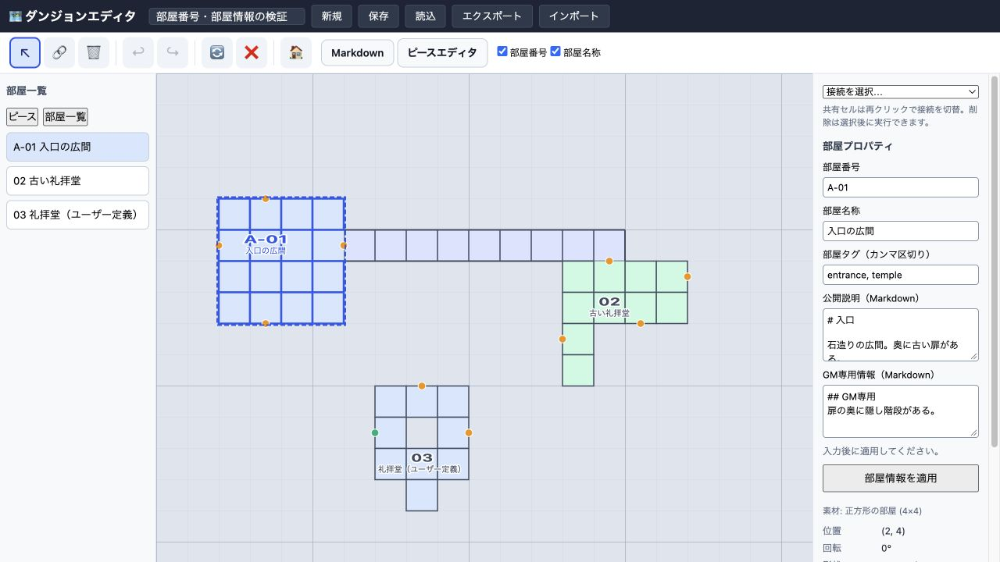

# 部屋番号・部屋情報管理

## 操作

配置した部屋や手動の通路ピースに番号を付け、キャンバスへ表示する。
左の「部屋一覧」から選択すると、右の部屋プロパティで番号・名称・タグ・公開説明・GM専用情報を編集できる。
説明とGM専用情報はMarkdownのテキストエリアとし、HTMLプレビューや全体Markdownからの自動分割は導入しない。

入力後に「部屋情報を適用」を押すと、全項目を1回の履歴として確定する。
不正な番号ではすべての変更を未適用のまま保持し、既存の保存値・キャンバス表示を変えずエラーを表示する。
適用した情報はメニューの「保存」でダンジョンと一緒にIndexedDBへ保存する。
適用前の入力は保存対象ではなく、部屋を切り替えると破棄される。

ツールバーの「部屋番号」「部屋名称」で番号のみ・名称のみ・両方・非表示を切り替える。
表示設定はStoreの表示状態とし、保存データやUndo／Redoに含めない。ページ再読み込み後は両方表示へ戻る。
部屋一覧は配置順で、選択を既存の選択状態へ反映する。自動センタリングや高度な並べ替えは行わない。



## データモデルと責務

```text
Piece                       再利用する素材・形状・接続口・素材タグ
PlacedRoom                  Room ID・Piece参照・配置・回転
  └ information             number / name / description / gmNotes / tags
Connection                  Room IDとConnector IDによる論理接続
CorridorNetwork             現在の配置・接続から生成する一時的な通路
DungeonDocument.markdown     ダンジョン全体のシナリオ
```

`RoomInformation` を追加し、正規化後の `PlacedRoom.information` に必須で保持する。
旧データと配置直前のピースは `PlacedRoomInput` として情報なしの入力を許可する。
Room IDと部屋番号は別の値であり、番号・名称の変更でも参照IDを再生成しない。
部屋の名称未設定時にはPiece名を表示するが、その名前をRoom Informationへコピーして二重管理しない。
Pieceの名称・タグ・形状・接続口、既存のユーザー定義ライブラリは変更しない。

`model/roomInformation.ts` は採番・検証・タグ整形・旧データの補完を担当する純粋処理。
`RoomInformationForm` は未適用の入力をローカルに保持し、Storeの `updateRoomInformation` が検証後に1回の履歴を追加する。
変化のない適用では履歴を増やさない。
部屋の移動・回転は情報を維持し、削除では情報と関連Connectionを部屋と一緒に除去する。他の番号やPiece定義は変えない。
既存の部屋複製機能はないため、今回新しく複製機能は追加しない。

## 採番と検証

新規配置時は現在の数値番号の最大値＋1。最小2桁で `01` / `02` / `10` / `100` のように表示する。
数字だけの番号をBigIntで比較し、JavaScriptの安全な整数範囲を超える番号でも丸めない。
`A-01` / `B1-05` などの英数字ラベルは最大値計算から除外する。
自動生成されたCorridorCellには番号を付けない。

手動の番号は前後の空白を除いた文字列で管理し、空白のみ・空文字列・同一ダンジョン内の完全一致を拒否する。
大小文字・ゼロ埋めは区別し、`01` と `1` は別の文字列として扱う。
部屋削除では他の番号を変更せず、欠番の詰め直しもしない。
現在の最大値を使うため、最大番号の部屋を削除すると、次の配置でその番号を再利用する場合がある。

名称は前後の空白を除く。公開説明とGM専用情報は改行やMarkdown記法を保持する。
タグは文字列の前後の空白・空要素・重複を除去し、最初に現れた順序を維持する。
素材タグと部屋タグの同期・継承・自動検索は行わない。

## ラベル描画

`roomLabelLayout` がワールド座標の実セルから外接範囲の中心に近い床セルを選ぶ。
同距離ならY・Xの昇順で決定し、入力セル順に依存しない。
ラベル幅はそのセルを中心に、同じ行の連続する床セル内に収める。
番号と名称の両方を表示する場合は、同じ床セルの上下2行に配置する。
長いラベルはSVGのtextLengthで幅を調整し、全文は一覧・プロパティ・タイトルで確認できる。

L字や穴のある自由形状でも、空きセルをラベルの基準位置にしない。
位置・回転後の実セルから座標を求めるためラベルが追従し、文字自体を回転させない。
ラベルはクリック判定を持たず、既存の部屋操作・接続ポイント・選択枠を維持する。
説明・GM専用情報・タグをキャンバスへ表示しない。

## 保存・移行・JSON

部屋情報はDungeonDocument内の各PlacedRoomへ保存し、既存Dungeon Repositoryを使用する。
新しいDBテーブルやDexieバージョンは追加しない。ReactからIndexedDBを直接操作しない。

`normalizeDungeonDocument` で、情報がない旧レコードへ空の名称・説明・GM専用情報・タグを補完する。
先に全室の有効な既存番号を予約し、その最大数値＋1から、情報がない部屋を元の配列順で補完する。
重複した旧番号は最初の部屋で維持し、後続の重複・空番号だけを補完する。
同じデータを繰り返し読み込んでも同じ番号となり、Room / Piece / Connector / ConnectionのIDを変更しない。
移行は読み込み時のメモリ上で行い、再保存時に新形式を保存する。

ダンジョンJSONの `schemaVersion` を **1.2.0** に更新する。旧 **1.0.0 / 1.1.0** を読み込める。
旧アプリのJSON読み込みは1.2.0に対応しないため、新しい出力は本バージョン以降で読み込む。
新形式では全室の情報を必須とし、番号の重複・空・不正な項目型を検証してから正規化する。
公開説明・GM専用情報・全体Markdownと、参照するユーザー定義Pieceのスナップショットを含む完全なプロジェクトデータを出力する。
Piece単体JSONのバージョンは1.0.0のまま。
不正な部屋情報はPiece登録より前に拒否し、インポート失敗時に部分的なライブラリ登録を残さない。
既存のPiece ID衝突・Connector参照・Connectionの検証も維持する。

JSONはGM専用情報を含む。プレイヤーへ配布できる公開用JSON・マップ・ガイドの生成は今回の対象外。

## Markdown保存と履歴

`saveMainEditorSnapshot` は既存レコードの全体Markdownを書き戻さず、部屋・接続等のメイン画面の項目を更新する。
`saveMarkdown` は全体Markdownと更新日時だけを変更し、部屋情報を更新しない。
別ウィンドウの `MARKDOWN_SAVED` の受信処理も、既存どおり全体Markdownだけを更新する。

部屋情報の適用・削除・復元を既存のダンジョン履歴で管理する。
Undo／Redoでは配置・部屋情報・接続を復元し、別ウィンドウで編集された最新の全体Markdownは現在値を維持する。
全体Markdownの編集はダンジョンの部屋操作履歴から独立し、部屋のUndoで古い本文へ戻さない。

## 物理計算の再利用

`createConnectionSceneResolver` を描画Hookから使用し、次の物理情報だけをシグネチャへ含める。

- 部屋ID、位置、回転
- Pieceの実セル、ConnectorのID・位置・方向・幅・種類
- ConnectionのID・端点・種類

部屋番号・名称・説明・GM専用情報・タグや、Pieceの名称・タグは除外する。
物理情報が同じなら占有グリッド・Routing・Corridor Geometry・CorridorNetworkを含むシーンをそのまま再利用する。
情報編集のUndo／Redoでスナップショットのオブジェクト参照が変わっても、同じシーンを再利用できる。
位置・回転・セル・接続口・Connectionが変化した場合は既存の経路処理を実行する。
Connectionだけが変わる場合は占有グリッドを再利用し、通路単位の既存セルキャッシュも維持する。

## 検証

`npm run build` / `npm run lint` / `npm test` が成功。既存194件に32件を追加し合計226件。
既存テストのスキーマ期待値を現行バージョンへ更新し、配置済み部屋の保存フィールドにinformationを追加した。
buildの500kB超チャンク警告は既存のもの。新しい依存パッケージは追加していない。

追加テスト:

- 新規・複数配置・手動通路・削除後の採番、文字列ラベル、大きな数値、欠番の維持
- 空・重複番号・不正型の拒否、変更なしの適用、1回の適用とUndo／Redo
- 同じPieceの別部屋への独立性、Piece定義と素材タグの不変性
- 表示4パターン、移動、全4回転、長方形・L字・自由形状の実セル内の位置、SVG文字列の安全性
- 旧データの予約番号を優先する安定した補完、欠落・不正な旧項目の補完、DB保存・更新・再読込
- JSON 1.2.0の完全往復、旧1.0.0 / 1.1.0、カスタムPieceとの共存、不正Import時の部分登録防止
- 全体Markdownと部屋情報の同時保存、部屋Undo／Redoで最新の全体Markdownを維持すること
- 情報編集・履歴復元・表示切替でシーンを再利用し、移動・回転では更新すること
- 自動生成通路へ部屋番号・部屋情報を付与しないこと

ブラウザでは正方形・L字・ユーザー定義Pieceを配置し、01・02・03を確認した。
A-01・名称・公開説明・GM専用情報・タグを適用し、1回のUndo／Redoで一括復元できた。
重複したA-01を別部屋へ設定するとエラーになり、元の02と接続を維持した。
部屋一覧の選択、表示4パターン、L字の移動・回転でのラベル追従を確認した。
保存→ページ再読み込み→読込で3部屋・1接続と部屋情報を復元した。
別ウィンドウで全体Markdownを保存してから部屋名称を変更・保存し、Markdownと部屋情報が双方とも保持された。
JSON出力ボタンの実行と既存ピースエディタの起動・ユーザー定義の読み込みも確認した。
JSONファイルの実際の往復操作は未検証。ファイル内容の生成・検証・移行・登録は自動テストで確認した。
アプリのブラウザ警告・エラーログはなし。

## 制約と今後の改善

適用前の入力は部屋選択の変更で破棄される。部屋情報は「適用」後にメニューの「保存」で永続化する。
表示設定は非永続。非常に長い名称や番号は幅に合わせて縮小される。
部屋一覧の自動センタリング、高度な検索・並べ替え、Room複製、番号の一括再編成は未実装。
部屋Markdownのプレビュー、内部リンク、Entity・Theme、プレイヤー向け出力・出版機能は今後の拡張とする。
