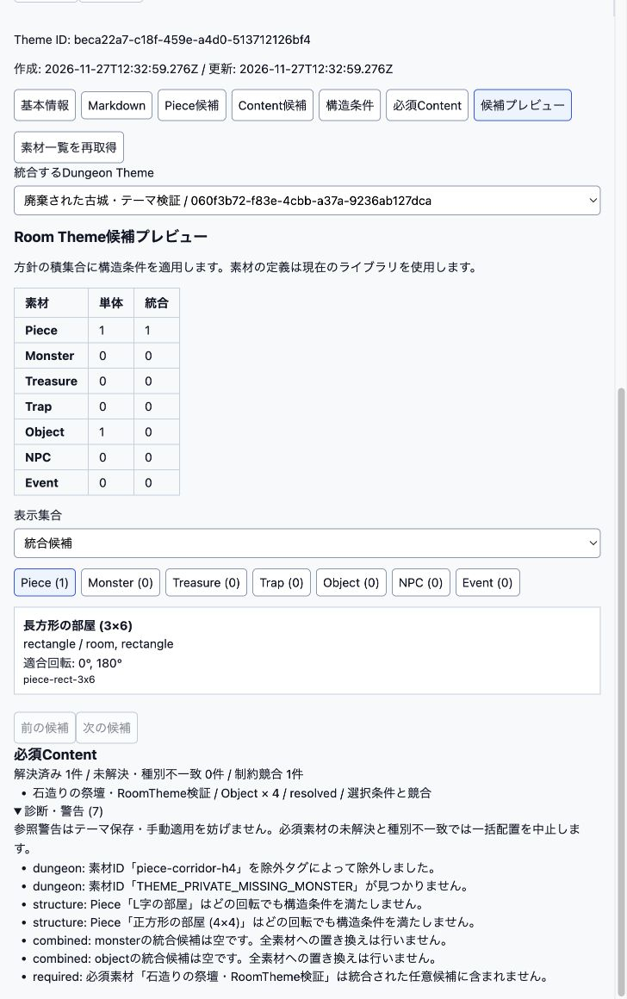
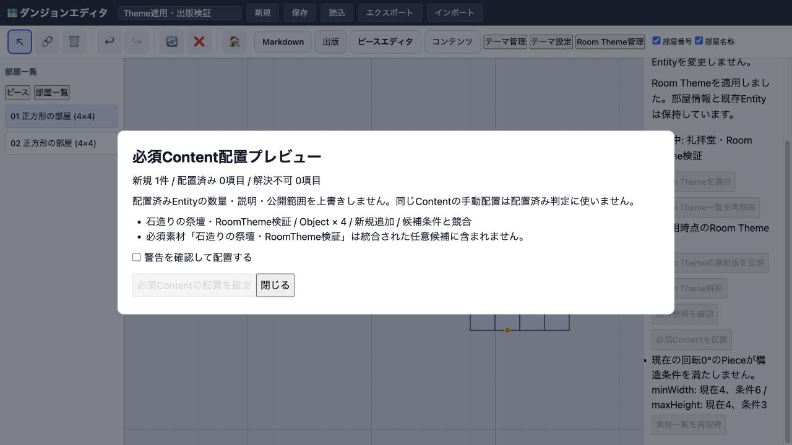

# Room Theme管理

> Phase 2.5で共通保存処理とDocument検証の境界を整理しました。機能追加時点の記録は以下に残し、現行の構成・制約は[アーキテクチャ](phase-2-5/architecture.md)と[監査結果](phase-2-5/results.md)を参照してください。

## 変更の範囲

個別の部屋の用途・構成知識・素材候補・物理条件・必須設備を、再利用可能なRoom Themeとして管理できるようにした。Dungeon Themeはダンジョン全体の方針、Room Themeは部屋の用途、Pieceは物理形状、Entityは実際の配置状態を担う。

同じPieceを異なるRoom Themeに、同じRoom Themeを異なるDungeon ThemeやPieceに利用できる。テーマの適用だけでは既存のPiece・位置・回転・部屋番号・名称・RoomInformation・Connection・Entity・Markdownを変更しない。手動の素材選択も制限しない。

## モデルと責務

| 実装 | 責務 |
|---|---|
| `src/model/roomTheme.ts` | RoomTheme / Draft / Assignment、構造条件・必須構成の検証、複製・同一性 |
| `src/model/themeSelection.ts` | 既存Piece / Content選択とRoom Theme選択の共通評価 |
| `src/model/roomThemeResolver.ts` | 候補の積集合、構造条件、適合回転、必須素材の解決と診断 |
| `src/model/roomThemePlacement.ts` | 一括配置予定、重複判定、数量差、制限、確認済み状態の識別 |
| `src/repository/roomThemeRepository.ts` | Room Theme Library永続化、競合検知、原子的Import |
| `src/themes/roomTheme*.ts` | フォーム変換・JSON入出力・更新通知 |
| `src/components/themes/RoomThemeEditor.tsx` | 専用ウィンドウの編集、条件と必須構成、統合プレビュー |
| `src/components/themes/RoomThemePanel.tsx` | 部屋への適用・解除・更新、診断・配置確認 |
| `src/components/themes/DungeonRoomThemeSelection.tsx` | Dungeon ThemeからRoom Theme候補を指定 |

`RoomTheme`は `id, name, genre, category, purpose, summary, description, gmNotes, tags, pieceSelection, pieceConstraints, contentSelection, requiredContents, createdAt, updatedAt` を持つ。genre/category/purposeは自由な文字列。用途や名称の自然言語を条件へ変換しない。

新規定義はUUID、空のメタデータ、Piece / 6種別Contentのnone、構造条件なし、必須構成なしで開始する。保存前はLibraryへ登録しない。編集時はIDと作成日時を維持し、正常保存時だけ更新日時を進める。

複製では新しいTheme IDと全必須構成項目の新IDを発行する。Piece/Contentの参照IDは維持し、配列やオブジェクトを共有しない。日時は新規保存時に設定する。

Dungeon / Roomの編集には既存 `useLibraryEditor` を利用し、一覧・保存・Export・未保存確認などの画面部分も `ThemeEditorWorkbench` へ抽出した。モデル・フォーム検証・専用タブ・Repositoryはドメインごとに分離した。Content選択ダイアログは表示文言を指定可能にして再利用し、Room Themeへの参照登録と実際のEntity配置を画面で区別する。

## 選択方針と統合

Piece / Contentの既存4モードとタグ条件をそのまま利用する。

| モード | 候補 |
|---|---|
| all | 対象種別の全素材から除外条件を適用 |
| filtered | 明示IDと肯定タグ条件の和集合から除外条件を適用 |
| explicit | 明示IDから除外条件を適用。肯定タグは不使用 |
| none | 常に空 |

allOfは全タグ、anyOfは1つ以上、noneOfはどれも持たない条件。タグをtrim・空除去・重複除去し、大小文字を区別した完全一致で評価する。IDは不透明な識別子として保持する。除外IDとnoneOfが明示指定より優先する。filteredで肯定タグも明示IDもない場合は空。genre/category/purposeによる暗黙の絞り込みは行わない。

`resolveRoomTheme`は次のように評価する。

1. 既存ResolverでDungeon / RoomそれぞれのPiece・Content候補を抽出する。
2. 両方ある場合はIDの積集合を使用する。片方だけならその候補、両方なしならライブラリ全体。
3. Roomの構造条件でPiece候補を絞り、適合する回転方向を付ける。
4. 任意Content候補と別に、必須構成の参照先・種別・競合を診断する。

一方がnoneなら統合候補も空。候補不足で全件へフォールバックしない。結果はID昇順・ID重複なし。React / Zustand / Dexie / 乱数に依存せず入力を書き換えない純粋な処理で、Editor・部屋パネル・必須配置・将来のGeneratorから共有できる。

### Piece構造条件

```ts
type RoomPieceConstraints = {
  minCells?: number; maxCells?: number;
  minConnectors?: number; maxConnectors?: number;
  minWidth?: number; maxWidth?: number;
  minHeight?: number; maxHeight?: number;
};
```

空欄は未指定。セル数・幅・高さは1以上、コネクタ数は0以上の整数。各最小値は対応する最大値以下でなければ保存できない。フォームは不正な入力値を維持してエラーを表示し、0と空欄を区別する。

面積は実際の占有セル数。非矩形の空き領域を加算しない。幅・高さは既存 `pieceBounds` による占有セルの外接矩形、コネクタは有効な外周Connectorの数で、実際のConnection数とは別。

現行Pieceが対応する0° / 90° / 180° / 270°のうち、1方向以上が条件を満たせば候補とする。結果は `{ piece, rotations }` を持つ。配置済み部屋は現在の回転だけを診断する。Pieceの交換や自動回転は行わない。

### 必須構成

```ts
type RequiredContentEntry = {
  id: string;
  contentId: string;
  expectedKind: ContentKind;
  quantity: number;
  customName: string;
  publicDescription: string;
  gmNotes: string;
  visibility: EntityVisibility;
};
```

項目IDはテーマ内で一意。同じContent IDの項目は複数作成できる。数量は固定の正整数で、1項目から数量を持つEntityを1件生成する。ContentDefinitionそのものをテーマへ埋め込まず、配置時に現在の素材からContent Snapshotを作る。

必須素材が任意Contentの統合候補に含まれなければ競合を警告する。必須要求は任意候補へ自動追加しない。手動配置では確認して続行できるが、素材欠落や種別不一致を無視した生成は許可しない。

### 診断

従来の欠落ID・種別不一致・明示/除外競合・タグ矛盾等に加え、構造条件による除外、Piece候補なし、空の積集合、Dungeon候補外のRoom Theme、必須Contentの欠落/種別不一致/候補競合、配置済みPieceの不適合を返す。警告は最大先頭100件を表示し、全件数と候補数を維持する。

定義の型や値の不正は保存・Importを拒否する。参照不足や候補なしは保存できる。削除された素材を別素材へ置換しない。

## Dungeon Themeの拡張と互換性

`DungeonTheme.roomThemeSelection` に `{ mode, includeRoomThemeIds, excludeRoomThemeIds, tags }` を追加した。既存Selection Resolverをそのまま共有し、Room Themeにも同じ4モード・タグ・除外優先順位を適用する。

この項目を持たない旧Dungeon Themeと旧適用Snapshotは、**all**へ補完する。従来のPiece / Content方針を変更せず、従来どおりRoom Themeを制限しない。**新規Dungeon Themeはnone**で開始する。旧データの補完と新規初期値を分けた。

Dungeon Theme Editorの「Room Theme候補」で条件と既存Libraryの明示/除外指定を編集できる。Room Themeを変更・削除すると候補一覧を更新し、未解決参照を警告する。候補外のRoom Themeも部屋へ手動適用できる。

## 操作方法

1. メインの「Room Theme管理」から専用ウィンドウを開く。同名ウィンドウを再利用する。
2. 基本情報で名称・独自ジャンル/分類・用途・概要・タグを入力する。名称の重複は許容しIDで識別する。
3. Markdownで構成知識とGM情報を編集する。既存のmarked / DOMPurify処理を共有し、外部画像・危険HTML・イベント属性・危険URLを除去する。
4. Piece候補と構造条件を設定する。
5. 「必須Content」でContent Libraryから項目を追加し、数量・個別名称・公開説明・GM情報・公開範囲を編集する。Content IDと想定種別も明示的に修正できる。削除はDraftの項目削除で、Library素材は削除しない。
6. 「Content候補」で任意Contentの6種別を独立して設定する。
7. 候補プレビューで任意のDungeon Themeを選び、単体/統合の7分類の件数・実際の候補・適合回転・必須項目・診断を確認する。
8. 保存する。新規/別選択/複製/Importの前に未保存変更があれば、保存・破棄・キャンセルを選ぶ。ウィンドウ終了時は標準の離脱確認を使用する。

検索対象は名称・用途・概要・genre・category・tagsで、大小文字を区別しない。genre/categoryの追加フィルターは完全一致。テーマ・素材・候補の一覧は50件ずつ表示する。検索やフォーム入力ごとに素材を再取得しない。

## 部屋への適用

部屋を選び、右パネルの「Room Theme」を開く。

```ts
PlacedRoom.roomTheme?: {
  sourceThemeId: string;
  themeSnapshot: RoomTheme;
};
```

AssignmentはPlacedRoomの1か所だけに保存し、未設定はフィールド不在に正規化する（入力のnull/undefinedも不在）。Room IDで管理し、適用時点の定義をディープコピーする。RoomInformationへ名称や説明を自動コピーしない。

Libraryの更新・削除でSnapshotや既存Entityを変更しない。「Room Themeの最新版を反映」は確認後に定義だけを更新する。追加された必須項目は別途一括配置するまで生成せず、消えた項目に由来するEntityも残す。元定義がなければ更新ボタンを無効化し、保持済み定義で編集・保存・出版を継続できる。

「統合候補を確認」で現在の素材に基づく診断を表示する。方針はSnapshotで固定されるが、候補素材の全定義は固定しない。素材Library更新で候補は変わり得る。

## 必須Contentの一括配置

「必須Contentを配置」で追加予定・配置済みスキップ・解決不可・競合・現在数量と必要数量の差を確認する。

- 対象RoomとSnapshotを検証し、全必須項目のContent参照・種別・数量を確認する。
- 同じ部屋の同じTheme ID・構成項目IDを持つEntityは配置済みとしてスキップする。通常の手動配置で同じContentを使っていても、この判定には含めない。
- 未配置項目を既存Entity Factoryで生成し、項目の数量・名称・公開説明・GM情報・公開範囲を初期値として設定する。
- Snapshot容量、1部屋/全体のEntity数、Entity総容量を検証する。解決不能・不正・超過が1つでもあれば全件を中止し、Storeと履歴を変更しない。
- 任意候補との競合やDungeon候補外のRoom Themeは確認チェックを必須にする。実行前に現在の素材を再取得し、レビュー済みの適用方針・素材・既存Entityと異なればプレビューを更新して再確認を求める。
- 全検査後にまとめてStoreへ反映する。生成数にかかわらずUndoは1回。追加0件は履歴を増やさない。

再実行で既存Entityの数量・名称・説明・公開範囲を上書きしない。削除したEntityに対応する項目は次回に再追加できる。手動編集後に必要数量との差を表示しても、差分補充や削減は自動実行しない。

### Entityの由来

```ts
origin?: {
  type: 'room-theme-required';
  sourceRoomThemeId: string;
  requiredEntryId: string;
};
```

由来情報は重複防止とGM向けの編集表示に使用する。Content IDやSnapshotを置き換えない。元Theme/構成項目がなくてもEntityは有効。通常のEntity編集・Content定義更新で由来を維持し、**別の部屋への移動と個別複製では解除**する。同じ部屋への移動は何もしない。

部屋全体の「部屋を複製」では、空き領域を探索して新Room ID・新部屋番号・新Entity IDを発行し、Theme Snapshot・RoomInformation・Entityを独立コピーする。Entityの由来はそのまま複製し、複製先でも必須項目の関係を維持する。元のConnectionは複製しない。空き領域が見つからない場合や制限超過時は変更しない。

Room Themeの変更・解除では過去Theme由来のEntityを保持する。異なるThemeの必須配置時には既存設備を推測で削除せず、今回の配置予定を確認させる。

## Undo / RedoとGeometry

Room Themeの適用・変更・解除・明示更新、必須Contentの一括配置、部屋削除・部屋全体複製を履歴に統合した。Undo/Redoは当時のSnapshotとEntity ID・Content Snapshot・由来を復元し、最新Libraryを再取得しない。

部屋の移動・回転はAssignmentを保持し、現在回転の診断だけ更新する。部屋削除では対応Assignment・Entity・Connectionをまとめて除去し、Undoで復元する。

テーマやEntityだけの操作で物理構造は変わらない。既存の物理レイアウトに基づくSceneキャッシュを再利用し、Occupancy / A* / Corridor Geometry / Networkを再計算しない。新しいモーダル表示中はメインの削除・回転等のキーボード操作を抑止する。

## 永続化・同期

Dexie **v4**で `roomThemes` テーブル（`id, name, genre, category, updatedAt`）を追加した。旧テーブルやレコードを作り直さず、Dungeon Theme・Piece・Content・Entity・Markdown・設定を保持する。旧Dungeon ThemeのRoom選択方針は読み込み時に補完し、移行時に既存レコードを書き換えない。

Room RepositoryはDungeon Themeと同じ更新日時による楽観的競合検知とトランザクションを使う。古い版によるsave/deleteは拒否し原稿を維持する。保存失敗・容量不足・Import失敗では未保存状態やImport確認データを保持して再試行できる。

正常な保存/削除/一括登録後、`trpg-dungeon-generator-room-themes` の `ROOM_THEME_LIBRARY_UPDATED` を通知する。Dungeon Editorの選択一覧、Dungeon Theme EditorのRoom候補、Room EditorのLibraryを更新する。cleanな編集は外部版を読み、dirtyな原稿と適用済みSnapshotは上書きしない。フォーカス復帰/再取得でも回復できる。

既存Piece / Contentチャンネルを素材候補の更新に利用する。Room/Dungeonテーマの素材参照は弱く、削除を阻止する新たな強参照にはしない。既存の配置済みPiece等の削除保護は維持する。

取得中に対象ダンジョン・選択Room・Assignmentが変わった場合やパネルを閉じた場合、遅れて返るデータを適用しない。必須配置の確認後に素材/配置状態が変わっても、確認済み状態を検査して古い予定の実行を防ぐ。

## JSON

Room Theme単体は `{ schemaVersion: '1.0.0', type: 'room-theme', theme }`、複数は `{ schemaVersion: '1.0.0', type: 'room-theme-library', themes }`。保存済みの現在項目・複数選択・検索/絞り込み結果・全体を出力できる。未保存編集は出力に混ぜない。

Importは構文・type・バージョン・全定義・重複キー（エスケープも検査）・入力内Theme ID重複・件数/容量を検査し、全件を1トランザクションで登録する。同一ID・同一内容は再利用し、異なる内容はスキップまたは新Theme ID発行を選ぶ。日時・タグ/ID集合の並び順・構造条件のキー順は同一性の差としないが、用途・必須構成項目IDと内容は比較する。

素材やRoom Themeが欠落していても構造が正しければテーマJSONを読み込める。依存素材を同梱・自動生成せず、素材ImportによるID変更も推測で書き換えない。Dungeon Theme JSONは既存のschema 1.0.0を維持し、追加方針と旧定義のall補完に対応する。Dungeon Theme ImportからRoom Libraryを書き換えない。

Dungeon JSONは **1.5.0**。PlacedRoomのAssignment、Room Snapshot、Entity origin、拡張Dungeon Snapshotを含める。**1.0.0〜1.4.0**も読み込め、テーマなしの旧Roomやoriginなしの旧Entityは従来どおり扱う。SnapshotからRoom/Dungeon/Content Libraryを登録・上書きしない。

現行画面の解除はフィールド不在として保存する。旧版の部分保存でRoom Theme情報がないRoomについては既存Assignmentを保持し、別窓で保存したMarkdownも維持する。

## 出版・情報分離

Room Themeは制作知識のためGM/Playerどちらのマップ・ガイド・印刷へも自動掲載しない。名称・用途・GM情報・構造条件・必須構成・任意候補・由来IDを出版Projectionに含めない。`PublishRoom`の型からもroomThemeを除外した。

生成済みEntityは既存の通常Entityとして出力する。GMガイドにはEntityの名称・数量・素材/配置情報、Playerには明示的に公開した配置固有の公開説明だけを渡す。EntityのGM情報をテーマ由来という理由で公開しない。

Player ZIPにTheme Snapshotやoriginを収録しない。Completeの `project/dungeon.json` はAssignmentとEntity由来を含め、Libraryなしでも復元できる。マップ・ピース印刷数量・CSVはテーマによって増減しない。

## 制限と対象外

| 項目 | 上限 / 条件 |
|---|---|
| Theme/Content/構成項目/由来ID | 128文字、空白のみ不可 |
| Theme名称 / genre / category / purpose / 概要 | 200 / 100 / 100 / 1,000 / 1,000文字 |
| テーマ詳細 / GM情報 | 各100,000文字 |
| テーマ全体 | UTF-8 JSON 512 KiB |
| テーマタグ・各タグ条件 | 各50個、1タグ64文字 |
| 明示/除外ID配列 | 各100個 |
| 各構造条件 | 最大1,000,000、セル/幅/高さは1以上、Connectorは0以上 |
| 必須構成項目数 / 1回の新規Entity数 | 最大50項目 / 50件（数量の合計ではない） |
| 必須数量 | 1〜1,000,000の整数 |
| 必須の個別名称 / 公開説明 / GM情報 | 200 / 20,000 / 20,000文字 |
| Content Snapshot / Entity総量 | 既存の256 KiB / 8 MiB |
| Entity件数 | 既存の1部屋50件 / 全体500件 |
| テーマJSON / Dungeon JSON | 10 MiB・1回500テーマ / 20 MiB |
| 部屋複製の空き領域探索 | 周辺512候補 |

超過は切り詰めず拒否する。大規模Libraryの取得・候補計算はメインスレッドで行い、表示をページ分割する。UIの任意の並び替え・高度なフォーカス制御は今回追加していない。

Faction / Encounter Template、Theme継承・合成、隣接条件・部屋数/出現確率/重み・数量範囲/ダイス、Entity座標/物理占有・家具衝突、自動Piece交換/回転/配置/接続、シナリオ自動生成、依存素材の同梱は対象外。標準Room Themeは自動投入しない。将来のGeneratorは同じ候補Resolver・必須配置処理を再利用できるが、再現可能な抽選や候補固定は別途設計する。

## 自動検証

2026-11-27に `npm run build`（TypeScriptチェックを含む）、`npm run lint`、`npm test` が成功。既存553件に**67件追加し全620件**。lint警告なし。

| テスト | 主な検証 |
|---|---|
| `roomThemeModel.test.ts` | 初期値・旧all/新none補完、構造値/上下限、非矩形面積・有効Connector・回転、単体/積集合/none、6種別・必須競合・欠落、決定性・非破壊、複製、JSON/フォーム/検索/容量 |
| `roomThemeState.test.ts` | CRUD/CAS/再起動、Import衝突/原子性/Library独立、4適用操作・履歴/経路キャッシュ、必須Factory初期値・Snapshot独立、再実行/数量差/削除後追加、未解決/種別/件数/容量の全件中止、確認済み状態、origin・部屋複製、移動/回転/削除、JSON/部分保存/弱参照 |
| `roomThemeMigration.test.ts` | DB v3→v4で旧Theme・Entity等をバイト相当のまま保持 |
| `roomThemeUi.test.ts` | 実Editor/Panel、未保存/失敗/外部競合、Import再試行、必須素材Picker/無効入力保持/6方針、統合プレビュー/更新、4Export範囲/ページ、Markdown、DungeonからRoom選択、配置/スキップ/競合確認/未解決停止、定義更新/削除/解除、古い素材プレビュー再確認、遅延応答 |
| `roomThemePublishing.test.ts` | Projection段階の非公開、生成Entityの公開範囲、テーマ/由来の有無で既存成果物一致、3種ZIP、Complete復元 |

従来のv1/v2移行、Content/Dungeon Theme Editor、Entity、Routing、Corridor Network、RoomInformation、Markdown、印刷・ピース印刷・ZIP・出版ゴールデン比較も通過。旧ゴールデンハッシュは維持し、プロジェクトのschema差だけを既存補正で扱う。各ウィンドウとRoom Theme Panelの遅延読み込み・メインへのMarkdownライブラリ非混入も検査する。

## 実ブラウザ検証

production buildを127.0.0.1:4173で実行。既存の2部屋の保存データ、Dungeon Theme 2件、Content 1件を読み込めることを確認してから検証用素材・テーマを追加した。

- 礼拝堂の名称・分類・用途・Markdown・Piece all・構造条件（16セル以上、Connector 1以上、幅6以上、高さ3以下）・Object任意候補・必須Object数量4/名称/公開説明/GM情報/公開範囲を設定し保存した。
- 候補Pieceは3×6、適合回転は0°/180°。Dungeon Themeを選ぶとObject単体1件→統合0件、必須構成の競合1件を確認した。
- 旧Dungeon ThemeのRoom選択がallに補完されていることを確認し、Room Libraryから明示選択して保存した。
- 4×4の配置済みRoomへ適用し、既存部屋情報を維持したまま構造不適合を表示した。競合確認前は必須配置が無効、確認後に1件のEntity（数量4）を生成した。
- 再実行で新規0件/配置済み1項目。Entityを数量7・別名称へ手動変更すると差-3を表示し、追加/上書きをしなかった。Undo/Redoで同じEntity IDと編集内容を復元した。
- Library用途を改訂しても適用時点の用途を維持し、更新確認の閉じる/確定で明示更新した。解除後のUndo、部屋複製で新部屋番号・新Entity ID・同じ数量のコピーも確認し、複製RoomはUndoで戻した。
- Theme複製は新Theme ID・新必須構成項目IDを持ち、複製用途の編集が元定義に影響しなかった。単体/全体JSONダウンロードで2件の独立した定義と同じ素材参照を確認した。
- 保存→ページ再読込→ブラウザ内保存済み一覧から復元。Dungeon JSON 1.5.0にRoom Assignment・改訂用途・Entity origin・数量7・Dungeonの明示Room候補が含まれることを確認した。
- GMガイドは手動変更した名称・数量・Entity GM情報を表示、Playerは公開説明の銀の聖杯だけを表示し、両方にRoom Themeメタデータなし。
- Player ZIP **7ファイル**を展開しTheme秘密文字列・名称・origin・Entity GM情報の混入なし、公開説明ありを確認。Complete ZIP **19ファイル**は `project/dungeon.json` にRoom Snapshot・origin・数量7を保持し、他の成果物へTheme情報を混入しなかった。





メイン画面のJavaScriptエラーはなし。Room EditorのログにはElectron組み込みスクリプトのエラーが記録されたが、アプリの編集・保存・JSON出力と候補確認は成功した。

ファイルアップロードによるImport、不可逆なLibrary削除、空Library環境への実ブラウザImportは操作していない。これらはJSDOM/fake-indexeddbで検証した。PDF保存ダイアログと実機印刷は今回未検証で、既存の印刷生成処理に対する自動比較を実施した。
