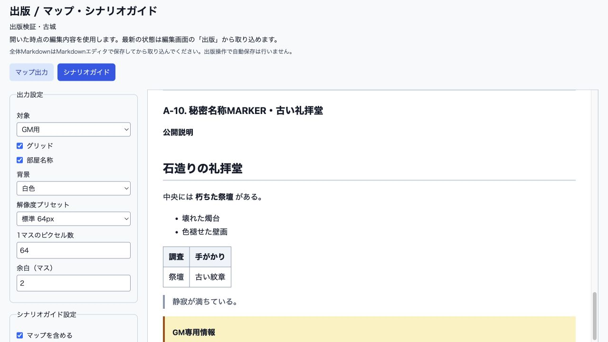
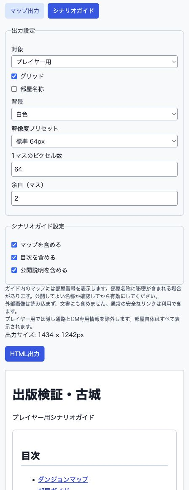

# シナリオガイド生成・HTML出版

## 操作

1. 部屋情報に番号・名称・公開説明・GM専用情報・タグを入力し、「部屋情報を適用」で確定する。
2. ダンジョン全体のMarkdownは、Markdownエディタで保存を完了する。
3. 編集画面の「出版」を押し、「シナリオガイド」へ切り替える。
4. 対象と出力するセクションを選び、文書プレビューを確認する。
5. 「HTML出力」で`名称-player-guide.html`または`名称-gm-guide.html`をダウンロードする。
6. 更新を取り込む場合は、編集画面で再度「出版」を押す。

部屋は説明が空でも掲載する。名称が未設定の場合は番号だけを使う。標準ピース・ユーザー定義ピースのどちらも同じ部屋情報抽出・描画を使用する。

プレイヤー用では部屋名称が初期非表示。名称の公開を有効にすると、目次・部屋見出し・埋め込みマップへ同じ名称が入る。画面に名称へ秘密を含める可能性を案内する。ガイドの埋め込みマップは部屋番号を常に表示し、グリッド・背景・余白・解像度は既存の出力設定を利用する。





## モデルと責務

```text
現在の部屋・配置・接続・Piece定義 + 保存済みの全体Markdown
  → 固定Publish Snapshot
  → PublishProfileのaudienceによる公開範囲の確定
    ├─ Map PublishDocument → 既存Map Geometry → SVG / PNG
    └─ Scenario PublishDocument → ScenarioGuide → HTML Renderer → HTML Export
                                     ↑
                             同じ時点・同じ対象のSVG
```

既存PublishDocumentへ任意の`scenario`コンテンツを追加した。シナリオ用はその投影型`ScenarioPublishDocument`を使い、部屋の物理形状とシナリオ抽出を分離する。これによりマップ参照が不正でも、ユーザーがマップを外せば部屋情報を出力できる。

`PublishScenario`はタイトル、部屋情報、任意の全体Markdown。`ScenarioGuide`はそこへ同じaudience、目次設定、任意のmapSvgを加えた文書構造。部屋はanchorId、mapRoomId、numberと任意のname / description / gmNotes / tagsを持つ。HTML文字列は元モデルへ入れない。

`PublishProfile`のaudienceを共用し、対象を選ぶ独立した状態は追加しない。名称設定もshowRoomNamesを共用する。`ScenarioGuideOptions`にはincludeMap、includeTableOfContents、includeScenarioMarkdown、includeRoomDescriptions、includeRoomTags、includeGmNotesを定義した。

| 設定 | プレイヤー初期値 | GM初期値 |
| --- | --- | --- |
| マップ・目次・公開説明 | 有効 | 有効 |
| 部屋名称 | 非表示 | 表示 |
| 全体Markdown・タグ・GM専用情報 | 出力不可 | 有効、個別に切替可能 |

対象を切り替えると対象別の初期値を適用する。設定と派生データは永続化しない。

## 公開情報の抽出

HTML Rendererへ渡す前に`buildScenarioPublishDocument`で明示的に必要な項目だけを抽出する。

- プレイヤー用には全体Markdown、GM専用情報、部屋タグをプロパティごと含めない。GM用の設定値を誤って渡しても対象判定によって除外する。
- 部屋名称は有効時のみRoomInformation.nameから抽出する。Piece名・Pieceタグを代用しない。
- descriptionは公開情報として扱い、出力設定に従って含める。
- マップは既存buildPublishDocumentのsecret除外と既存Routing / CorridorNetworkを利用する。
- ラベルだけをガイドの番号・名称に差し替え、形状や経路を再計算しない。元のGeometryも変更しない。
- 出力に元DungeonDocument、元Room ID、Connection ID、編集状態、プレイヤー向け警告情報を埋め込まない。

全体Markdownには公開範囲の区分がないためGM用として扱う。プレイヤー用概要フィールド、部屋そのものの秘匿、未探索領域の制御は追加していない。

## 部屋の順序・目次

番号を数字部分とその他の文字列に分けた自然順で比較する。巨大な数字でも精度を失わないよう、先頭ゼロを除いた桁数・辞書順で比較する。数値的に同じ番号は元表記で順序を確定し、同一番号は安全なアンカーIDで順序を固定する。Localeや入力配列の順序に依存させず、元配列を変更・再採番しない。

アンカーはRoom IDを元にした固定64bitハッシュで、番号や名称を使わない。ハッシュ衝突時は元ID順の接尾辞で区別する。`guide-room-...`を部屋用に、`guide-overview` / `guide-map` / `guide-rooms`を主要セクションに使う。ユーザーのMarkdownからid/name属性を除去し、目次用IDとの衝突を防ぐ。

目次は出力するセクションと部屋だけをリンクする。独自Wikiリンクやマップからの部屋リンクは実装しない。

## MarkdownとHTML

既存`renderMarkdownToHtml`を出版モード付きに拡張し、marked→DOMPurifyの変換を再利用する。通常のMarkdownエディタには従来のサニタイズ設定を維持する。

出版モードは見出し・段落・リスト・表・引用・コード・強調・リンク等の許可リストを使う。script、イベントハンドラ、iframe、object、embed、SVG、画像、style、外部スタイルシート、フォーム、id/name/data/aria属性等はMarkdownから除去する。通常のURLはhttp(s)、mailto、文書内リンクのみ許可する。画像は外部・埋め込みを問わず出力せず、取得も行わない。

通常の文字列であるタイトル・番号・名称・タグはHTMLエスケープする。アプリが生成したSVGのみ、信頼済みのマップとして直接埋め込む。SVG内のラベルも既存のXMLエスケープを利用する。

HTMLはdoctype、lang=ja、UTF-8、viewport、title、内蔵CSS、header/nav/mainを備える。アプリ本体のCSS・JavaScript・DBを参照しない。CSPはdefault-src 'none'、style-src 'unsafe-inline'、base-uri 'none'、form-action 'none'とし、Referrer Policyもno-referrerとする。

プレビューは同じ生成HTMLをsandbox属性が空のiframeへ渡す。スクリプト実行と親へのアクセスは許可しない。srcdocのフラグメントが親URLへ解決されることを避けるため、プレビュー内の目次hrefだけを`about:srcdoc#guide-...`へ調整する。出力HTMLは通常の`#guide-...`を使う。本文・描画・スタイルの生成処理は共通であり、ブラウザで両者の一致を確認した。

GM専用情報は背景色・罫線と「GM専用情報」の見出しで識別する。長い本文やコードはページ分割可能にし、見出し直後の改ページ、マップ、表の行、短いタグ欄の分割を抑える印刷用CSSを含む。専用PDF生成は行わない。

## スナップショット・失敗時の扱い

出版ボタンを押した時点の未保存Documentをcloneし、同じIDのRepositoryから保存済み全体Markdownだけを読み取る。保存されていないDocumentには現在保持しているMarkdownを使う。非同期取得を待つ前にウィンドウを開き、ポップアップ制限に対応する。連続起動や編集元の切替では古い取得結果を捨てる。

部屋・名称・マップは取得時の固定スナップショットから生成する。Markdownエディタの未保存バッファを直接取得せず、画面に先に保存が必要であることを表示する。ダンジョンやMarkdownを出版操作で強制保存しない。既存のtoken・dungeonId検査、明示的な再取得を維持する。

未解決の接続を含むマップには既存の警告と継続チェックを適用する。プレイヤー向けHTMLへ警告文や警告線を入れない。マップを生成できない場合は出力を止め、「マップを含める」をオフにして文書だけを出力するか、元の配置を修正できるよう案内する。マップなしの場合は経路計算を要求しない。

スナップショット×対象のGeometryキャッシュを共用する。表示設定変更では経路を再計算しない。Markdown変換はスナップショット単位にキャッシュし、同じテキストの再変換を避ける。生成HTML文字列をダウンロードにも利用する。既存の多重出力防止、オブジェクトURL解放、古いPNG結果の破棄を維持する。

## 制限

| 項目 | 上限 |
| --- | --- |
| ガイドの部屋数 | 1,000 |
| 選択した各テキスト・Markdown | 100,000文字 |
| 選択したガイド全体のテキスト | 1,000,000文字 |
| ガイド内マップの部屋床 | 32,768セル（通路は既存上限を継承） |
| 完成HTML | UTF-8で8MiB |

上限は定数として管理する。超過時は出力設定の変更を案内し、元データを切り捨てて不完全なファイルを作らない。マップのSVG/PNG解像度・セル展開・経路探索は既存の制限を継承する。

## 検証結果

- `npm test`: 273件成功（既存251件＋ガイド22件）。
- `npm run build` / `npm run lint`: 成功。既存のバンドルサイズ警告は継続。
- Markdownライブラリの追加はなく、実DOMでDOMPurifyを検証するためdevDependencyへjsdomを追加した。
- 既存の互換バージョン範囲でDOMPurify・Vite等の修正版へ更新し、npm auditは検出0件。
- 抽出・公開範囲・自然順・アンカー・空文書・各セクション切替・名前の明示公開・Piece名の非流用・Markdown・XSS/URL/画像対策・完全HTML・マップ埋込・マップなし・制限・Snapshot・Repository/履歴/JSON互換性を自動テストした。
- 実画面では5部屋、通常通路、隠し通路、回転したユーザー定義ピース、日本語名、公開説明、GMメモ、タグ、全体Markdownを使用した。未保存の適用済み部屋情報と保存済み全体Markdownが同じガイドへ入ることを確認した。
- GM用本文・マップ、プレイヤーへの切替、名称オン/オフ、マップなし、目次から部屋への移動、HTMLダウンロード、既存SVG/PNGダウンロードを確認した。
- ダウンロードしたGM用/プレイヤー用HTMLには各5部屋・SVG1個があり、すべての目次リンク先とアンカーの一意性を確認した。目次hrefのプレビュー用補正を戻すと、プレビューHTMLと保存ファイルが一致した。
- プレイヤー用HTML全体から、識別用に入力した秘密名称・GMメモ・秘密タグ・全体Markdown・隠し通路・外部画像URL・scriptが除外されていることを確認した。

## 未確認範囲・既知の制約

検証ブラウザはfile:プロトコルを許可しないため、ダウンロードしたHTMLを別タブで開く操作が拒否された。その制限を回避する代替操作は行っていない。ローカルファイルの単独表示、実際のネットワーク切断状態での表示、標準印刷プレビューは未確認。埋め込みプレビュー、保存ファイルのDOM解析、外部リソース参照の不在、印刷用CSSの存在は確認済み。実際の印刷結果はブラウザ・用紙・フォント設定に依存する。

Markdownエディタ自身の画像表示は従来どおり。ガイドでは画像を除去する。部屋名称・公開説明・ダンジョン名の公開範囲はユーザーが管理する。全体Markdownの保存前バッファは取り込まない。

Entity・Wikiリンク・用紙設定・ページ番号・PDF Exporter・ZIP・テーマ・外部画像取得・サーバー処理・新規DBテーブルは今回の対象外。将来はScenarioGuideへ構造化セクションを追加し、同じ情報抽出とHTMLをPDF/出版パッケージへ再利用できる。
