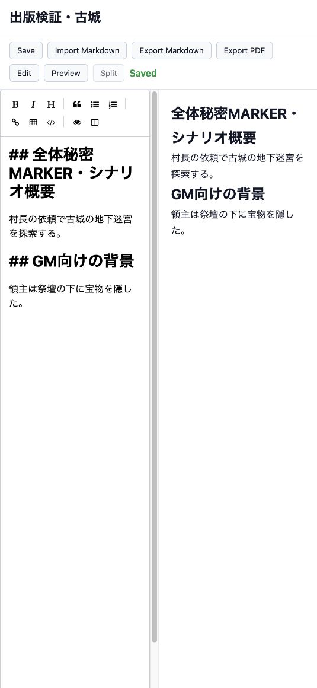

# 画面ごとの遅延読み込み

## 対応内容

優先度「低」とした初期読み込みの分割を実施した。従来はAppがダンジョン、Markdown、ピース編集を一括で読み込み、通常のダンジョン画面にもEasyMDE等のMarkdown編集用コードとCSSが含まれていた。

`src/App.tsx`で4画面をそれぞれReact.lazyの入口にし、URLで指定された画面だけを読み込む。出版画面だけでなく、Markdown・ピース編集の子画面も通常のEditorを読み込まない。URL判定の優先順は出版、ピース編集、Markdown、通常Editorのまま維持している。

Viteが共通依存を共有チャンクへ分離する。画面専用CSSも各画面の読み込みに追従する。手動でライブラリを細分化する設定や容量警告の上限変更は追加していない。

`WindowLoader`は画面名付きの読み込み案内を表示する。読み込み失敗等を検出した場合は白画面になるのを防ぎ、通信状態の確認と手動の再読み込みを案内する。自動で再読み込みする処理は追加していない。

## 容量比較

基準はmasterの`822cc4f`。同じ依存関係・環境で本番ビルドを比較した。以下はJavaScriptの圧縮後・gzip前のサイズ（1 kB = 1,000 bytes）。

| 対象 | 変更前 | 変更後 |
| --- | ---: | ---: |
| エントリーの単一JS | 775.92 kB | 194.20 kB |
| 通常のダンジョン画面の必要JS合計 | 775.92 kB | 364.90 kB |
| 最大の単一JS | 775.92 kB | 333.25 kB |

通常画面の合計にはエントリー、選択したEditor、実行時補助、DB等の静的依存チャンクを含み、同じファイルは一度だけ数えている。エントリーだけの容量を画面起動に必要な総量として扱っていない。通常画面の必要JSは約53%減った。500 kB超のチャンク容量警告も解消した。

Markdown編集画面は必要な編集ライブラリを引き続き読み込む。分割は全画面を合わせたコード総量や実際の起動時間の短縮率を保証するものではない。初回の画面表示には追加チャンクの取得が必要で、通信状態とキャッシュに影響される。

## 検証

- `npm test`：全412件成功（既存409件＋追加3件）。
- `npm run build` / `npm run lint`：成功。容量警告なし。
- 待機中の画面名表示から読み込み完了へ移ること、非同期import失敗時の案内と再読み込みボタンの動作をReact画面で検査。
- 実際のVite本番ビルドのチャンク依存をテストでたどり、エントリーと各画面が他の画面を先行読み込みしないことを検査。EasyMDEはMarkdown編集画面にだけ含まれ、全単一チャンクが既存の500 kB警告閾値以下であることも検査する。ファイル名のハッシュやソース中のimport文字列だけの検査にはしていない。
- 本番用ビルドを`vite preview`で開き、通常Editorと、ツールバーから開くMarkdown・ピース編集・出版の4画面を確認。
- ローカル保存済みの「出版検証・古城」（5部屋・4接続）を読み込み、部屋・通路の表示、Markdownの編集用UIとSplitプレビュー、標準ピースの16セル表示、出版スナップショット受信とマップを確認。
- 出版側のシナリオガイドではMarkdownの見出し・強調・一覧・表を確認。ピース印刷では23枚・A4・25.4 mm・全3ページ・未配置0枚とPage 1のプレビューを確認。

保存形式、経路探索、Undo / Redo、出版生成処理や印刷レイアウトの変更はない。既存の出力互換性・保存・履歴・公開範囲の回帰テストも成功した。実機印刷・ネイティブPDF保存やファイルImportは今回実行していない。

